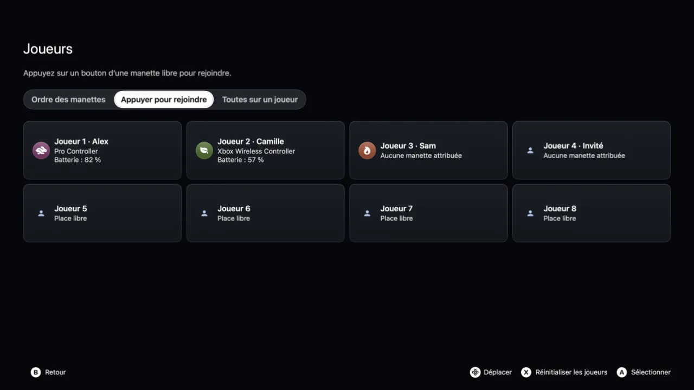

## Lance
<!-- step play checked bf0c3410:Tests/CatalogAppChecks/run_store_next_step.py bf0c3410:Tests/CatalogAppChecks/run_profiles.py -->
Choisis un jeu, puis **Jouer**. Le bouton dit toujours la prochaine étape : Jouer, Compiler, Télécharger.

## Reviens
<!-- step back code bf0c3410:docs/how-it-works/flows.md bf0c3410:PLAYER-GUIDE.md -->
Quitte le jeu : Oort revient devant, sauf si tu es passé à une autre app. Sur un jeu compilé récent, Home propose aussi de revenir sans le fermer.

<!-- missing session-card: La fiche de session, avec un jeu inventé. -->

## Jouez à plusieurs
<!-- step together checked bf0c3410:Tests/CatalogAppChecks/run_players_screen.py bf0c3410:Sources/NXLibrary/Views/Players/PlayersScreen.swift -->
L’écran **Joueurs** place jusqu’à huit joueurs. Le jeu en tient compte seulement si sa version compilée le permet.

