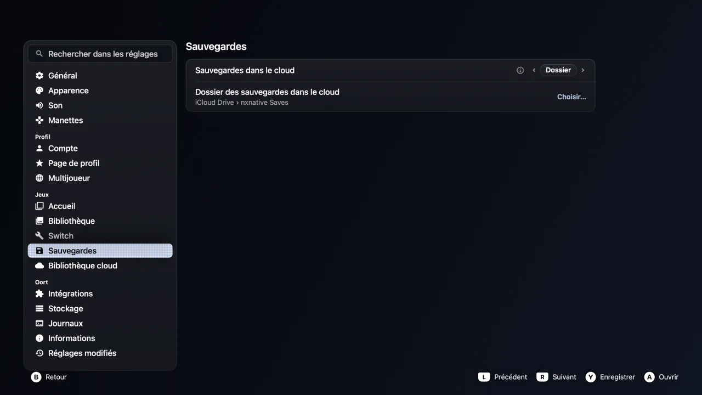
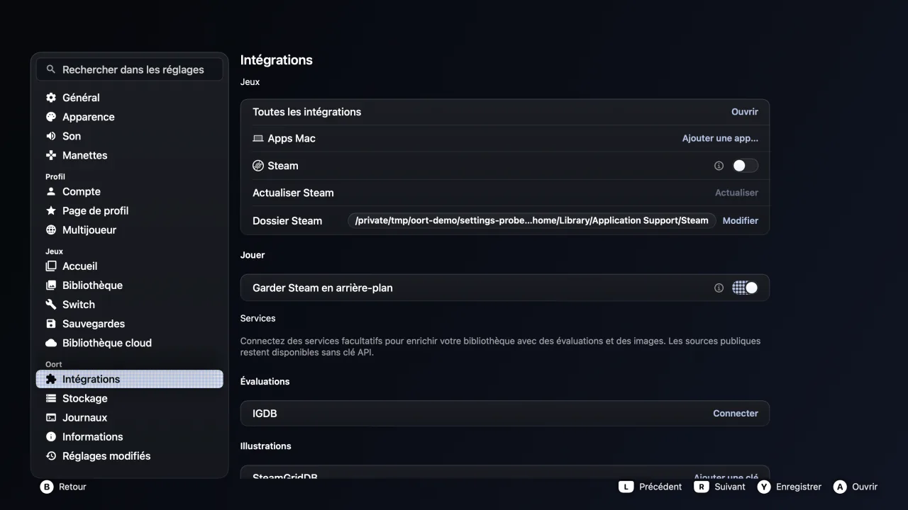

## Fais une copie
<!-- step backup code bf0c3410:Sources/NXLibrary/Views/GameOptions/SavesPanel.swift bf0c3410:PLAYER-GUIDE.fr.md -->
Jeu fermé : **Options du jeu › Sauvegardes › Créer une copie de sauvegarde**. Elle est datée et vérifiée.

<!-- missing saves-panel: Le panneau Sauvegardes avec un jeu inventé. -->

## Restaure
<!-- step restore code bf0c3410:Sources/NXLibrary/Views/GameOptions/SaveImportDetails.swift bf0c3410:PLAYER-GUIDE.fr.md -->
**Importer une sauvegarde…**, choisis la copie, lis l’aperçu, confirme. Oort copie d’abord la sauvegarde actuelle.

<!-- missing save-import: L’aperçu d’import, sauvegarde inventée. -->

## Synchronise, ou pas
<!-- step sync checked bf0c3410:Sources/NXLibrary/Views/Settings/SettingsCloudSavesSection.swift bf0c3410:Tests/CatalogAppChecks/run_settings_confirmations.py -->
**Réglages › Sauvegardes** : désactivé, iCloud Drive ou un dossier à toi. Il faut la couper pour importer ou restaurer. La synchronisation ne remplace pas une copie.

## Steam et apps Mac
<!-- step steam code bf0c3410:docs/how-it-works/steam.md bf0c3410:PLAYER-GUIDE.md -->
Oort ne touche pas à leurs sauvegardes.

