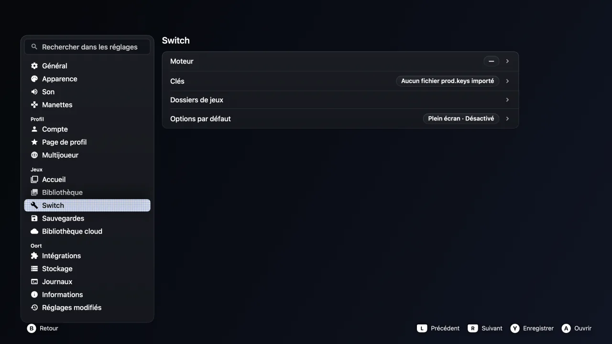
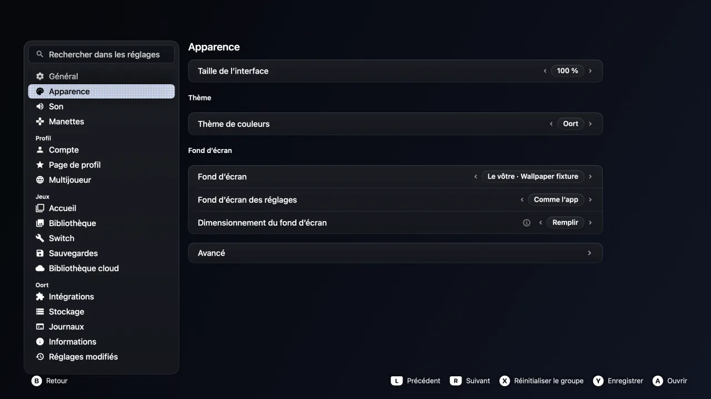
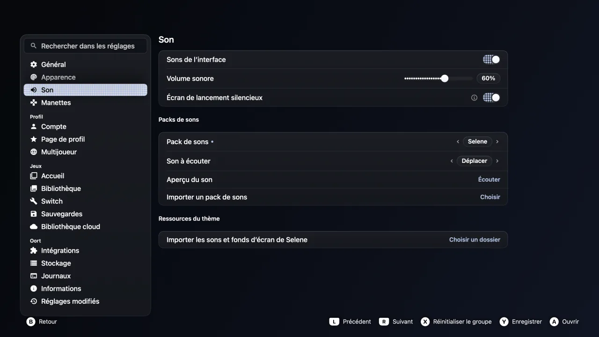
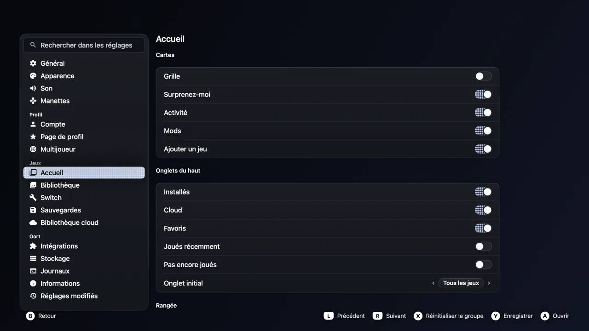
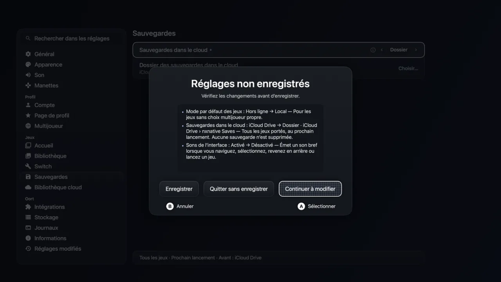

## Trouve un réglage
<!-- step find checked bf0c3410:Tests/CatalogAppChecks/run_settings_confirmations.py bf0c3410:Sources/NXLibrary/Views/Settings/SettingsView.swift -->
Cherche en haut de la liste. **Réglages modifiés** montre ce que tu as changé.

## Couleurs et taille
<!-- step look checked bf0c3410:Tests/CatalogAppChecks/run_settings_confirmations.py -->
**Réglages › Apparence** : thème, fond et taille de l’interface, de 80 à 125 %.

## Sons
<!-- step sound checked bf0c3410:Tests/CatalogAppChecks/run_settings_confirmations.py -->
**Réglages › Son** : volume, pack de sons, et tes propres notes avec **Compose**.

## L’accueil
<!-- step home checked bf0c3410:Tests/CatalogAppChecks/run_settings_confirmations.py -->
**Réglages › Accueil** choisit les cartes et les onglets.

## Enregistre
<!-- step save checked bf0c3410:Tests/CatalogAppChecks/run_settings_confirmations.py -->
Oort demande avant de quitter si un réglage n’est pas enregistré.

