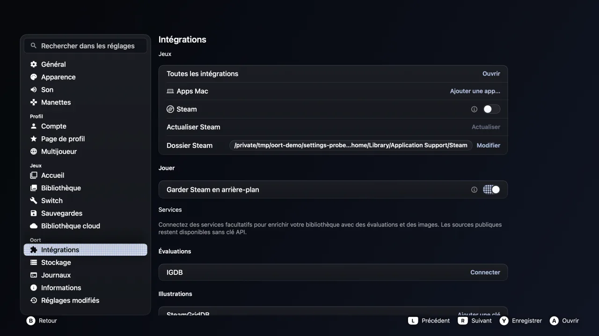
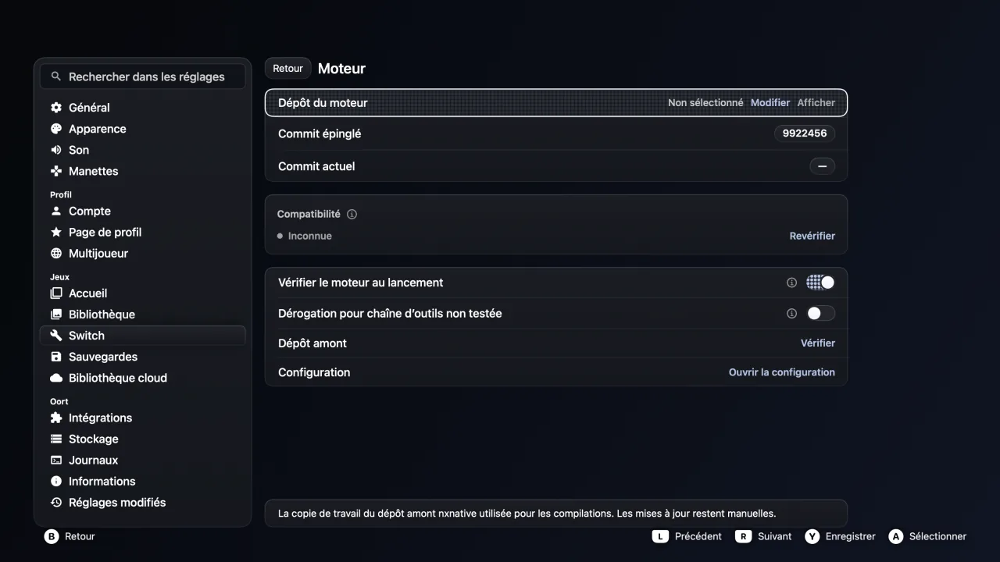
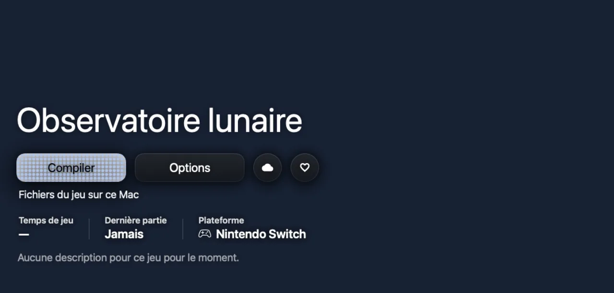
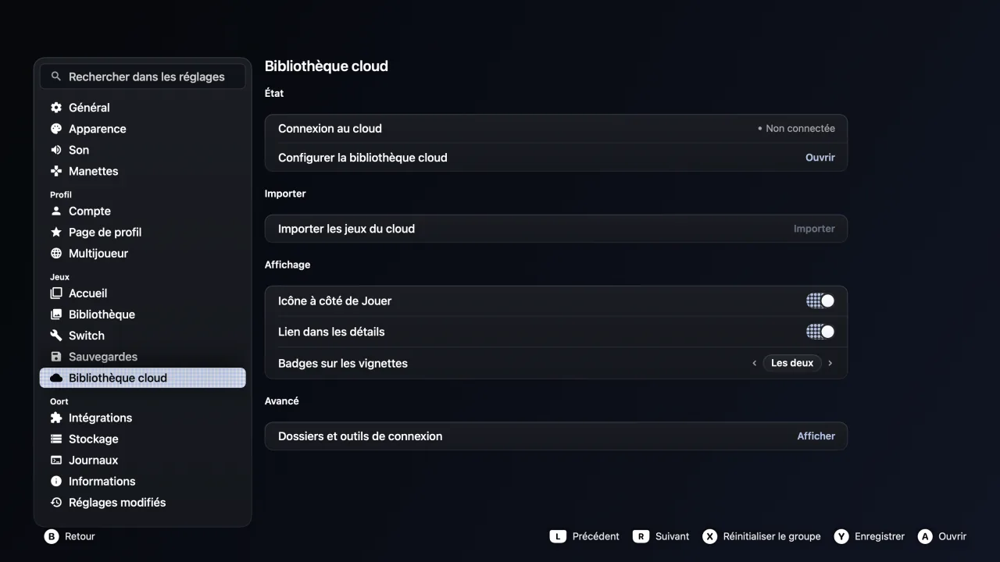
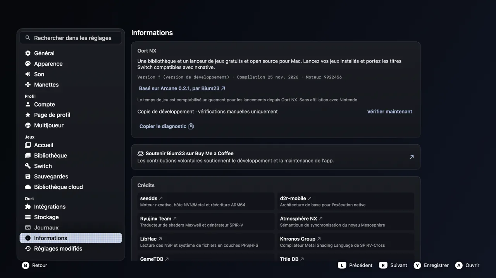

## Il manque un jeu Steam
<!-- step steam code bf0c3410:PLAYER-GUIDE.md bf0c3410:Sources/NXLibrary/Views/Settings/SettingsSourcesSection.swift -->
**Réglages › Intégrations** : vérifie le dossier Steam, puis **Actualiser Steam**. Le jeu doit être installé et fait pour Mac.

## Compiler est bloqué
<!-- step build checked bf0c3410:Tests/CatalogAppChecks/run_build_gates.py bf0c3410:PLAYER-GUIDE.md -->
**Réglages › Switch › Moteur** dit ce qui ne va pas. Un jeu déjà compilé se lance quand même.

## Fichiers du jeu introuvables
<!-- step files code bf0c3410:PLAYER-GUIDE.md bf0c3410:Sources/NXLibrary/Views/GameOptions/GameOptionsView+Rows.swift -->
Pour recompiler : **Options du jeu › Modifier les détails › Associer les sources…**. Pour jouer, l’app suffit.

## Le cloud ne répond pas
<!-- step cloud checked bf0c3410:Tests/CatalogAppChecks/run_cloud_shelf.py bf0c3410:Sources/NXLibrary/Views/Settings/SettingsCloudLibrarySection.swift -->
**Réglages › Bibliothèque cloud**, puis teste la connexion. Oort garde le dernier état connu et le dit.

## Raconte le problème
<!-- step report code bf0c3410:SECURITY.md bf0c3410:CONTRIBUTING.md -->
[Ouvre un signalement](https://github.com/sofianbll/oort-nx/issues) : ce que tu faisais, ce que tu as vu, tes versions. Relis **Copier le diagnostic** avant de le coller. N’y joins ni jeu, ni clé, ni sauvegarde.

