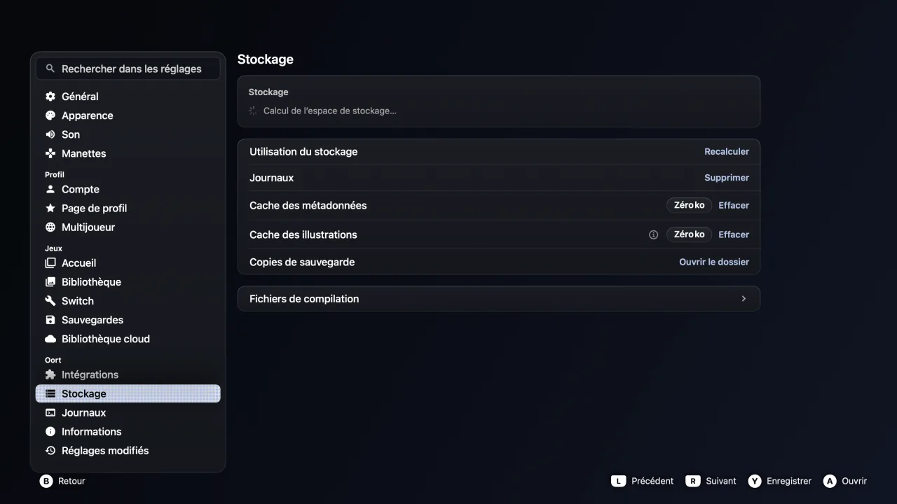

## Retire l’app
<!-- step app code bf0c3410:PLAYER-GUIDE.md bf0c3410:Sources/NXLibraryCore/App/AppDataProfile.swift -->
Mets Oort NX à la Corbeille. Tes jeux compilés, tes fichiers et tes sauvegardes restent.

<!-- missing trash: Oort NX glissé vers la Corbeille. -->

## Efface sa bibliothèque si tu veux
<!-- step data code bf0c3410:Sources/NXLibraryCore/App/AppDataProfile.swift bf0c3410:docs/how-it-works/architecture.md -->
Elle est dans `~/Library/Application Support/Oort NX`. Attention : tes copies de sauvegarde et la copie de tes clés y sont aussi.

## Les jeux restent jouables
<!-- step games code bf0c3410:docs/how-it-works/architecture.md bf0c3410:PLAYER-GUIDE.md -->
Un jeu compilé est une app Mac : elle s’ouvre sans Oort. Ses sauvegardes sont dans `~/Library/Application Support/nxnative`.

