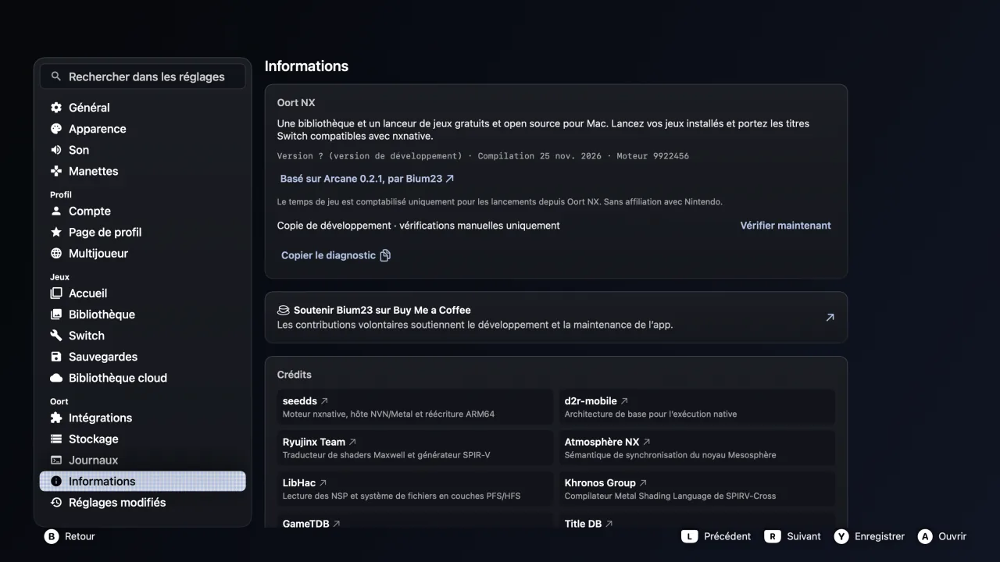
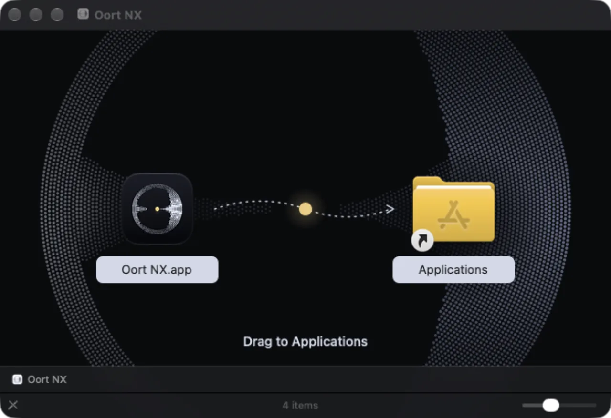

## Cherche
<!-- step check checked bf0c3410:Tests/CatalogAppChecks/run_settings_confirmations.py bf0c3410:Sources/NXLibraryCore/Settings/SettingsCatalog.swift -->
**Réglages › Informations › Vérifier maintenant**. Oort regarde aussi seul, une fois par jour au plus.

## Installe
<!-- step install code bf0c3410:docs/how-it-works/flows.md bf0c3410:CHANGELOG.md -->
**Mise à jour** télécharge, vérifie, remplace et rouvre Oort. Cela attend la fin d’une compilation ou d’une partie.

<!-- missing update-dialog: La fenêtre de mise à jour avec une version inventée. -->

## Depuis la 0.3.0
<!-- step old code bf0c3410:CHANGELOG.md bf0c3410:PLAYER-GUIDE.fr.md -->
Elle ne sait pas passer seule à cette version : installe le DMG une fois.

