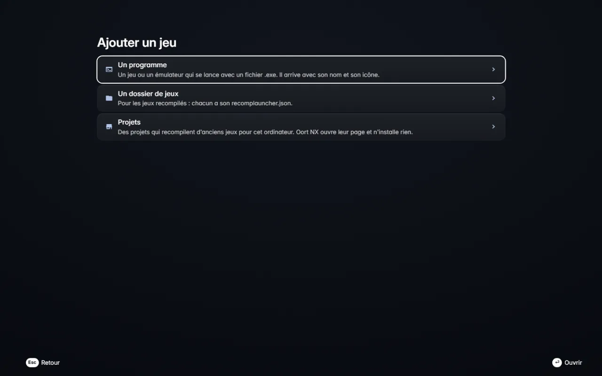
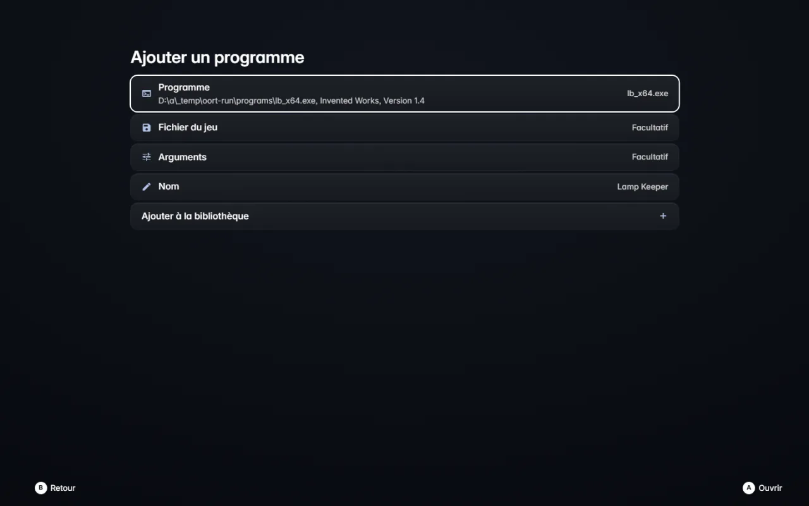

## Ouvre Ajouter un jeu
<!-- step add checked f18e2119:desktop/ui/app.js -->
Choisis la tuile **+**, puis **Un programme**.

## Choisis le fichier
<!-- step program checked f18e2119:desktop/tests/guide.js f18e2119:Sources/OortCompanion/ProgramFile.swift -->
**Programme** est le fichier .exe du jeu ou de l’émulateur. Pour un émulateur, **Fichier du jeu** est le jeu qu’il doit ouvrir.

## Ajoute-le
<!-- step finish checked f18e2119:desktop/tests/guide.js f18e2119:Sources/OortCompanion/Companion+Own.swift -->
Son nom et son icône arrivent seuls, lus dans son fichier. Change le nom si tu veux, puis **Ajouter à la bibliothèque**.

