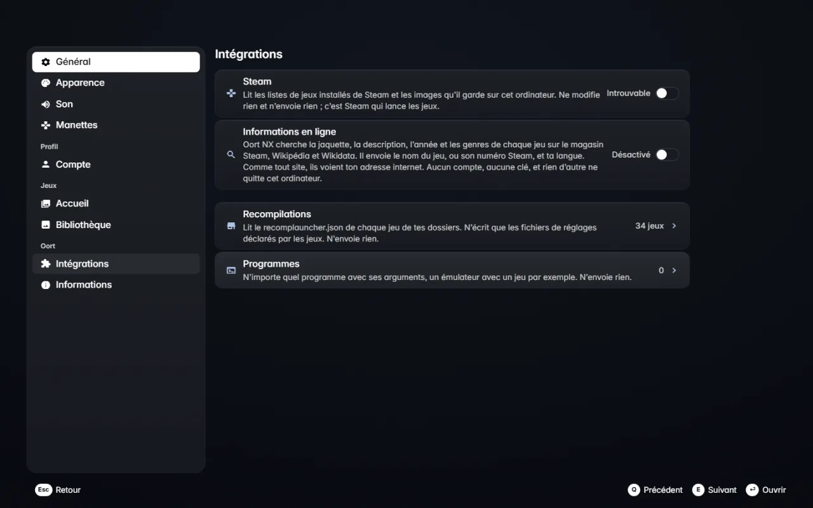
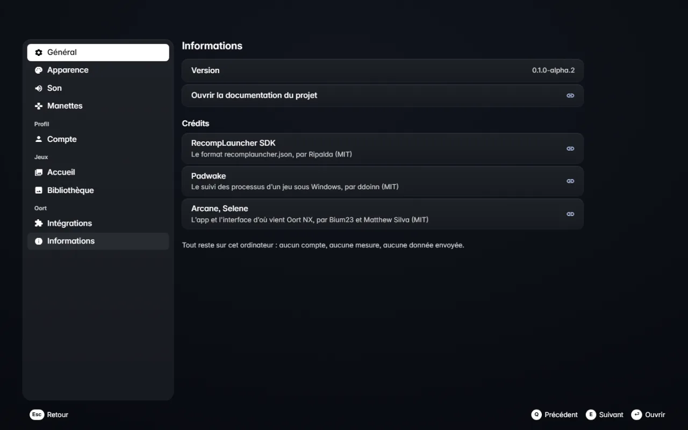

## Lit
<!-- step reads code cc9db84a:desktop/README.md cc9db84a:Sources/OortCompanion/Companion.swift -->
Les dossiers et les programmes que tu ajoutes, et le `recomplauncher.json` de chaque jeu. D’une copie que tu choisis, il regarde le nom et l’emplacement.

## Écrit
<!-- step writes code cc9db84a:Sources/OortCompanion/Store.swift cc9db84a:Sources/OortCompanion/Places.swift -->
Son dossier `%LOCALAPPDATA%\io.github.sofianbll.oort-nx.desktop` et les fichiers de réglages qu’un jeu recompilé déclare. Les derniers messages d’un jeu sont gardés dans ses journaux.

## Envoie
<!-- step sends code cc9db84a:desktop/README.md cc9db84a:desktop/src-tauri/tauri.conf.json -->
Rien : pas de compte, pas de mesure, aucune donnée. Les liens vers les projets s’ouvrent dans ton navigateur, et l’installateur peut demander WebView2 à Microsoft.

