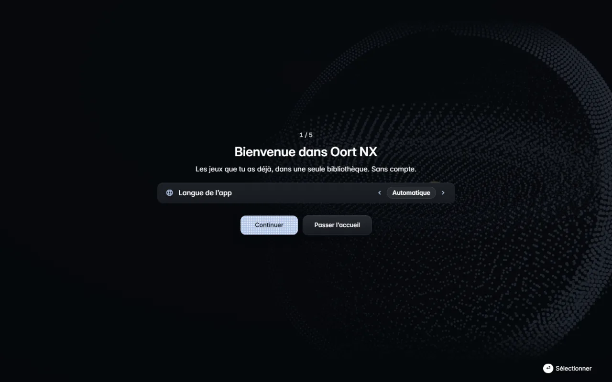
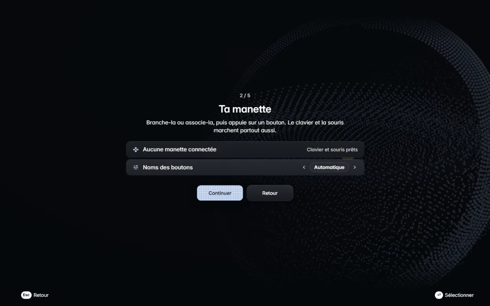
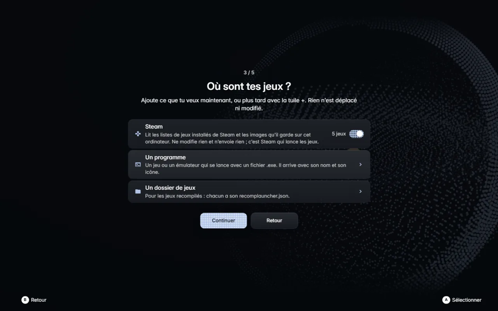
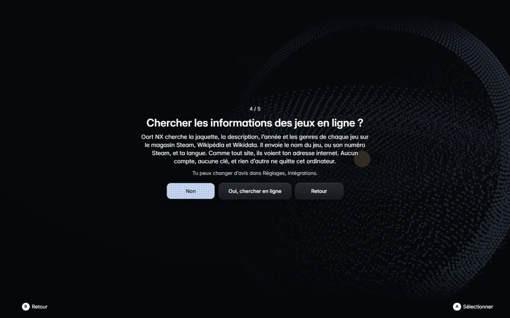
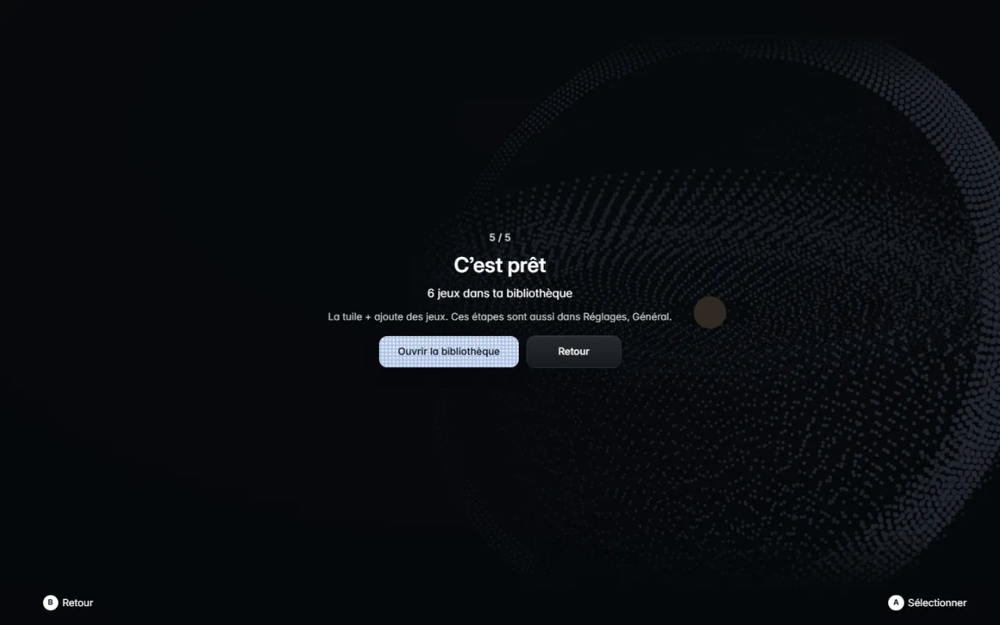
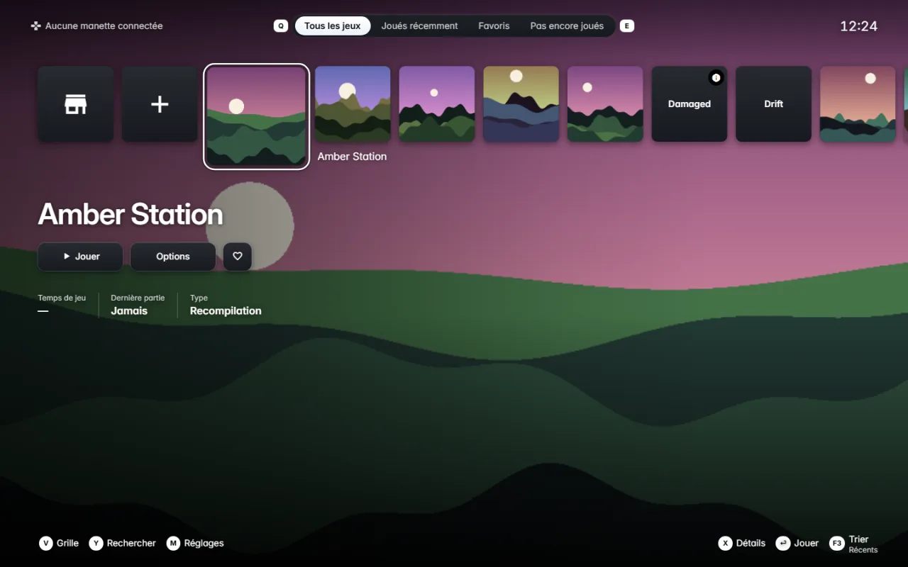

## Passe ou suis l’accueil
<!-- step welcome checked f18e2119:desktop/tests/guide.js f18e2119:desktop/tests/windows/prove.ps1 -->
L’accueil guidé s’ouvre : cinq pages courtes, à la manette ou au clavier. Choisis ta langue, puis **Continuer**. **Passer l’accueil** le ferme.

## Essaie ta manette
<!-- step controller checked f18e2119:desktop/tests/guide.js f18e2119:desktop/tests/windows/prove.ps1 -->
Branche-la et appuie sur un bouton : son nom s’affiche. Sans manette, continue au clavier ou à la souris.

## Dis où sont tes jeux
<!-- step games checked f18e2119:desktop/tests/guide.js f18e2119:desktop/tests/windows/prove.ps1 -->
Steam, un programme, un dossier de jeux recompilés : ajoute ce que tu veux. Rien n’est déplacé ni modifié, et la tuile **+** fera pareil plus tard.

## Réponds pour les informations en ligne
<!-- step online checked f18e2119:desktop/tests/guide.js f18e2119:desktop/tests/windows/prove.ps1 -->
Oort demande s’il peut chercher jaquettes et descriptions. **Non** est le choix de départ, et rien n’est envoyé avant ta réponse.

## Ouvre ta bibliothèque
<!-- step done checked f18e2119:desktop/tests/guide.js f18e2119:desktop/tests/windows/prove.ps1 -->
**Ouvrir la bibliothèque**. L’accueil se rouvre dans **Réglages › Général › Accueil guidé**, sans rien effacer.

## Retrouve tes jeux
<!-- step home checked f18e2119:desktop/ui/app.js f18e2119:desktop/tests/walk.js -->
Chaque jeu est une tuile. Les deux premières tuiles ouvrent **Projets** et **Ajouter un jeu**.

