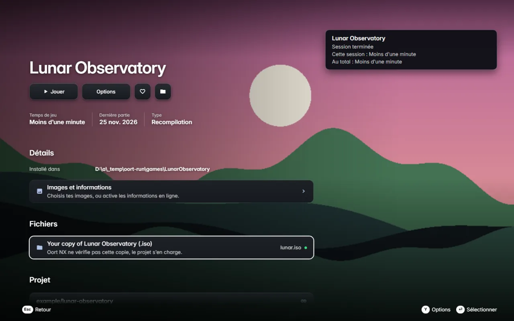
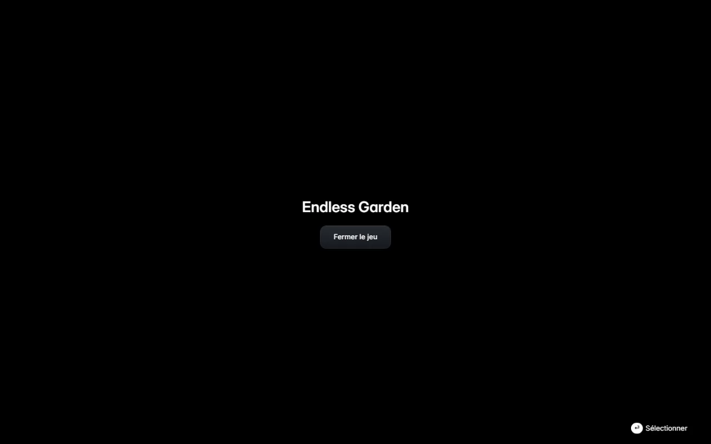

## Lance
<!-- step play played cc9db84a:desktop/src-tauri/src/lib.rs cc9db84a:desktop/tests/windows/prove.ps1 -->
Choisis **Jouer**. L’écran montre le jeu, puis Oort se réduit.

## Reviens
<!-- step back checked cc9db84a:desktop/src-tauri/src/lib.rs cc9db84a:desktop/tests/windows/prove.ps1 -->
Quitte le jeu comme d’habitude : Oort revient devant et affiche le temps de ta partie.

## Ferme un jeu bloqué
<!-- step close checked cc9db84a:desktop/ui/app.js cc9db84a:desktop/tests/play.js -->
Reviens à la fenêtre d’Oort : **Fermer le jeu** apparaît au bout de quatre secondes. Ce qui n’est pas enregistré est perdu. Le bouton Home n’est pas encore pris en charge en jeu.

