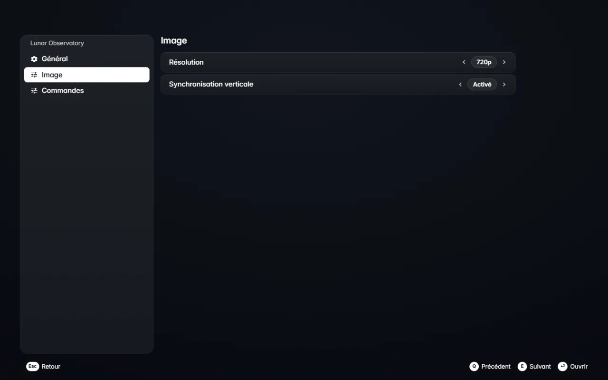

## Elles restent au jeu
<!-- step where code f18e2119:Sources/OortCompanion/Places.swift f18e2119:Sources/OortCompanion/Companion.swift -->
Oort ne lit, ne copie et ne déplace aucune sauvegarde. Elles sont là où le jeu les range.

## Fais ta copie
<!-- step copy code f18e2119:desktop/ui/app.js f18e2119:desktop/src-tauri/src/lib.rs -->
**Options › Ouvrir le dossier** ouvre le dossier du jeu. Copie toi-même ses sauvegardes ; certains jeux les gardent ailleurs.

