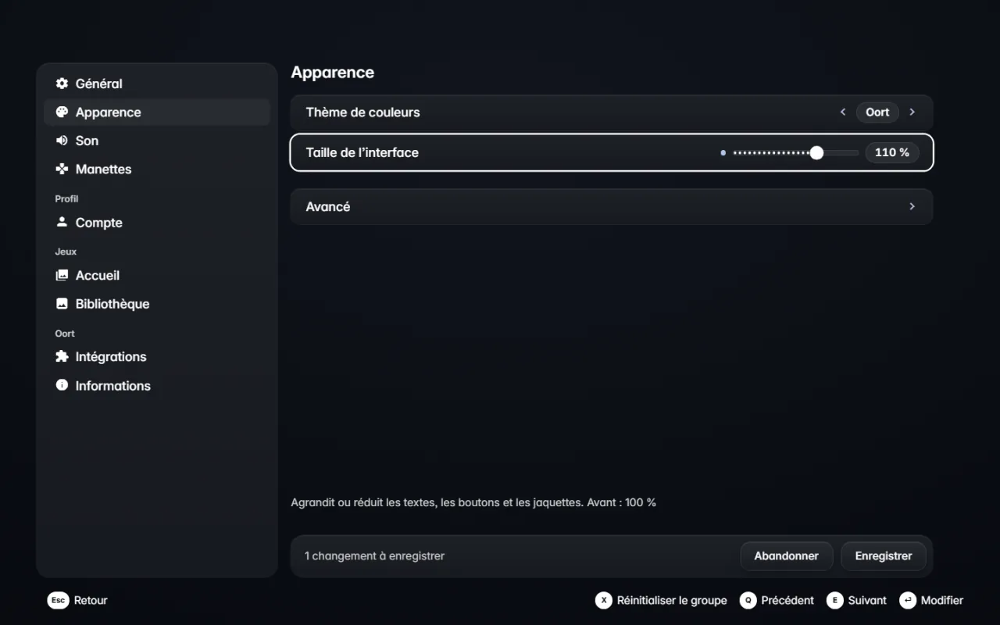
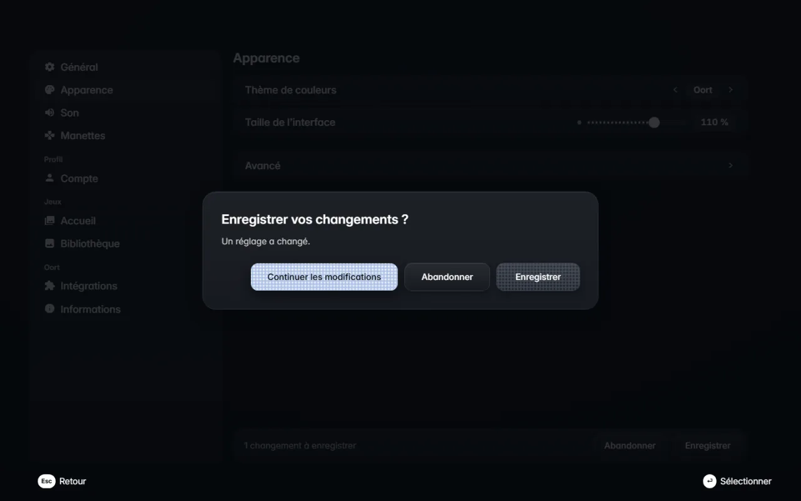
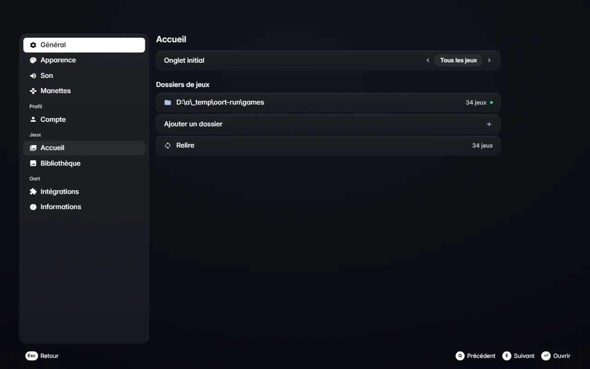
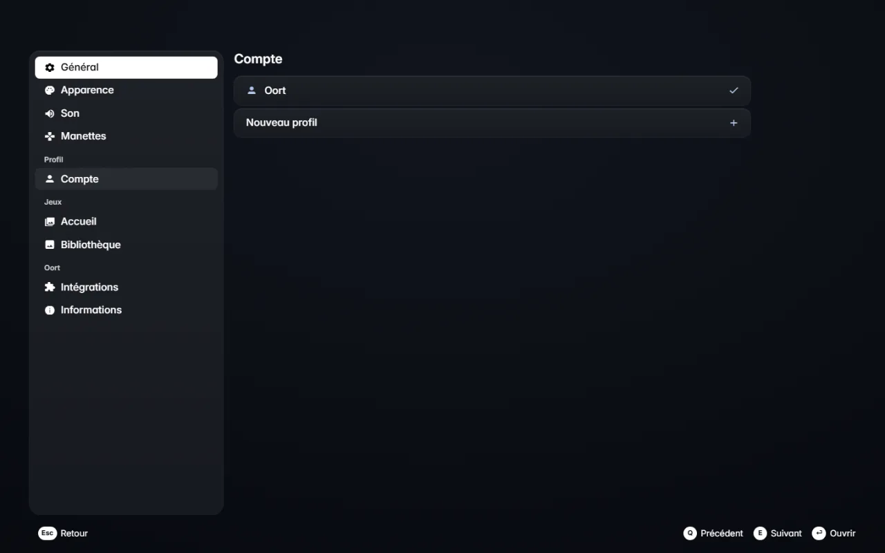
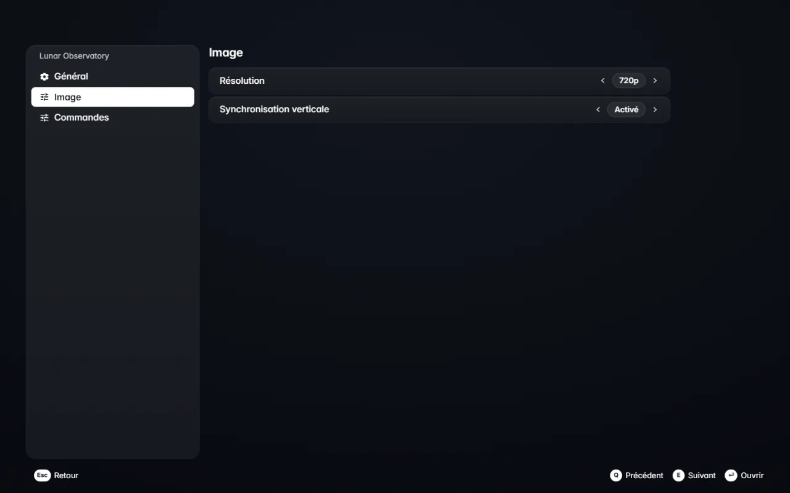

## Couleurs et taille
<!-- step look checked f18e2119:Sources/OortCompanion/SettingRows.swift f18e2119:desktop/tests/look.js -->
**Réglages › Apparence** : le thème et la taille de l’interface, de 80 à 125 %.

## Enregistre
<!-- step save checked f18e2119:desktop/ui/app.js f18e2119:desktop/tests/walk.js -->
Un point marque ce que tu as changé. **Enregistrer** garde, **Abandonner** annule.

## Dossiers de jeux
<!-- step folders checked f18e2119:desktop/ui/app.js f18e2119:Sources/OortCompanion/Companion.swift -->
**Réglages › Accueil** ajoute ou retire un dossier et le relit. Retirer un dossier ne supprime rien du disque.

## Profils
<!-- step profiles checked f18e2119:Sources/OortCompanion/Companion.swift -->
**Réglages › Compte** crée un profil par personne, sur cet ordinateur seulement.

## Réglages d’un jeu
<!-- step game checked f18e2119:desktop/ui/app.js f18e2119:Sources/OortCompanion/SettingRows.swift -->
Pour une recompilation, **Options** montre les réglages que le jeu déclare. Un programme ou un jeu Steam n’a que ses images et ses informations.

