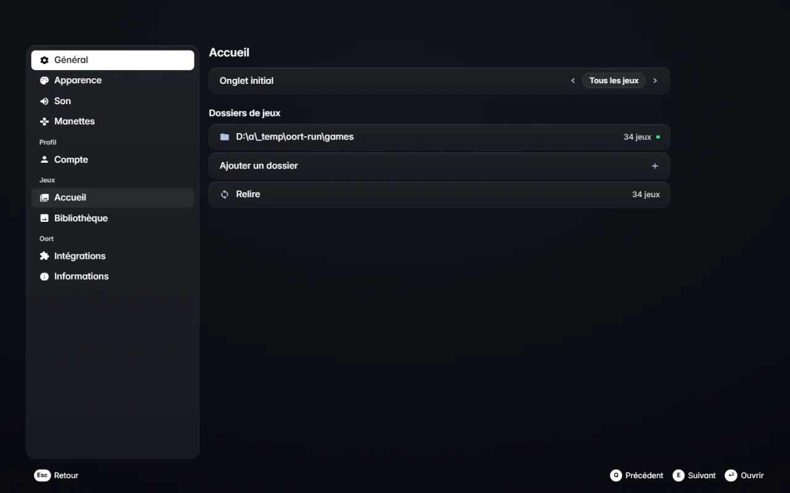
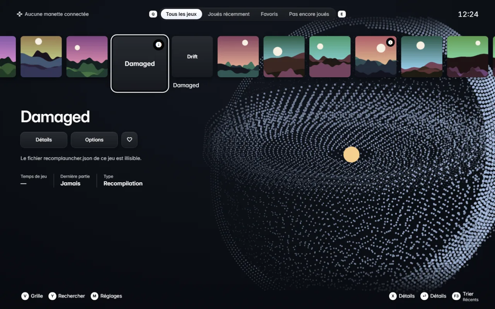
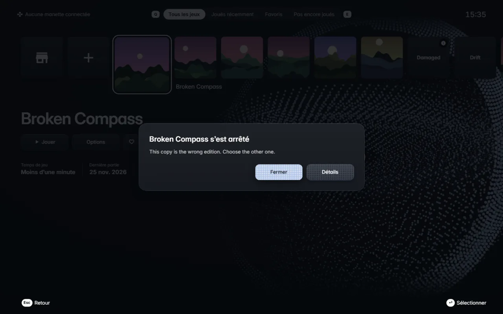
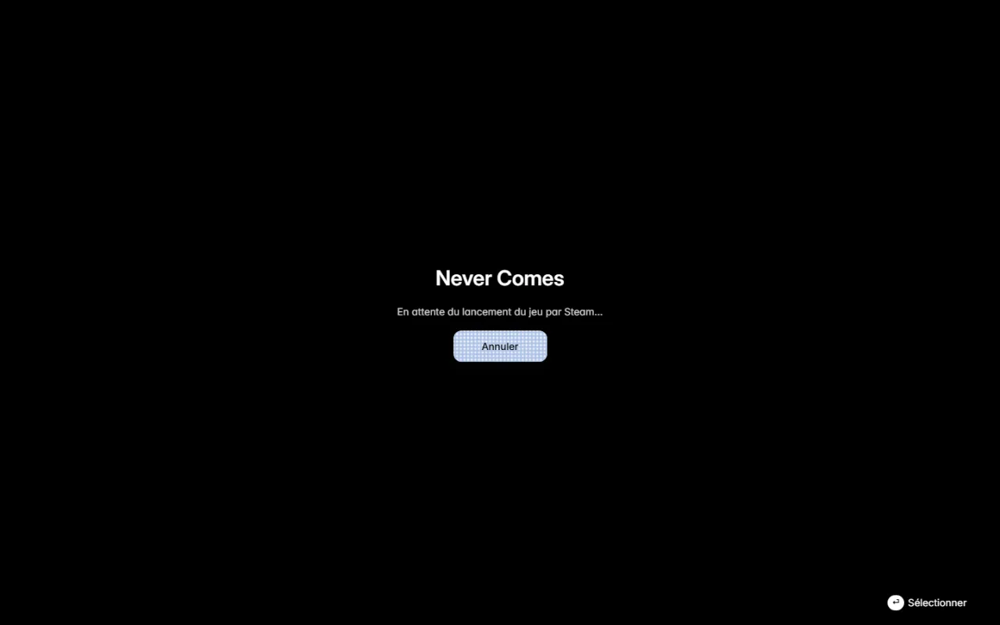
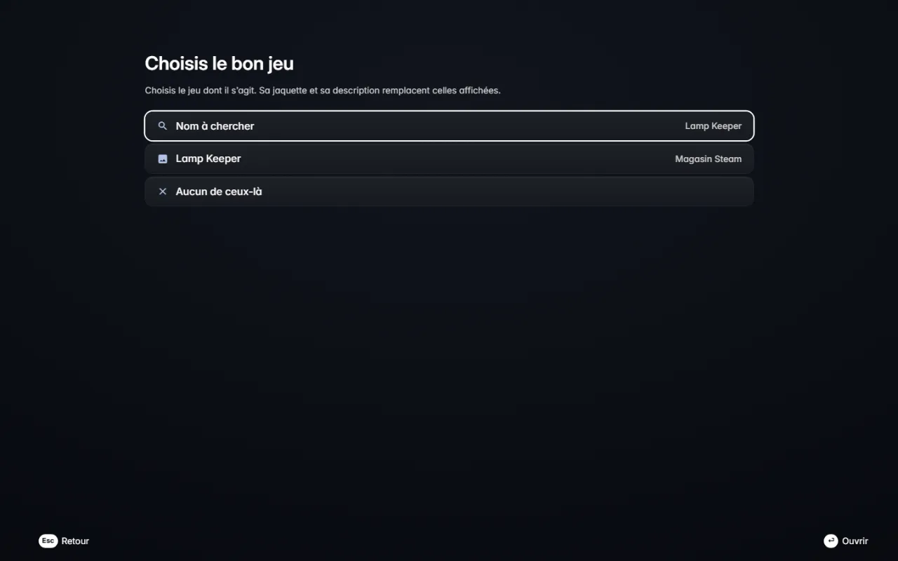
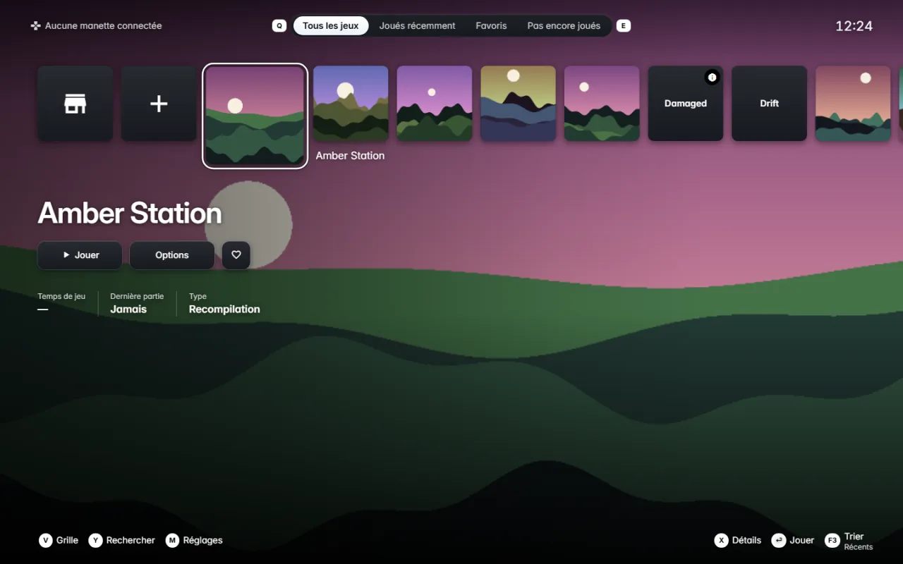
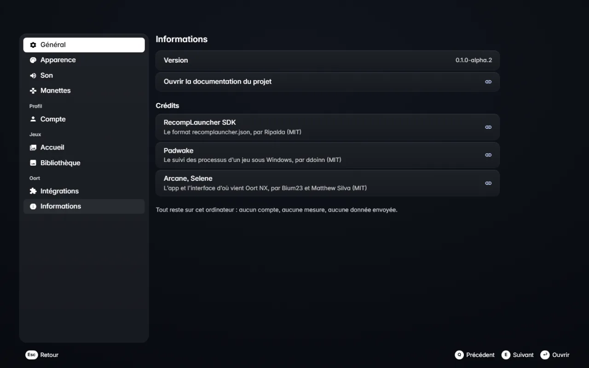

## Il manque un jeu
<!-- step missing checked f18e2119:desktop/ui/app.js f18e2119:Sources/OortCompanion/Companion.swift -->
**Réglages › Accueil › Relire**. Pour une recompilation, vérifie que son dossier contient `recomplauncher.json`.

## Le jeu est marqué illisible
<!-- step unreadable checked f18e2119:desktop/ui/app.js f18e2119:desktop/tests/walk.js -->
Son `recomplauncher.json` est abîmé ou demande un lanceur plus récent. Reprends-le dans le projet.

## Le jeu s’arrête
<!-- step crash checked f18e2119:desktop/src-tauri/src/lib.rs f18e2119:desktop/tests/play.js -->
Oort montre le message que le jeu a laissé. Vérifie ensuite que le jeu démarre seul, hors d’Oort.

## Steam ne répond pas
<!-- step steam checked f18e2119:desktop/tests/steam.js f18e2119:Sources/OortCompanion/SteamShelf.swift -->
« Introuvable » : ouvre Steam une fois, puis **Réglages › Accueil › Relire**. Si l’attente dure, regarde la fenêtre de Steam : il pose sans doute une question.

## Mauvaise jaquette, ou aucune
<!-- step cover checked f18e2119:desktop/tests/online.js f18e2119:Sources/OortCompanion/Online.swift -->
**Options › Images et informations** : choisis le bon jeu, change le nom, ou prends une image à toi. Sans informations en ligne, un programme n’a que son icône.

## La manette n’est pas vue
<!-- step pad code f18e2119:desktop/src-tauri/src/pad.rs f18e2119:desktop/ui/nav.js -->
Appuie sur un bouton avec la fenêtre d’Oort devant, puis débranche et rebranche-la. Pas essayé avec une vraie manette.

## Raconte le problème
<!-- step report code f18e2119:SECURITY.md f18e2119:CONTRIBUTING.md -->
[Ouvre un signalement](https://github.com/sofianbll/oort-nx/issues) : ce que tu faisais, ce que tu as vu, ta version. N’y joins ni jeu, ni clé, ni sauvegarde.

