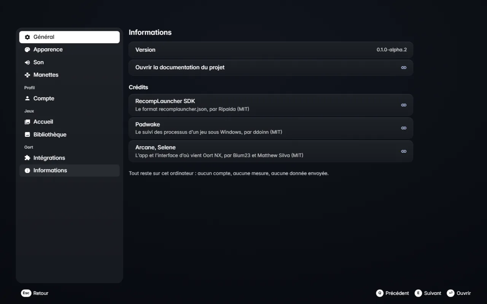

## Regarde ta version
<!-- step check code cc9db84a:desktop/README.md https://github.com/sofianbll/oort-nx/releases/tag/windows-v0.1.0-alpha.1 -->
Elle est dans **Réglages › Informations**. Oort ne cherche pas les mises à jour tout seul sur ce système.

## Installe par-dessus
<!-- step over checked cc9db84a:desktop/tests/windows/prove.ps1 -->
Lance le nouvel installateur sans désinstaller. La réinstallation de la même version garde ta bibliothèque ; passer à une autre version n’a pas été essayé.

