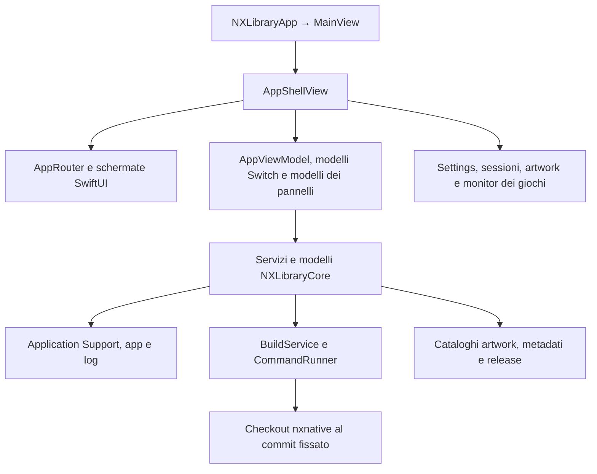

# Arcane — guida tecnica

Questa guida descrive **come funziona l'app oggi**, area per area. Non contiene storia né stati di validazione: lo storico è nel [CHANGELOG](../../CHANGELOG.md) e nelle note datate, cosa ha provato il maintainer è in [validation.md](../working-on-it/validation.md).

Ordine di lettura per chi lavora sul codice:
1. [AGENTS.md](../../AGENTS.md): le regole.
2. Questa guida: la mappa.
3. [conventions.md](../working-on-it/conventions.md): come si costruisce una cosa nuova.
4. [flows.md](flows.md): i percorsi completi.
5. Il documento dell'area, se c'è (per esempio [steam.md](steam.md)).
6. [file-map.md](../working-on-it/file-map.md): un file per riga.

Il [README](../../README.md) è la guida d'uso; la [guida di sviluppo](../working-on-it/development.md) raccoglie build, runtime, CI e release.

**Engine predefinito:** pin `99224562186a8fdb7e97afb872319a21941ec317` di `seedds/nxnative`, definito in `AppViewModel.defaultPinnedEngineCommit`. Il suo lock certifica Metal `32023.922`, asset Apple `27B47`, con Xcode minimo `27.2`. Le revisioni di ogni pin sono in [upstream-upgrades](../history/engine-upgrades/README.md).

## Indice

- [Struttura e dipendenze](#struttura-e-dipendenze)
- [Avvio e stato dell'app](#avvio-e-stato-dellapp)
- [Catalogo, fonti e libreria](#catalogo-fonti-e-libreria)
- [Navigazione e focus](#navigazione-e-focus)
- [Impostazioni](#impostazioni)
- [Lingua e regione](#lingua-e-regione)
- [Setup, engine e compatibilità](#setup-engine-e-compatibilità)
- [Sorgenti e porting](#sorgenti-e-porting)
- [Avvio dei giochi e sessioni](#avvio-dei-giochi-e-sessioni)
- [Pagina del gioco](#pagina-del-gioco)
- [Cheat](#cheat)
- [Mod](#mod)
- [Salvataggi, backup e recupero](#salvataggi-backup-e-recupero)
- [Spazio su disco](#spazio-su-disco)
- [Artwork, metadati e voti](#artwork-metadati-e-voti)
- [Interfaccia Selene e input](#interfaccia-selene-e-input)
- [Dati su disco](#dati-su-disco)
- [Aggiornamenti e distribuzione](#aggiornamenti-e-distribuzione)
- [Verifica e manutenzione](#verifica-e-manutenzione)
- [Steam](steam.md): documento a parte

## Struttura e dipendenze

[Package.swift](../../Package.swift) dichiara sette target. La toolchain dell'app è quella di Xcode, con deployment minimo macOS 26 (`LSMinimumSystemVersion` 26.0 nell'app). *Perché:* è la versione più vecchia che il maintainer prova, e il porting chiede comunque macOS 26.6 per Xcode 27.2.

| Target | Compito |
|---|---|
| `NXLibrary` | Eseguibile SwiftUI, integrazione AppKit, controller, notifiche, coordinamento e rendering. |
| `OortCore` | Logica portabile: input, focus, tastiera PIN, particelle, righe e versioni. Solo Swift e Foundation, senza risorse né dipendenze. |
| `NXLibraryCore` | Modelli, persistenza, gestione file, contratti del motore, processi e logica delle funzionalità. Riesporta `OortCore` per i chiamanti esistenti. |
| `ArcanePorting` | Il modulo Switch: Setup, build, avvio, impostazioni del gioco, cheat, store Nintendo, salvataggi, mod RomFS e GameBanana, la parte nxnative di catalogo e libreria. Dipende da `NXLibraryCore`. |
| `NXLibraryCoreTests` | Test XCTest della base, con dati sintetici e dipendenze sostituibili; dipende solo da `NXLibraryCore`, quindi prova che la base compila senza il modulo. |
| `ArcanePortingTests` | Test XCTest dei file che usano il modulo, anche le regole della base provate attraverso le sue entrate (`SettingsCatalog.all`, `CatalogStore(directory:)`). |
| `OortCoreTests` | Test della logica portabile; usano `OortCore` senza gli altri moduli dell’app. |

`scripts/check_oort_core.py` controlla manifest e import, anche nei rami condizionali; può preparare un pacchetto Swift minimo per Linux. Il wrapper `ProfileKeypad` in `NXLibraryCore` conserva il PIN locale a quattro cifre; il tipo portabile riceve la lunghezza esplicitamente.

Il Core ha una cartella per area: `App`, `Catalog`, `Library`, `Selene`, `Details`, `Artwork`, `Achievements`, `Mods`, `Settings`, `Steam`. Tutto ciò che è Switch (Setup, build, avvio, impostazioni del gioco, cheat, store Nintendo, salvataggi e i loro backup, mod RomFS e GameBanana, la parte nxnative del catalogo e della libreria, lo spazio delle app portate) è il target `ArcanePorting` (`Sources/ArcanePorting/`), con una sottocartella per parte; dipende da `NXLibraryCore`, e l'app li importa entrambi. *Perché:* la base non importa il modulo, così il compilatore ferma ogni uso di un suo tipo o membro.

Ciò che il modulo usa della base e l'app no è `package` (per esempio `CatalogStore(directory:publication:kinds:legacy:)`, `LibraryPresentation.duration`); un'estensione del modulo che crea un valore della base chiama un init `package` con tutti i valori, perché da un altro modulo non può assegnare proprietà `let` (`GameDetailPresentation(title:…savePath:)`). Dove la base ha bisogno del modulo (righe e reset di Settings, impostazioni del modulo, conteggi del primo avvio, controlli della copia di sviluppo, tipi e import del catalogo) riceve valori o chiusure da un'entrata generica; l'entrata con lo stesso nome di sempre sta in un'estensione dentro `ArcanePorting/` e passa quelli del modulo.

`NXLibrary` dipende da `NXLibraryCore`. Il Core usa anche framework macOS, fra cui Combine, AppKit, ImageIO, CommonCrypto e IOKit. Il package non dichiara dipendenze SwiftPM esterne.



Il checkout nxnative fornisce estrattore, rewriter, shader, profili dei giochi e runtime dei giochi compilati. Arcane prepara gli argomenti, controlla i requisiti e presenta lo stato delle operazioni. La cache dello stato upstream si riusa soltanto quando il suo commit di base coincide con il pin.

`SystemCommandRunner` drena stdout e stderr in parallelo e attende la fine del processo e dei due stream senza eseguire il run loop chiamante. *Perché:* un comando sincrono, come il controllo Git dei cheat in Game Options, non deve far rientrare SwiftUI durante un aggiornamento della vista.
I comandi cloud annullabili usano un gruppo di processi separato, I/O non bloccante e un termine di 60 secondi; soltanto l'autorizzazione OAuth aspetta fino a cinque minuti. I trasferimenti rclone hanno 120 secondi di inattività, azzerati solo se cambiano byte, verifiche o file conclusi. Annullamento, scadenza e uscita terminano il gruppo senza aspettare pipe ereditate da un figlio.

La variante asincrona attende su una coda utility e invia SIGTERM al sottoprocesso quando si annulla il task. Può leggere solo stderr per la progressione, lasciando stdout al risultato del comando.

## Avvio e stato dell'app

**Finestra e menu.**
- `NXLibraryApp.swift` registra una sola `Window` e i comandi della barra menu. File → Add Game sostituisce New Window: controller, updater e catalogo condiviso non offrono un flusso a più finestre.
- `AppDelegate.swift` registra il font Material Icons e gestisce chiusura e riapertura della finestra. `MainView.swift` presenta `AppShellView`.
- `NativeMenuCommands` osserva il tracking dei menu AppKit e rinvia le azioni al turno successivo della coda principale, mantenendo l'input sospeso durante il passaggio.
- La shell pubblica le disponibilità nella scena attiva tramite `FocusedValues`: benvenuto, Setup, pannelli e assenza di selezione disabilitano i comandi che non si applicano. Mouse, tastiera e controller non cambiano selezione sotto un menu nativo.
- In Spotlight, Game Details usa `SpotlightState.showGameDetails` come il comando interno e conserva il titolo selezionato; in Collection apre la pagina Details. Game Options blocca l'hit testing del contenuto sottostante.

**Profilo dei dati.**
- `AppDataProfile` e `AppData` centralizzano percorsi e preferenze. Il marker di build `NXLibraryDevelopmentProfile` e il bundle ID `local.nxlibrary.development` distinguono la Dev dalla release; la release usa i percorsi di sempre.
- `DevelopmentStartupView` prepara il profilo in background prima di costruire gli store e la shell, senza schermata di preparazione. `LaunchReveal` tiene trasparente la finestra fino al primo frame del moonlight (il drawable presentato, su entrambi i percorsi di rendering), con ripiego dopo 1 s, poi la mostra con una dissolvenza di 0,25 s. Un errore mostra il recupero senza aspettare il moonlight. *Perché:* la transizione fullscreen parte da una finestra già disegnata. `DevelopmentProfileImporter` legge la sorgente senza attivare gli store che la potrebbero riparare, copia in staging una lista dichiarata di dati, verifica gli hash e attiva la destinazione separata. I file che solo il modulo sa leggere (`library.json`, il catalogo con i suoi tipi e l'import legacy) si controllano con `DevelopmentProfileImporter.portingChecks`, che `AppData.prepare()` passa.
- Le preferenze storiche appartengono a una lista esplicita; file di credenziali e nuovi token non si copiano per semplice prefisso. Le sessioni rimaste aperte nella copia terminano all'ultimo heartbeat registrato. Ripetere l'avvio non reimporta e non sovrascrive la Dev. La copia fallisce con Retry/Close, senza ripiegare sul profilo stabile.
- Nella Dev il recupero dei salvataggi e la riconciliazione automatica delle icone non partono all'avvio. `DevelopmentOperationStore`, escluso dall'import, registra le richieste esplicite di build e icone e ne permette la ripresa dopo un riavvio. La pulizia automatica visita solo la Temp del profilo Dev, non lo staging sui volumi condivisi. Il factory dei `ModStore` disabilita la manutenzione automatica: consultare e aggiornare le schede non scrive l'overlay né elimina installazioni residue, e la lettura usa lo stato reale dell'overlay. Le azioni manuali agiscono sui giochi reali.
- `release.sh` rifiuta un marker Dev nel pacchetto, e `AppUpdate` rifiuta un pacchetto del genere come aggiornamento.
- Solo in Debug, la fixture Integrations sostituisce l’avvio normale e riceve radice e preferenze temporanee: usa le stesse viste con fatti sintetici, senza aprire store o servizi reali.

**Shell.**
- `AppShellState` prepara coordinatore, router, lingua e tema sul main actor prima di pubblicare la shell pronta. L'inserimento nella finestra già visibile conserva gli oggetti preparati. Il bootstrap prepara catalogo e profilo prima della shell, quindi il modello usa quel documento senza una seconda lettura fallibile durante l'inizializzazione.
- `AppShellView.swift` possiede gli oggetti condivisi tramite `@StateObject`: `AppViewModel`, router, impostazioni, sessioni, artwork, monitor dei giochi e updater. Imposta palette, canvas Selene, preferenze di accessibilità e livelli sovrapposti. Benvenuto, Setup, menu, ricerca, opzioni di un gioco e conferme ricevono una priorità esplicita nell’input.
- La shell condivide un solo `AppSettingsStore` con router e coordinatore. L'avvio rispetta i flag di verifica del motore e di scansione della libreria; senza scansione carica il catalogo salvato.
- Quando cambia l’UUID del profilo attivo, `SessionCardPresenter` scarta le notifiche di fine sessione e degli obiettivi, sia in attesa sia visibili.
- `LocalProfileStore` conserva identità, avatar, aspetto e ultima scelta. Il primo profilo usa i preferiti del catalogo e le sessioni precedenti senza riscriverli; gli altri usano UUID distinti. L’ospite ha un UUID nuovo per ogni sessione e preferiti in memoria: non cambia l’ultimo profilo permanente. Il codice a quattro cifre si conserva come impronta legata all’UUID, non in chiaro; non è una barriera per chi accede ai file del medesimo utente macOS. Un file dei profili illeggibile non si sostituisce.
- Nel Core, `PlayerPlan` tratta separatamente profilo locale e controller per ciascuno di otto posti. Solo un’identità stabile univoca o una conferma assegna un controller; il modello suggerisce candidati ma non stabilisce l’identità. `PlayerPlanStore` conserva i campi sconosciuti del JSON e pubblica atomicamente. `PlayerLaunchEnvironment` calcola opzioni soltanto per capacità dichiarate, rispettando `env.txt` e limitando il nickname a offline e locale. Il modello non è collegato alle schermate o al lancio.
- `ProfilePINDialog` usa `ProfileKeypad` per tutti gli ingressi del codice, dal selettore dei profili e da Security (anche dal lucchetto del profilo). La griglia ha tre colonne, focus ad anello bianco e quattro punti senza mostrare le cifre. A agisce sul tasto in focus; ✓ o Menu inviano solo quattro cifre. Il rifiuto svuota i punti, li colora e li scuote a meno che Riduci movimento sia attivo. L'aiuto e l'input restano allo strato attivo.
- `ProfilePage` apre le sessioni del profilo attivo e i progressi degli obiettivi locali. Ogni intestazione ha un titolo statico e un solo pulsante «Vedi tutto» con focus. L’arte del gioco più giocato sfuma sullo sfondo, senza sostituirlo. Gli amici in gioco mostrano una miniatura se il Title ID corrisponde a un gioco visibile. `ProfilePageCards` conserva ordine e visibilità nello stesso profilo e dimensiona griglia e colonna Amici in base allo spazio. Le sessioni archiviate contribuiscono ai totali, non alla distribuzione giornaliera. Nessuna data d’iscrizione viene dedotta per i profili precedenti.
- `startInFullscreen` sta in `AppSettings` (default false), compare in Search e Changed e torna al default con il reset di Start-up. `StartupWindowView` lo legge alla creazione e lo applica una sola volta alla finestra visibile e attiva, dopo `LaunchReveal.whenShown`. `isWindowSettling` tiene ferma l’entrata fino alla notifica di fine transizione, con ripiego a 4 s dall’aggancio alla finestra. Cambiare la preferenza non altera la finestra corrente.

**Coordinatore.**
- `AppViewModel.swift` coordina libreria e catalogo, Locate Sources e rimozione delle sorgenti, lancio (con salvataggi cloud e mod), primo avvio, apertura di Game options, chiusura e rimozione dei giochi, spazio su disco, icona di Arcane nel Dock, avvisi e registro, e tiene lo stato del porting che legge la home.
  - Crea i modelli Switch descritti qui sotto (`lazy var`, per esempio `app.porting`) e li dà alle schermate che li mostrano.
  - Le estensioni `AppViewModel+…` collegano catalogo, fonti, controller, salvataggi, diagnostica, mod, installazioni in attesa, la tile del porting e la chiave SteamGridDB; altre dividono il coordinatore per compito (libreria, lancio, azioni su un gioco, file di un gioco, spazio su disco). Sono parti dello stesso oggetto osservabile; chi scrive le proprietà `private(set)` resta nel file del tipo.
- `PortingModel` tiene Add Game: la bozza (cartella o file scelti, scansione, titoli trovati, selezione delle sorgenti, nome, bundle ID, scelte per il primo avvio, controllo delle chiavi, spazio su disco) e la build: avvio, eventi del motore, annullamento, fine, notifiche, azioni sugli errori riconosciuti e ciò che il passo Porting ne mostra (passo del wizard, fasi, avanzamento, esito ed errore). Tiene anche le cartelle della build e quella finale dell'app, lo spazio libero, le sorgenti che l'engine accetta, l'ultimo comando (per la diagnostica), la durata delle fasi finali per la stima e la pulizia all'avvio dei temporanei vecchi di un giorno (`PortingModel.sweepStaleBuildTemp`, statica perché gira in background).
  - Le viste di Add Game e la riga Game files di Impostazioni → Libreria lo osservano da sole, così un cambio di fase ridisegna solo quelle schermate.
  - Back (Esc, B) segue `PortingModel.stepBack` e `closingAsks`. Durante un porting chiude Add Game e il porting continua; dopo un successo chiude senza chiedere, perché non resta niente da perdere. Dopo un errore torna alle opzioni; un Rebuild, che non riempie i passi prima di Porting, chiude.
  - Il resto di Arcane legge di un porting solo `isBuilding`, `currentBuildGameID` e `portingProgress` (la tile della home), che restano sul coordinatore; la stima della tile prende da `PortingModel` la durata delle fasi finali.
  - Raggiunge il resto dell'app solo da `PortingModel.app`: libreria, chiavi, engine, catalogo e i valori di Game options. *Perché:* quell'elenco è ciò che il modulo Porting dovrà chiedere alla base.
  - Le installazioni in attesa (`AppViewModel+PendingInstall`) restano sul coordinatore. *Perché:* le avviano anche Play, i salvataggi e la chiusura di un gioco, e il loro dialogo appartiene alla libreria.
- `SetupModel` tiene il Setup Switch: cartella, validità e commit dell'engine, ciò che l'engine sa leggere (`engineSourceCapabilities`), controllo Upstream e Newest engine (`SetupModel+NewestEngine`), chiavi importate (`KeyStore`, riepilogo, importazione), controllo dell'ambiente, compatibilità, override della toolchain non testata e gate (`canPassToolchainGate`).
  - Lo osservano da sole le schermate che ne mostrano una parte: Impostazioni (Setup and engine, Keys, About, la lista Changed), Add Game, Game options, la home e la pagina del gioco (Rebuild segue il gate) e l'offerta di aggiornamento della shell (l'Xcode richiesto).
  - Come `PortingModel`, raggiunge il resto dell'app solo da `SetupModel.app`; `pinnedEngineCommit` resta sul coordinatore.
- `RuntimeSettingsModel` legge e scrive le scelte salvate di un gioco già costruito: Game options, More settings, il ripristino dei default per i nuovi giochi, le variabili che il build supporta. Lo usano anche il porting (scrive le scelte della bozza) e Play. `GameOptionsPresentation` nella base riceve da quelle scelte solo `GameOptionsBuildSettings` (chiavi fisse, righe visibili, scala di rendering, altre impostazioni); la conversione da `GameSettingsSnapshot` sta in `ArcanePorting/Details/GameOptionsPresentation+Porting.swift`.
  - Non tiene stato e nessuna vista lo osserva: la verità sono i file del gioco, e le schermate tengono la loro copia.
  - Raggiunge il coordinatore solo da `RuntimeSettingsModel.app`, per il registro, l'avviso di salvataggio fallito e i default dei nuovi giochi.
- `CheatsModel` dice cosa sono i cheat di un gioco e cosa fare dei file aggiunti (vedi [Cheat](#cheat)). Non pubblica nulla: pannello Cheats, riga di Game options e pagina del gioco lo leggono quando si aprono o si ricaricano. Se l'engine dell'app ha i cheat lo dice git, che `prepare(for:)` interroga fuori dal thread principale; finché la risposta manca, `cheatContext(for:)` è nil e chi legge non mostra nulla sui cheat. Da `CheatsModel.app` legge solo la cartella dell'engine.
- `AppIconModel` scrive l'icona nell'app del gioco (vedi [Artwork, metadati e voti](#artwork-metadati-e-voti)) e tiene ciò che serve mentre lo fa: icone in corso o da rifare, log delle build che aspettano l'esito, la richiesta di Play in attesa e l'avanzamento per gioco.
  - Lo osserva da sola Change artwork, per la riga di stato dell'icona.
  - Raggiunge il resto dell'app solo da `AppIconModel.app`: libreria, catalogo, avvisi, Play e lo stato della build. La ricerca online dell'icona automatica (`AppViewModel.automaticIconArtwork`) resta sul coordinatore perché la usa anche Steam.
- `StoreMetadataModel` (`app.store`) tiene ciò che lo store Nintendo dice di ogni gioco nella lingua dell'app: caricamento alla selezione o all'apertura, coda in background dopo un cambio di lingua, screenshot di ripiego, scelte di Change metadata sopra i dati dello store, cache.
  - Lo osservano da sole le schermate che lo mostrano: Spotlight, Collection, la pagina del gioco, Game options, Change artwork, Change metadata, la schermata di lancio e la card di fine sessione (attraverso la shell).
  - Raggiunge il resto dell'app solo da `StoreMetadataModel.app`: libreria, gioco in primo piano e chiave di personalizzazione. L'indice delle copertine GameTDB (`refreshBoxArtIndex`) resta con `boxArt` sul coordinatore, perché serve le copertine di tutta la libreria.
- Gli stati di un solo pannello hanno il loro modello: `SetupCheckModel`, `SavePanelModel` (anteprima, operazione in corso, errore, ultimo backup, importazione riuscita) e gli altri elencati in [conventions.md](../working-on-it/conventions.md#1-dove-va-il-codice). Gli aggiornamenti destinati alla UI si pubblicano sulla coda principale.

**Primo avvio.**
- Il primo avvio apre su `found`: cosa c'è già sul Mac, letto senza cambiare nulla.
  `FirstRunFindings` conta i giochi Steam per Mac installati (`.nativeReady`) e le app portate nella
  cartella Game apps (il conteggio arriva da `FirstRunFindings+Porting.swift`); `FirstRunFindingsReader` legge in un worker annullabile. Open library è utilizzabile anche durante la lettura: annulla la richiesta prima di completare il Setup, senza inventare risultati o attivare fonti non scelte. Le fonti restano aggiungibili dalle Impostazioni; un risultato tardivo è scartato dal requestID.
- La scoperta usa `CatalogSourcesModel.discoveryRoot`: cartella scelta nella fonte, anche spenta,
  altrimenti quella standard. Una lettura incompleta o fallita mostra Retry senza interruttore;
  non equivale a nessun gioco trovato. Retry ripete la lettura senza attivare la fonte.
- La riga Steam pronta rispetta la scelta o, in sua assenza, la fonte già configurata; le app portate sono
  una riga informativa e Porting apre i requisiti. `FirstRunSetup.steamChoice` si salva in `NXLibrary_SetupSteamExplicitChoice`
  finché il Setup è incompleto, così resta anche dopo una chiusura durante Porting.
  Quando il primo avvio finisce da Open library, Your games o Skip, la shell applica la scelta
  con `CatalogSourcesModel.configure`. Open library completa il Setup; la fonte Switch si
  accende solo se c'erano app portate, che entrano subito nella libreria.
- Dalla card Porting il Setup prosegue in Get ready e Your games; B su Get ready torna a `found` durante il primo avvio. Skip for now completa l'introduzione anche con libreria vuota. La verifica prima di ogni porting resta obbligatoria, e i pannelli di build possono avviarla su richiesta. I risultati asincroni di un checkout precedente si scartano, e il porting registra la propria fotografia della toolchain.
- `FirstRunSetup` tiene insieme pagina corrente e completamento. `NXLibrary_SetupPage` permette di riprendere una configurazione interrotta. La vecchia chiave `NXLibrary_SetupSteamChoice` conta solo se spenta e senza una scelta nuova: un vecchio valore acceso può venire dalla rilevazione automatica. Al completamento si eliminano le due chiavi, dopo aver mantenuto la scelta nel modello per la shell. `NXLibrary_SetupCompleted` impedisce ripetizioni automatiche dopo Skip. Una configurazione completata non torna mai a `found`; Open Setup riapre manualmente Get ready e Your games senza rendere incompleta una configurazione precedente.
- `YourGamesSetupView` aspetta la scansione prima di distinguere libreria vuota o pronta; Open library e Skip tornano alla libreria. `FoundGamesSetupView` e Your games disegnano le righe con `SetupCardRow`. Le pagine condividono backdrop, indicatore, transizioni e canale di input; Add Game sospende il proprio input quando Setup è davanti.
- **Benvenuto in Oort NX.** Chi aggiorna da NX Library vede una volta `ArcaneWelcomeView`: il nome nuovo, quattro novità, l'offerta di Steam se è trovato con giochi e la sua fonte è spenta (la ricerca e l’attivazione usano la stessa `discoveryRoot`; Add accende la fonte con `CatalogSourcesModel.configure`, Not now non accende nulla) e Open library. `ArcaneWelcome` decide: Setup completato, `AppSettings.welcomeArcaneShown` falso e nessun recupero in corso.
- `AppShellState` decide il benvenuto prima di pubblicare la shell, così la libreria non compare in mezzo. Benvenuto e pagine Setup chiedono lo sfondo alla shell come ogni pagina (`SeleneBackdropRequest`): il moonlight è uno solo, quindi chiuderli lascia lo stesso sfondo in movimento. I recuperi si aprono sopra; se il benvenuto non era dovuto all’avvio, la shell lo presenta più tardi solo quando Setup, dialoghi, lancio e visore sono chiusi e nessuna operazione sui salvataggi è in corso (`hasActiveSaveOperations`). Il Setup ha precedenza nel disegno e nell’input.
- Fino alla fine della dissolvenza del benvenuto, `AppViewModel.isWelcomeOpen` fa cedere la tastiera ai monitor delle schermate sotto e trattiene l’entrata di Spotlight, come `shellDialogOwnsInput` per l’offerta di aggiornamento; `ShellOverlayInputTests` controlla che ogni monitor ceda a entrambi. Ogni uscita (Open library, B, Esc) prima sfuma, poi salva e passa alla libreria (`SeleneTheme.screenDuration` dopo). Le uscite e la fine di un primo Setup impostano `welcomeArcaneShown`, così un’installazione nuova non lo vede mai. Non tocca `RunningGameMonitor` né `SteamPlayCoordinator`: un gioco aperto resta giocabile.

## Catalogo, fonti e libreria

**Il catalogo comune.**
- `CatalogGame` conserva il record della sua fonte, un `any CatalogSourceRecord`: il `PortedGame` completo per nxnative (conformità in `ArcanePorting/Catalog/PortedGame+Catalog.swift`) oppure `SteamCatalogGame` (`SteamCatalogGame+Record.swift`). Il protocollo porta identità, preferito e nascosto, validazione, presenza (`CatalogRecordPresence`) e termini di ricerca; due voci sono uguali solo con record dello stesso tipo e valore. Nome, UUID e scelte personali hanno un solo proprietario; il riferimento alle personalizzazioni conserva chiave e namespace dell'integrazione. Non si costruisce mai un falso gioco nxnative per Steam.
  - `CatalogIntegration` è un nome aperto (`"steam"` nella base, `"nxnative"` dichiarato dal modulo). I tipi che un lettore conosce (`CatalogRecordKinds`) arrivano al decoder in `userInfo`; senza, conosce solo Steam. `CatalogStore` li riceve alla creazione insieme all'import legacy (`CatalogLegacyImport`): `CatalogStore(directory:)` del modulo passa `CatalogRecordKinds.standard` e `CatalogLegacyImport.nxnative`. *Perché:* la base legge il catalogo senza conoscere il formato Switch, e senza il modulo i giochi Switch restano conservati.
- `CatalogGamePresentation` espone installazioni, operazioni supportate e un target di avvio tipizzato, senza avviare servizi o consultare il disco. La disponibilità dell'avvio resta distinta dal supporto dell'operazione, e una fonte disattivata non produce un target utilizzabile.
- `CatalogDocument` (versione 1) contiene revisioni, fonti abilitate e fingerprint della base legacy riconosciuta alla conversione o dopo una scelta esplicita di conservare il catalogo.
  - Un gioco o una fonte la cui `integration` non è nota (scritti da una versione più nuova, o da una con un modulo di fonte in più) si legge come `CatalogJSON` in `preservedGames` / `preservedSources` e si riscrive intatto dopo quelli noti; nessuna proiezione, ricerca o schermata lo vede e nessuno lo modifica. `validate()` ne controlla solo la forma (`integration` stringa, `data` oggetto), l'unicità della fonte e dell'`id`. I numeri restano `Decimal`. *Perché:* un catalogo con una fonte in più non deve diventare illeggibile né perdere giochi. `CatalogGame` da solo continua a rifiutare un'integrazione sconosciuta.
- `CatalogStore` legge input regolari fino a 16 MiB.
  - Un profilo senza catalogo riceve il documento dell'import legacy, se lo store ne ha uno e il file c'è; altrimenti un catalogo vuoto con una fonte spenta per ogni tipo noto.
  - `CatalogLegacyImport` dà i nomi dei due file (principale e backup) e la conversione. Quello del modulo (`CatalogLegacyImport.nxnative`, in `ArcanePorting/Catalog/CatalogStore+Porting.swift`) converte direttamente i byte di `library.json` (formato precedente, descritto da `LibraryFile`) con `CatalogDocument.converting`, mantiene UUID, record e chiavi e lascia `library.json` intatto.
  - Il fingerprint della base legacy, la sua verifica a ogni lettura e il conflitto (`legacyConflictCandidate`, `keepCurrentLibrary`) usano gli stessi due file; uno store senza import legacy non ne ha.
  - Le scritture concorrenti usano un lock non bloccante e la revisione attesa. Il candidato si serializza, si rilegge e si valida prima della pubblicazione atomica; una copia valida precede la sostituzione del principale.
  - Archivio danneggiato, versione sconosciuta, input legacy cambiato e principale assente con backup richiedono un recupero esplicito, mai una libreria vuota automatica. L'offerta di ripristino conserva gli hash di principale e backup: se i file cambiano, l'offerta non vale più; il principale danneggiato si conserva e il backup resta intatto.
  - Se il catalogo è valido ma la vecchia app modifica gli input legacy, `DevelopmentStartupView` offre **Keep Arcane's library**. `CatalogLegacyConflictCandidate` cattura le impronte di catalogo, backup e input; `keepCurrentLibrary` le rivalida sotto lock e archivia i byte presenti in una cartella esclusiva `catalog-conflict-*` prima di riconoscere la nuova base legacy. Mantiene giochi e fonti Arcane, senza fusione e senza scrivere sui file legacy. Il catalogo e il suo restore point usano la stessa base riconosciuta; una successiva modifica legacy torna a bloccare letture e scritture. *Perché:* una vecchia copia riaperta dopo un aggiornamento manuale non deve imporre di scartare il catalogo nuovo.
  - `commitUncertain` segnala un errore della sincronizzazione finale dopo una possibile pubblicazione: il chiamante rilegge la revisione prima di ritentare.
  - Il formato usa i valori Date Codable per conservare le frazioni; solo l'ingresso legacy usa ISO8601.
- `CatalogRepository` è l'unico writer del catalogo. Carica la versione corrente e applica ogni modifica tipizzata una volta; non ritenta da solo operazioni con effetti sui file. Le modifiche nxnative (`updateNXNative`, `mergeNXNative`, `recordNXNativeBuild`) sono estensioni in `ArcanePorting/Catalog/CatalogRepository+Porting.swift` sopra la sua `transaction`. Le scansioni confrontano la generazione osservata con build, installazione e sorgenti correnti prima di aggiornare i campi; una richiesta di refresh durante una scansione resta in coda.
- Per rimuovere un gioco Switch o le sue sorgenti, `CatalogStore` mantiene il lock esclusivo del catalogo fino alla fine. Prima di pubblicare `catalog-removal-pending.json` rifiuta più percorsi con la stessa identità fisica, senza confondere file distinti su un volume sensibile alle maiuscole. Il registro sincronizzato conserva scheda, revisioni, identità e percorsi di recupero. Ogni file viene rinominato senza sostituzione nel Cestino dello stesso volume. Al riavvio, il ripristino dei file precede quello della scheda: per un vecchio intento con alias, anche i percorsi senza voce propria nel Cestino devono risolvere all'identità originale. Una sostituzione, un volume indisponibile o un link fisico ancora mancante lasciano l'intento per il recupero. Il lease impedisce l'avvio interno durante il ritiro; Finder e altri processi non partecipano.
- `AppViewModel` pubblica il catalogo e una proiezione nxnative di sola lettura. Scansioni, icone, sorgenti e risultati delle build passano dallo stesso repository; le righe mostrate non si salvano mai come libreria di ripiego.
- Il risultato di una build aggiorna soltanto i campi di sua competenza. Un risultato non salvato resta in `CatalogBuildRecoveries` (`ArcanePorting/Catalog/`) per il retry della generazione giusta; le installazioni automatiche aspettano che sia risolto. Il risultato e il menu File tengono disponibile l'azione di salvataggio anche dopo la chiusura dell'avviso.
- `CatalogPersonalizations` porta i riferimenti alle viste e ai loader; i percorsi nxnative restano quelli di sempre, i dati personali Steam hanno una radice separata. L'importatore Dev comprende i file del catalogo.

**I giochi Switch (nxnative).**
- `PortedGame` rappresenta un titolo nxnative: identità, app installata, sorgenti, impostazioni runtime, ultimo porting, toolchain e installazione eventualmente differita.
- `ImportService` scansiona i bundle `.app` nelle sole cartelle scelte e riconosce un gioco da `DMTitleID` o dal bundle ID `org.nxnative.<title ID>`. La visita è in ampiezza, fino a sei livelli e 4000 cartelle, con deduplicazione dei percorsi canonici. Non entra in bundle e package e non segue i link delle sottocartelle.
- Limiti e letture fallite producono avvisi con motivo e azione utile, visibili accanto a Scan game apps e, nel primo Setup, sotto Game apps. Non aprono dialoghi automatici né cicli di Retry all'avvio e non cancellano il catalogo; una scansione successiva li aggiorna o li toglie.
- `appsForLibrary` sceglie una sola osservazione per titolo: il percorso già registrato se esiste, altrimenti la più recente. Un'app fuori dall'area scandita lascia invariata la sua voce. Merge e metadati usano la stessa scelta.
- `NXNativeLibraryMerge` parte dalla voce salvata e aggiorna esplicitamente i dati osservati. Conserva impostazioni, identità, preferiti, installazione in attesa ed errore dell'ultimo porting. Se adotta un'altra app al posto di quella scomparsa, usa la provenienza dell'app ritrovata, non la certificazione della build precedente.
- Add Game → Add ported app (o trascinamento nella stessa schermata) usa l'identità dichiarata per scegliere la destinazione. `ImportService` misura inventario e spazio, poi copia in staging sul volume Game apps. Solo sulla copia ripristina i sidecar rclone con destinazione relativa interna, i sigilli `CodeResources` rinominati in `.xml`, i link dati nxnative dichiarati nel sigillo, i file di firma vuoti mancanti e i permessi di esecuzione. Rimuove la quarantena ricorsivamente e verifica identità e firma.
- Solo se la firma fallisce, l'adozione confronta percorso, dimensione e MD5 con tutti i manifest v2 del titolo, esclusi i sigilli `_CodeSignature` e con i link rappresentati dalla loro destinazione. Basta una corrispondenza esatta per firmare ad hoc e verificare di nuovo tramite `BuildOutputInstaller`, come nel packaging di Arcane. Nessuna corrispondenza o lettura cloud fallita impedisce l'adozione. Senza manifest v2 o connessione la firma di ripiego è ammessa e l'esito dell'importazione mostra «Content not verified» in grigio. La firma ad hoc non autentica l'autore.
- Un title ID noto richiede conferma: una copia sicura nella cartella scelta viene sostituita con scambio atomico, mentre un'app registrata fuori cartella resta sul disco. Prima dello scambio, l'impronta dei metadati dell'intero bundle deve coincidere con quella dell'anteprima; una modifica a un file interno invalida la conferma. Il sorgente non cambia. Il catalogo conserva UUID e preferenze, ma non attribuisce al bundle adottato il risultato di una build precedente.
- Aggiungere sorgenti dal wizard usa `merge(replacingSources: true)`. In Options → Edit details, Attach sources riusa il selettore dei file e la scansione di Add Game, richiede un solo gioco compilabile con lo stesso title ID e aggiorna la voce senza sostituirne il bundle o la cronologia. Mantiene il workspace e la cache registrati o pianifica quelli mancanti. I file originali restano dove sono. Le scansioni automatiche conservano la selezione registrata e il bundle installato.
- `GameResourceState` riconcilia app, sorgenti e stato. Conserva build in corso e workspace non ancora compilati, distingue app mancante da file d'origine mancanti e mantiene Play per una build esistente. Le viste usano `PortingPills.unavailable` per il motivo breve e l'azione primaria disabilitata; `PortingTileLook` distingue il passo necessario e l'aggiornamento facoltativo. La voce resta in libreria: non si cerca l'app spostata, e Refresh controlla le cartelle già configurate. Un cambio di cartella durante la scansione scarta il contesto precedente e avvia quella nuova.
- `AppSizeCache` ricorda le dimensioni per percorso e data di modifica.
- Settings → Porting → Game folders usa un'unica riga **Scan game apps** per scoperta e refresh, disabilitata durante la scansione (anche come azione del controller). Collection conserva il proprio ingresso per importare build esistenti.

**Le fonti.**
- `CatalogSourcesModel` tiene configurazione e stato della fonte Steam e la richiesta di scansione corrente. La lettura avviene su un worker annullabile. Disattivazione, cambio di cartella o nuova richiesta invalidano il risultato precedente. La generazione salvata distingue anche disattivazione e riattivazione sulla stessa radice; nei cataloghi schema 1 più vecchi il valore mancante si legge come una sentinella fissa. Un risultato valido si applica all'ultima revisione conservando le modifiche indipendenti ai preferiti.
- `SteamCatalogReconciler` applica snapshot già letti, con un ticket legato alla revisione e alla radice. La fusione mantiene UUID, preferiti, nascosti e installazioni storiche. Un titolo ambiguo resta da verificare, una scansione parziale conserva le osservazioni non viste, una fonte assente segnala indisponibilità; l'assenza diventa "non rilevato" solo con uno snapshot completo. `needsInstallationReview` tiene l'ambiguità separata dalla disponibilità del disco. Nessun record o file di gioco viene eliminato.
- Menu → Manage sources e Settings → Sources attivano Steam, aggiornano o annullano la ricerca, scelgono la sua cartella e recuperano titoli nascosti o installazioni da controllare. L'avvio scansiona solo Steam già abilitato. Adottare esplicitamente sorgenti o build Switch abilita nxnative nello stesso catalogo; una scansione passiva non attiva un'esperienza non scelta.
- Tutto il resto di Steam è in [steam.md](steam.md).
- `MacShortcutRecord` conserva UUID, bundle ID e percorso canonico di una singola app scelta. `CatalogRepository` aggiunge la voce e attiva la fonte nella stessa transazione; un percorso già presente non crea un duplicato. Il trascinamento segnala successo solo se l'aggiunta è accettata dal catalogo. Il collegamento esplicito a un nuovo percorso con lo stesso bundle ID conserva l'UUID e l'immagine scelta. Non c'è scansione o copia dell'app; la rimozione riguarda solo il record.

**La libreria mostrata.**
- `CatalogLibraryProjection` seleziona le voci delle fonti attive. Spotlight, Collection e ricerca usano gli stessi record, UUID, filtri e ordine salvato; le viste specifiche ricevono il record reale.
- Spotlight e Collection usano i filtri condivisi e `AppSettings.librarySort`. `LibraryQuery` ordina per ultima partita (default), nome, aggiunta recente o tempo totale da `PlaySessionStore`, con il nome a parità. La Collection aperta da una scheda del profilo usa direttamente l'elenco ordinato da `ProfilePageCard`, senza leggere o cambiare filtro, ricerca e ordinamento globali. Disegno e focus usano quell'elenco. Non c'è una data di aggiunta nel catalogo: si usa `PortedGame.modificationDate`, mettendo i titoli senza data in fondo. Le osservazioni Steam non sono date di modifica.
- R3 o F3 aprono la lista di ordinamento ancorata al prompt in basso, sia in Spotlight sia in Collection. L’ordine corrente compare sotto il prompt; i dorsali continuano a cambiare filtro. La stessa scelta è in Settings → Library → Games. Su dalla riga raggiunge il ritratto a sinistra. In Spotlight l'ordine predefinito conserva i riordini salvati; gli altri riempiono i posti dei giochi senza scambiare le card. Porting e download mantengono la precedenza. Confermare lo spostamento manuale di un gioco torna a Recenti per rendere effettivo l'ordine manuale.
- I giochi Steam mostrano l'icona della propria app Mac e la fonte, senza interrogare servizi Nintendo né riscrivere bundle. Hanno la stessa testata, pagina e Opzioni dei giochi nxnative. I titoli nascosti restano recuperabili dalle fonti.
- Il collegamento Mac mostra titolo e icona locale, o l'immagine scelta con il selettore già usato da Change artwork. Spotlight e Collection offrono Play e le opzioni della tessera, senza pagina Details, statistiche o richieste ai cataloghi online.
- Menu e comandi specifici nxnative ricevono soltanto `PortedGame`: selezionare un gioco Steam non può avviare una build né aprire salvataggi o mod Switch.
- I titoli Switch importati dal cloud usano lo stesso catalogo e le stesse personalizzazioni di Spotlight e Collection. `CloudLibraryModel.downloadItem` distingue app e sorgenti da scaricare; `LibraryQuery` filtra usando gli ID solo cloud calcolati dalla libreria. Il pulsante tondo in Details apre `CloudLibraryPanel` per gestire app, cache e file collegati.
- `DownloadCloudOverlay` legge lo stato del trasferimento sulle tessere visibili. `DownloadCloudMotion` disegna una fascia di luce sull'orlo del riempimento, senza livello se il totale è ignoto, e riunisce i punti nel glifo Oort solo al successo. Il titolo della copertina composta esclude i punti senza cambiare la linea. Core Animation interpola gli sprite sopra l'arte già composta e si ferma senza ridisegni a riposo; con Riduci movimento resta solo il fonduto a esito riuscito.

## Navigazione e focus

`check_selene_tokens.py` impedisce alla CI di accettare nuovi argomenti numerici
per font, padding e raggi. In una pull request ogni voce della baseline può solo
diminuire. Rimuovere le occorrenze sostituite con token.

`SeleneTokens` conserva le misure di riferimento del canvas e gli effetti condivisi;
`SeleneTheme` applica la palette corrente. `Motion` definisce le curve per ruolo.
Il rail di Spotlight e Collection ripunta la molla critica alla nuova selezione;
con Riduci movimento la posizione e gli interruttori cambiano direttamente.

`SeleneOverlay` fornisce il velo e il clic esterno per menu, ricerca, opzioni,
profili, conferme e Cloud. La shell applica il blur associato allo stile e
nasconde input del puntatore, VoiceOver e suggerimenti dei livelli coperti.
Router e pannelli continuano a gestire gli stessi comandi e identità di focus;
`ProfileLayers` decide quale strato dei profili resta attivo.
`SeleneConfirmDialog` condivide l'ordine dei pulsanti con la navigazione:
conferma a sinistra, annullamento a destra. Il chiamante conserva il focus
iniziale sulla scelta sicura. `SeleneDialogCard` mostra i suggerimenti del
dialogo attivo, anche per le scelte multiple e per l'assistente cloud. A indica
la selezione del pulsante attivo, anche se è la scelta sicura. Nei dialoghi a
scelta il testo ha una larghezza definita prima di misurare l'altezza, per
contenere anche i titoli e i messaggi su più righe.

- `AppRouter` gestisce schermata corrente, cronologia di ritorno e richieste di selezione. `SpotlightState`, `LibrarySelectionState`, `DetailsFocus`, `MenuSelectionModel` e `FocusIndex` descrivono il focus indipendentemente dal disegno SwiftUI. `LibraryQuery` applica ricerca, filtri e ordinamento a qualunque gioco che dia `LibraryQueryRecord` (id, nome, preferito, nascosto, installato, termini di ricerca); le entrate per `PortedGame` di filtro, selezione e Surprise me sono estensioni in `ArcanePorting/Library/`.
- Le viste principali sono Spotlight, Collection e Details. Ricerca, Add Game, Console, Game Options e Settings si raggiungono dalla shell e dalle azioni del router. Le estensioni `…+Input.swift` traducono tastiera, mouse e controller in modifiche ai modelli di focus.
- **Righe di tessere.**
  - `SpotlightTileArtwork` e `SteamArtwork` leggono l'immagine già decodificata dalla cache anche nel primo body, prima della `.task`. `TileArtMemo` distingue fonte, richiesta e revisione della scelta personale, con limiti di 200 immagini e 160 MB. `GameIconProvider` ricorda anche i giochi senza icona quadrata, per percorso dell'app e del workspace: la build sposta il gioco sulla sua app, e `forget` legge di nuovo dopo un cambio d'icona. Steam include il build ID dell'installazione e rivalida i file nel task senza svuotare l'immagine durante la lettura. *Perché:* tornando da Settings le viste sono nuove, ma l'arte già caricata non deve passare dal ripiego mentre il task riparte.
  - Le righe di Spotlight e Collection mettono ogni tessera al suo posto e scorrono con un'unica camera (`SpotlightRowGeometry`): la riga si muove come un pezzo solo, e una tessera creata al bordo mentre la riga scorre non arriva prima delle vicine.
  - Lo scorrimento è una molla smorzata: a pressioni rapide riprende la velocità che ha invece di ripartire ogni volta. `RailCamera` limita anche la posizione interpolata alla lunghezza corrente. Le tessere si creano quattro oltre ogni bordo dello schermo.
  - In Spotlight posto e dimensione di ogni tessera e la camera si ricavano da un solo valore animato, la posizione della selezione (un indice, con frazioni a metà strada). *Perché:* animati separatamente, la crescita di una tessera partiva un paio di fotogrammi dopo il suo spostamento e la tessera si staccava dalla vicina.
  - Una selezione che salta più tessere scorre attraverso quelle in mezzo; mentre una tessera è sollevata per spostarla cresce solo lei.
  - In Spotlight sinistra e destra sulla riga lavorano sulla lista filtrata. La parte sotto gli screenshot si monta quando la pagina sale, così navigare tra tessere evita il calcolo di descrizioni, classifica e link fuori schermo.
- **Entrata di Spotlight** (`SpotlightView+Entrance`, tempi e fasi in `SpotlightEntrance`).
  - C’è solo la prima volta che una home si vede dopo l’avvio, se è Spotlight (`AppViewModel.homeSeen`, che segna anche Collection), con **Entrance animation** accesa e mai con Riduci movimento. La chiave `introAnimation` resta compatibile; la shell usa lo stesso interruttore per il suono di avvio.
  - Benvenuto e Setup, fino alla fine della chiusura, e la finestra che prende il fullscreen tengono l’entrata coperta. L’arte è nascosta (`ArtReveal.hidden`); riga e informazioni si preparano a opacità 0,001, mentre la barra è nascosta e non ricevono input. *Perché:* il primo disegno delle tessere avviene prima del volo. Benvenuto e Setup chiedono alla shell lo stesso sfondo condiviso, così chiuderli lascia lo stesso moonlight in movimento.
  - Scoperta la home, il moonlight ha 0,5 s da solo. Poi l’entrata aspetta, per al massimo un altro secondo, che finisca la prima ricerca dell’arte (`TileArtPendingKey`, da `SpotlightTileArtwork` e `SteamArtwork`).
  - L’arte entra in 1,4 s con la curva di `OpacityFade`, come lo scorrimento fra giochi. Il moonlight continua a muoversi finché l’arte è entrata; anche la prima immagine arrivata tardi sfuma (`SeleneArtLayerView.heldOnce`).
  - Ogni tessera visibile parte più vicina al centro della riga (75% della distanza), con scala 0,35 e spostamento verticale −18 unità; vola in 0,9 s, con dissolvenza di 0,5 s, da 0,6 s più 0,06 s per tessera. Le tessere oltre il bordo destro fanno solo una dissolvenza, al massimo dodici. `EntranceFlight` e `EntranceFade` calcolano movimento e opacità su orologi lineari avviati insieme, con il ritardo dentro ogni effetto.
  - Le informazioni salgono di 40 unità da 1,3 s, in 0,8 s, con dissolvenza di 0,7 s; il titolo sotto la selezione arriva da 2 s. `SpotlightEntrance.end(of:)` determina l’atterraggio finale. Le [misure dell’entrata](../history/reviews/2026-11-17-entrance-frames.md) descrivono metodo, campioni e limiti della sonda temporanea.
  - Barra in alto (tab, ritratto del profilo e orologio) e hint dei pulsanti (`SeleneHomeChrome.hintsHeld`) arrivano per ultimi, insieme: a volo finito sfumano in 0,4 s (`SpotlightEntrance.controlsFade`).
  - Nessun input salta l’entrata. Fino all’atterraggio (`Phase.takesInput`) Spotlight ignora controller, tasti e rotella e non riceve clic; passano solo le scorciatoie con ⌘, ⌃ o ⌥. *Perché:* l’entrata è l’apertura dell’app e va vista intera. Un volo iniziato atterra comunque entro 5 s (`SpotlightEntrance.longestWait`), così l’input non resta mai bloccato.
  - Uscendo da Spotlight, ridimensionando durante il volo o accendendo Riduci movimento, tutto atterra subito, barra e hint compresi.
- **Cursore a schermo intero.** `FullscreenCursorView` (un NSView nella shell) osserva finestra, mouse e transizioni native; `CursorIdleState` decide la visibilità con il tempo monotono.
  - In fullscreen, con il mouse nel contenuto, il puntatore si nasconde dopo tre secondi senza movimento. Cambi di schermata, menu interni, ricerca, opzioni, tastiera, controller, clic e scroll non lo rendono visibile; un movimento riavvia il ritardo.
  - La posizione reale si campiona anche dal timer, perché i loop nativi di menu e controlli possono consumare gli eventi prima del monitor locale. Durante un menu nativo non parte un nuovo nascondimento, ma un puntatore già nascosto resta nascosto; alla chiusura si riallinea lo stato AppKit.
  - Pannelli di sistema, perdita di focus e uscita dal fullscreen ripristinano la visibilità. Il distacco rimuove monitor, timer e osservatori e ripristina il precedente `acceptsMouseMovedEvents`.

## Impostazioni

**Integrations.** La barra in Spotlight e Collection e la pagina a schermo intero leggono `IntegrationOverview.rows`, una proiezione dei fatti pubblicati dai proprietari esistenti. Non avviano verifiche, non salvano preferenze e non condizionano Play. La pagina distingue una scansione vuota da una incompleta, una verifica passata da una connessione attuale e una destinazione per i salvataggi da una copia verificata. Le righe descrivono lettura, scrittura e invio; la sezione in arrivo contiene solo testo.

`IntegrationOverview.open` risolve l’ID nell’inventario di Search e Changed (`SettingsCatalog.all`) e chiede ad `AppRouter` di aprire il gruppo, senza azionare il comando. `SettingsView` aspetta le azioni pubblicate per mettere a fuoco la riga e disabilita gli avvii automatici della destinazione. I testi «legge, scrive, invia» descrivono le operazioni dei servizi, non nuovi permessi: separano client Steam locale e servizi Valve, porting locale e download, e sincronizzazione delle partite e archivio dei giochi. Indietro ripristina la riga in Integrations e poi la barra; gli aggiornamenti di stato non cambiano il focus.

**La barra laterale.** `SettingsSidebarGroup` raggruppa le sezioni: Search e Changed, poi cinque gruppi.
- **Profile:** Identity, Theme and background, Security, Nextendo e Profile page agiscono sul profilo attivo.
- **General:** Start-up, Navigation, Spotlight, Sound & music, Look, Controllers, Play together, Online services. `SettingsStartUpSection` fa scorrere le scelte di avvio; `LocalProfileStore` le risolve prima che `AppShellState` applichi l’aspetto del profilo attivo.
- **Library:** Sources, Games, Storage. Valgono per i giochi di ogni fonte.
- **Porting:** Setup and engine, Keys, Game folders, New games, Cloud saves, Cloud library, Porting storage. Valgono solo per i giochi convertiti.
- **System:** About, Console. In `SettingsAboutSection`, il pulsante di sostegno volontario a tutta larghezza, prima dei crediti, mostra l’icona di Buy Me a Coffee e apre la pagina nel browser predefinito. Clic, tastiera e controller usano la stessa azione.

Regole della barra:
- Porting è l'unico gruppo di piattaforma (`isPlatform`). Search, Changed e il titolo antepongono il gruppo alle sezioni di Porting e Profile.
- `SettingsSection` dichiara i casi nell'ordine della barra, quindi `allCases` la percorre come è disegnata. I `rawValue` sono identità e non cambiano: `sources` è la pagina Sources, `library` e `games` sono Game folders e New games di Porting; `cloudSaves` e `cloudLibrary` sono distinti.
- La barra dei comandi mette B (Back) a sinistra e LB/RB, X e A a destra.
- Ogni riga di `SettingsCatalog` tiene il suo `rowID` quando cambia sezione.
- Dove stanno le righe che si potrebbero cercare altrove:
  - schermata di lancio, Surprise me e card della sessione in Library → Games, perché valgono per ogni fonte; Hidden game apps elenca solo le app portate nascoste;
  - Rumble e Rumble strength in Porting → New games, perché sono default copiati nei nuovi giochi convertiti;
  - prod.keys in Porting → Keys; Check engine at launch e Setup in Setup and engine, dove Compatibility ripete già il controllo dell'ambiente;
  - Refresh library at launch e Box covers in Porting → Game folders;
  - le cache di compilazione, per gioco e per tutti, in Porting → Porting storage; spazio usato, log, cache di metadati e artwork e backup in Library → Storage;
  - App icon in Look: è l'icona del Dock.
- Online services (`apiServices`) raccoglie IGDB (voti) e SteamGridDB (artwork). La nota iniziale dice che le connessioni sono facoltative e che le fonti pubbliche funzionano senza chiavi. Non esiste un reset di gruppo che elimini le credenziali.
- General → Play together è il punto globale per VPN, modalità predefinita e parametri locali avanzati. Il client ID pubblico in Advanced è un override facoltativo in `AppSettings`, con ripiego sul valore del bundle Arcane. La riga e i risultati corrispondenti richiedono il profilo originale e un checkout compatibile.
- La pagina del profilo mostra Amici solo con un conto collegato e riusa il pannello di conto per la gestione. Il primo profilo conserva il token nxnative dove si trova; gli altri usano `profile-credentials/<UUID>/refresh_token`. Arcane passa al gioco online solo il percorso `DM_NEXTENDO_LOGIN_DIR` e rifiuta per i profili aggiuntivi un host che non supporta questa variabile. I token non si copiano in Dev né nel backup di migrazione. I badge online leggono un conteggio pubblico per title ID solo se il profilo attivo ha un token; il token non viene inviato.
- `SettingsAPISection` presenta Nextendo come gioco online facoltativo nella sezione del profilo, anche senza un conto collegato. Il reset disattiva la condivisione senza disconnettere il conto; Security richiede il PIN esistente o Touch ID per rimuovere il codice.
- `NextendoSettings` pubblica lo stato della sessione e la scheda account in memoria. `NextendoBrowserSignIn` apre il browser predefinito e riceve il codice una sola volta su `127.0.0.1`, preferendo la porta `47823`. Il listener si chiude con Cancel o dopo cinque minuti. `NextendoAuthorization` verifica lo `state` OAuth e calcola il challenge PKCE.
- La presenza Nextendo è privata per impostazione predefinita. Arcane rinnova la presenza senza titolo ogni 45 s usando lo store OAuth del solo profilo attivo. Un gioco Switch online riceve `DM_NEXTENDO_PRESENCE=0` se manca uno dei due consensi; un vecchio host che non riconosce la variabile richiede una ricompilazione, non pubblica in deroga. Quando l’host pubblica il titolo, Arcane sospende la propria presenza senza titolo. La presenza precedente scade sul server; un rifiuto non disconnette il conto.
- `NextendoAccountService` usa `NextendoOAuth` per leggere identità, paese, profilo, amici, richieste, giocatori recenti e disponibilità del gioco online. Lo stato di gioco usa il token di gioco, non il refresh token. Le richieste passano da `BoundedDownload` con limiti, timeout, HTTPS sul solo host Nextendo e senza redirect. Solo una lettura può essere ripetuta dopo un 401, con un rinnovo sotto il lock condiviso. Prima di scrivere, il servizio verifica che la sessione condivisa appartenga ancora all'account mostrato; la scrittura non si ripete automaticamente per evitare di duplicare un'azione di esito incerto. Alla conferma segue una nuova lettura. Una lista non disponibile resta distinta da una lista vuota; un rifiuto del gioco online non scade la sessione.
- Il registro unificato e la Console di Arcane riportano solo il percorso fisso e il codice HTTP o `URLError`. La scheda mostra il motivo utile per una lettura non riuscita; per `discord_unlinked` o `unverified` da `/api/online-status` distingue Discord dall'e-mail e offre un collegamento al conto.
- `SettingsAPISection` mostra il codice condivisibile, il paese e lo stato accanto all'account, con il ritratto quando disponibile. Il pannello Amici parte chiuso e ordina prima gli amici online, poi i preferiti e infine per nome. Ospita l'invio per codice, le richieste ricevute con azioni e quelle inviate in sola lettura. I giocatori recenti stanno in un elenco richiudibile; Aggiungi compare solo con un codice valido e senza amicizia o richiesta esistente. Immagini e nomi dei giochi mancanti si caricano quando servono; i ritratti usano la cache immagini in memoria. Le azioni condividono focus da tastiera e controller; `SettingsView` dà priorità al dialogo di rimozione.
- `SettingsAPISection` mostra lo stato VPN all'apertura e al ritorno in primo piano; il pulsante apre l'app selezionata o il sito ufficiale. `AppSettings` legge la vecchia scelta Automatico come ZeroTier; senza scelta il default è Nessuna. Search, Changed e Reset group includono le preferenze di rete senza toccare il client ID.

**Chi decide cosa.**

| Punto dell'interfaccia | Autorità |
|---|---|
| Settings → Porting → New games | Valori iniziali copiati nei nuovi titoli, vibrazione compresa; scelta globale dello schermo al prossimo avvio dei giochi portati. |
| Game Options → Next launch | Configurazione di quel titolo, applicata al prossimo avvio. |
| Use new game defaults | Copia una volta i default correnti nel gioco selezionato. |
| Add Game → Review | Nuovo titolo: parte dai default. Titolo esistente: `GameRuntimeConfig.forReview` legge le sue opzioni effettive. La conferma salva i valori mostrati. |
| Cloud saves | La riga apre un dialogo: nessuna preferenza cambia prima della scelta. Preferenza riapplicata prima di ogni avvio, compreso Off. |
| Controllers | Navigazione della libreria e tasto Home nei giochi nxnative compatibili. |

- Options e Play passano da `RuntimeSettingsModel`. Un build con le scelte salvate usa `NXNativeGameSettings`; uno più vecchio ripiega su `GameRuntimeConfig.load`: prima le preferenze per titolo in UserDefaults, poi `env.txt` del titolo, poi quello nel bundle, infine i valori del modello.
- Il rebuild ricava `languageForBuild` dalla configurazione del titolo e non tiene una lingua separata dal wizard. I default globali cambiati non aggiornano da soli i giochi già aggiunti. Search e Changed attribuiscono la vibrazione a Porting · New games.
- Settings → Porting → New games salva lo schermo globale; non lo copia nei giochi. In Next launch, Game Options offre le frecce Selene quando si può scegliere il valore globale, la finestra di Oort NX o un display. L'UUID di Core Graphics resta salvato quando il display si scollega. `InstalledEngineCapabilities` cerca il valore esatto `DM_SCREEN` nel `dmhost` installato: senza il marcatore la riga per gioco è nascosta e il lanciatore non passa la variabile. `env.txt` ha la precedenza.

**Catalogo e salvataggio.**
- `SettingsCatalog` descrive i singoli controlli: la base tiene le righe delle sezioni fuori dal gruppo Porting, `SettingsCatalog+Porting.swift` quelle del gruppo Porting e compone l'elenco completo `all`, ordinato per sidebar. *Perché:* ogni sezione viene da un solo elenco, così l'ordine resta quello dichiarato. Changed riceve anche le differenze delle preferenze esterne ad `AppSettings`. Le azioni del controller si aggiornano con lo stato dei pannelli e mantengono il focus per identità. About pubblica azioni selezionabili.
- `AppViewModel.confirmSetting` usa lo stesso `SettingsNotice` e `SeleneChoiceDialog` dei salvataggi cloud per le scelte su biblioteca cloud, motore e rete. Annulla ha il focus iniziale; spostare il focus non applica la scelta. Assistenti, editor e selettori nativi che hanno già un pulsante esplicito non aprono un secondo dialogo. Aspetto, suoni e navigazione si applicano subito.
- Reset group è possibile dove `SettingsReset.canReset` lo dice. `SettingsReset.reset` rimette ai default i valori `AppSettings` della sezione in una sola assegnazione (la base in `resetShared`, New games in `SettingsReset+Porting.swift`); la schermata ripristina anche tema applicato, icona dell'app e zona morta della levetta. Le cartelle Game apps e Game files restano invariate. In Cloud library ripristina subito solo l'aspetto; connessione, credenziali e Cloud saves non hanno reset. In Play together il reset chiede conferma e non tocca il client ID o le scelte dei singoli giochi.
- `AppSettings` tiene le impostazioni del modulo Porting (`gameDefaults`, `cloudSaves`, `cloudSavesPickedFolder`, elencate in `moduleKeys`) come `CatalogJSON` intatto in `moduleValues`; `AppSettings+Porting.swift` le legge e scrive con i tipi del modulo, sotto le stesse chiavi. Un valore assente o illeggibile vale il suo default; un file nuovo scrive la chiave solo dopo una scelta. Le altre chiavi sconosciute si scartano. *Perché:* una chiave ritirata può contenere un segreto (la vecchia chiave SteamGridDB).
- `AppSettingsStore` salva `settings.json` tramite un file temporaneo, pubblica gli errori e conserva una copia di un file illeggibile prima di permetterne la sostituzione. La UI usa un dialogo Selene con Retry per una scrittura fallita.
  In Spotlight e Collection l'ultimo gioco selezionato è stato di navigazione nello stesso store, senza notificare gli osservatori delle impostazioni a ogni movimento. Lo store include lo stesso campo nel JSON, accoda la scrittura in background e sostituisce le scritture ancora in attesa con la selezione più recente. Un salvataggio esplicito e la chiusura conservano la selezione corrente.
- `GameRuntimeConfig.save` propaga gli errori di `env.txt` e salva le preferenze per titolo solo dopo una scrittura riuscita. Un `env.txt` illeggibile si conserva e si segnala.

## Lingua e regione

**Scelta della lingua.**
- `AppLanguage` definisce auto/en/it/fr/de/es/pt-BR/zh-Hans. `AppLocale` risolve le preferenze ordinate del Mac e una regione indipendente, valida i codici e mappa pt-BR a pt soltanto per Nlib.
- Per il cinese `AppLanguage.supported` accetta zh-Hans e zh senza script; zh-Hant, TW, HK e MO passano alla preferenza successiva, perché non c'è una traduzione tradizionale. I formati usano `zh-Hans_<regione>`, Nlib riceve `zh` (senza descrizioni cinesi, quindi About this game cerca l'introduzione di Wikipedia) e Steam `schinese`.
- `AppSettings` conserva i due override in modo additivo: vecchi file e scelte non riconosciute tornano ad Automatic.
- `DevelopmentStartupView` carica un solo `AppSettingsStore`, configura il locale e passa lo store a `MainView` e `AppShellView`. Gli initializer delle viste non pubblicano cambi di locale, perché il controllo sincrono della toolchain può far rientrare il run loop mentre SwiftUI costruisce i propri StateObject.

**Propagazione alle viste.**
- `AppLocalization` pubblica il contesto. La shell lo propaga alle viste tramite `nxAppLocale`, una dipendenza SwiftUI esplicita che non ricrea identità o stato.
- Settings passa questo valore alla barra laterale, e `SettingsSection.title(in:)` risolve le categorie nel contesto ricevuto, anche con il focus sulle righe. Righe, informazioni, pannelli e suggerimenti condivisi usano lo stesso valore.
- Il numero di versione non cambia con la lingua; il suffisso delle build senza marker è localizzato in About e nella barra laterale. I due passi del Setup usano lo stesso locale anche per VoiceOver.
- `L10n` tiene al massimo un bundle per ciascuna delle sette lingue. Le risorse iniettate restano isolate, senza memorizzare testi interpolati o dati personali. Cattura il contesto per il lavoro asincrono e legge il catalogo compilato, cercando prima nel bundle installato. Non si usa nessun servizio esterno di posizione o traduzione.

**Testi.**
- I testi controllati dall'app sono nel catalogo condiviso `NXLibraryCore/Resources/Localizable.xcstrings`, con interpolazioni e plurali.
- Restano indipendenti dalla lingua: dati personali, rawValue salvati, regex, eventi dell'engine, variabili `DM_*` e identità dei controlli.
- I componenti Settings risolvono le etichette alla presentazione e mantengono i rowID originali; le righe con i nomi dei giochi usano i titoli così come sono. Search confronta anche i testi tradotti.
- I testi upstream noti di `launcher.json` si localizzano solo nella presentazione; valori e note sconosciute tengono il testo upstream. Per i selettori di scelta, `option_notes` associa la nota al valore attuale; se manca, resta la descrizione della build o quella già usata dalla riga.
- `AppIdentity.displayName` è il nome visibile Oort NX. `L10n` adatta la copia resa senza rinominare le chiavi del catalogo; i formati normali adattano il testo prima di interpolare gli argomenti e i plurali con il solo conteggio anche dopo la scelta della variante. `AppIdentity.name` resta Arcane per il User-Agent. Bundle ID, cartelle dei dati, preferenze e segni `.nxlibrary-*` mantengono le identità storiche, perché cambiarle separerebbe i dati di chi aggiorna.
- I nomi delle palette Arcane, Arcane Crystal e Arcane Flow restano invariati perché identificano temi, non l’app. La chiave autonoma del trofeo Arcane mantiene le sue traduzioni.
- Ogni richiesta di rete si presenta con `AppIdentity.userAgent()`, cioè `Arcane/<versione> (macOS; +https://github.com/Bium23/NxLibrary)`.
- **Open project docs** in About apre `AppIdentity.documentationPage`, il README online, nel browser predefinito: è la guida per i giocatori e si apre su ogni Mac, senza dipendere da dove sta il codice sorgente.

**Start-up.**
- Start-up ospita lingua e regione. `LocalePicker` offre la scelta diretta delle lingue e cerca i nomi localizzati delle regioni per codice stabile, con input da tastiera e controller distinto da Settings.
- Le righe distinguono la lingua di menu, generi e descrizioni dai soli formati regionali. Il cambio non ricrea router o sessioni e non cambia la lingua di nessun gioco. Date e dimensioni seguono il locale scelto; nomi dei giorni e durate sono localizzati.

**Generi e descrizioni.**
- `GameGenre` traduce alla presentazione i generi noti senza modificare metadati e scelte salvate; i generi sconosciuti restano come sono.
- `NintendoStoreMetadataService` legge le vecchie cache come inglesi e salva i percorsi per lingua e regione, riusando i dati tra regioni della stessa lingua.
  - Un cambio di sola regione non aggiorna i metadati. Un cambio di lingua conserva la scheda visibile, legge la cache fuori dal thread principale e, con dati freschi già presenti, chiede solo la descrizione tradotta.
  - `cachedForDisplay` dà alla pagina la voce della lingua dell'app o, se manca, la più recente in un'altra lingua, con la sua nota di lingua: un'app aperta in una lingua nuova non mostra pagine vuote. Quella voce non è mai fresca per la nuova lingua, quindi la descrizione si chiede comunque.
  - Dopo un cambio di lingua `StoreMetadataModel.refreshLocalizedMetadata` mette in coda ogni gioco della libreria, prima quello in primo piano; `queueLanguageFetch` li chiede una richiesta alla volta, nella lingua corrente, perché il giocatore non debba aprirli uno per uno. All'avvio `preloadCachedStoreMetadata` mette in coda i giochi mostrati in un'altra lingua (`isInLanguage`), per esempio dopo un cambio di lingua del Mac ad app chiusa.
  - Un gioco che non ottiene la lingua per un errore va in attesa. Tre errori di fila fermano il giro, perché provider o rete sono giù e chiedere ogni gioco non serve. I giochi in attesa si richiedono dopo cinque minuti, al massimo tre volte per lingua, o subito quando `ConnectivityWatcher` vede il Mac tornare online (in quel caso `forgetDescriptionRetries` toglie l'attesa di un minuto).
  - Gli ID 0400 dei giochi Switch 2 sono ammessi al lookup Nlib come gli 0100.
  - `descriptionCheckedAt` distingue un ripiego già controllato da una vecchia cache mai cercata nella lingua richiesta. Una traduzione vuota, o il 404 "Game not found" di Nlib per un gioco che non ha, si ricontrolla dopo 24 ore; dopo un errore di rete o un'altra risposta si riprova dopo un minuto. `languageResolved` dice se la lingua è sistemata (trovata, confermata assente o inglese).
  - Chiede una descrizione Nlib localizzata anche quando il catalogo US ne ha già una inglese, e non invia parametri di regione non documentati.
  - Se qualcosa fallisce, si tiene prima una descrizione tradotta già in cache, senza rinnovarne la freschezza; altrimenti si tiene il ripiego inglese.
  - Il modello conserva la lingua della descrizione, e Details e Spotlight la indicano quando è diversa da quella dell'app. Le scelte personali hanno la precedenza.
  - `metadataLocaleGeneration` impedisce a una risposta vecchia di ripopolare la UI dopo un cambio di lingua. Screenshot e artwork restano condivisi.

**Controlli.** SwiftPM compila le risorse e `build_app.sh` le include prima della firma. `check_localizations.py` verifica copertura delle sei lingue, segnaposto, plurali e risorse compilate; `release.sh` ripete il controllo sullo ZIP estratto. Le traduzioni sono bozze dell'agente, non revisioni di madrelingua.

## Setup, engine e compatibilità

**Ambiente.**
- `SystemDetector` e `EngineLocation` trovano checkout e cartelle dell'utente.
- `NXNativeEnvironment` raccoglie lo stato di Python, strumenti, Xcode e Metal. I tool dell'engine sono eseguibili nativi: .NET non serve.
- `EngineToolchain` risolve Python e `PATH`, preferendo il runtime incluso nel bundle quando c'è.

**Setup.**
- `SetupProbe` raccoglie i dati del Setup. `SetupCheck` li traduce in schede, stati e azioni. `SetupCheckModel` esegue i controlli in background, compresa la lettura di `xcode-select` a ogni ricontrollo (4 s), e coordina installazioni e avanzamento. `SetupActions` prepara gli argomenti Git per portare un checkout gestibile al pin.
- `SetupActions.engineOverride` legge insieme `NXLibraryEngineRepository` e `NXLibraryEngineCommit` dal plist. Senza una coppia valida, rimangono i default upstream. Con un pin personalizzato, la scheda motore indica il deposito; Setup clona da lì o scarica il solo pin senza modificare `origin`. `UpstreamChecker` confronta sempre con `seedds/nxnative` `main`.
- Get ready mostra soltanto i cinque requisiti tecnici, in una griglia 3 + 2. I problemi alle cartelle non riaprono questa schermata.
- `SetupCheckModel` combina l'errore di importazione di `SetupModel` con il risultato della verifica: la scheda Chiavi mostra il motivo senza aprire un avviso dietro al Setup. Le etichette delle schede sono localizzate.
- Your games presenta Game apps, la cartella unica in cui cercare giochi nxnative esistenti e installare le prime build.
  - Il default `~/Applications` si prepara al primo uso solo se non è già stato scelto o ricordato un percorso. Le destinazioni personalizzate o confermate restano ricordate anche quando non sono disponibili.
  - La lettura basta per scoperta e Play; le nuove installazioni richiedono la scrittura.
  - Game files è una scelta facoltativa in Settings → Porting → Game folders, separata dalla selezione temporanea del wizard.
  - Cambiare Game apps non sposta le app registrate; cambiare Game files non sostituisce i sorgenti di un titolo senza conferma esplicita. `GameFoldersCopy` mantiene coerenti i nomi.
- Con un engine che riconosce le cartelle estratte, Setup permette di proseguire senza chiavi. Le sorgenti cifrate continuano a richiederle e a passare dal controllo preliminare.

**Gate di compatibilità.**
- `SetupModel.refreshCompatibility` esegue in background `NXNativeEnvironment` e `CompatibilityChecker`. Quest'ultimo verifica commit, modifiche del checkout, contratto CLI e compilatore Metal richiesto dal lock del motore. `ToolchainRequirements.current` contiene Xcode minimo e asset Metal. `ToolchainGateCopy` spiega il risultato nella UI.
- Una build con l'override del gate riceve `toolchainVerified=false` e `--allow-other-metal`.
- Play valuta la disponibilità dell'app già installata separatamente dal gate per un nuovo porting.

**Newest engine.** L'engine più nuovo è una scelta esplicita del giocatore (Settings → Setup and engine → **Newest engine**).
- Dopo il controllo Upstream, che misura sempre i commit rispetto al pin, `NewestEngine.fetchLock` legge il lock di main da GitHub. Se certifica un Metal diverso da quello del lock del pin, la riga dice che serve una versione più nuova di Arcane e non offre il cambio.
- `NewestEngineSwitcher` rifiuta un checkout con file modificati, scarica, rilegge il lock con git e solo allora fa `checkout --detach`.
- La scelta (`NewestEngineChoice`) è salvata e diventa il commit atteso dal gate e quello registrato nelle build. `SetupModel` la ripristina senza richiamare il coordinatore durante la propria inizializzazione. Accende l'override, che resta bloccato finché la scelta è attiva, e marca le build come non testate. Il gate mostra **Newest engine** in arancione, mai Certified.
- Il Setup continua a installare il pin, ma per il commit scelto mostra la scheda pronta in arancione con **Back to tested** e non la riporta indietro da solo.
- La scelta decade quando il checkout non è più su quel commit, o quando un aggiornamento di Arcane porta un pin che lo contiene. Se l'override l'aveva acceso la scelta, torna spento. Settings e Setup usano la stessa frase (`NewestEngineCopy.note`).

**Capacità dell'engine adottate** (la decisione per ogni pin è nella sua nota in `history/engine-upgrades/`):
- **Cartelle estratte e pacchetti con più contenuti:** `EnginePackageReader` riusa il lettore content-meta upstream; `ExtractedSourceCatalog` legge NPDM e profili registrati senza chiavi.
- **NUP e cartelle senza profilo:** quando lo script espone `survey_nup` / `survey_dump`, `EngineSourceCapabilities` li accetta e l'engine li porta con un profilo provvisorio. Review mostra **Not tested with this engine yet** per qualunque sorgente senza profilo.
- **File `.zs` danneggiati:** il classificatore dell'engine controlla i file `.zs` danneggiati in NUP e cartelle (riga `files.format`).
- **Programmi NUP:** `NUPSourceCatalog` conserva programma, applicazione e base DLC distinti in
  `NUPProgramSelection`, facoltativo sui record storici. Le conversioni UI e i sorgenti salvati mantengono
  la selezione. Un engine con il contratto multiprogramma riceve `--program` esplicito, anche zero per
  i vecchi record, così un rebuild non segue un nuovo default. Metadati discordanti o un checkout
  incapace di selezionare il programma fermano il build; non viene mascherato l'ID.
- **NUP senza base:** Review offre solo le versioni di update (la più recente selezionata, una sempre scelta), e la build passa quella versione con `--package`, mai `v0`.
- **Archivio pipeline mancante:** `stage_end` con `warn: true` mostra ⚠ sulla fase e una spiegazione in **Ready to play** (`BuildWarningCopy`).
- **Preparazione del primo avvio:** quando l'engine riporta `Prewarm pipelines`, `PortingETA` mostra un'attività localizzata invece di riusare la durata finale di un vecchio build. Il tempo trascorso resta nella lista delle fasi; senza un conteggio non si inventa una percentuale. Un warning di questa fase spiega che il gioco prepara le pipeline mancanti al primo avvio.
- **Cache shader in un file:** cache di compilazione e librerie shader sono un file ciascuna (`shader/cache/cas.db`, `msl/b-<chain>.img`); Arcane non legge dentro nessuno dei due. Quando l'engine sposta una vecchia cache, con l'evento `say` `moving the compile cache …` (`PortingProgress.shaderCacheWorkMessage`), `PortingProgress.isUpdatingShaderCache` si accende e `PortingETA` mostra **Updating shader cache** senza avanzare la percentuale né stimare una durata. Lo stato si azzera alla fase o al passo successivo e a fine build; `PortingFailureEngineTests` verifica che l'engine del pin stampi ancora quel testo.
- **Errori delle chiavi:** si riconoscono le chiavi troppo vecchie (con la versione firmware quando è nota) e il ticket comune mancante nel pacchetto. Quest'ultimo usa il kind salvato `keys` con un dettaglio identificativo, così anche un launcher precedente legge la voce durante un rollback. La UI spiega il ticket senza proporre di sostituire le chiavi o forzare il porting.
- **Interfaccia dei giochi:** la guida dei controlli elenca l'uscita con Home (2 s, poi A) e Shift + frecce per la levetta destra. Le righe nuove di `settings.tsv` (120 fps, upscaler del gioco, forma dell'immagine) arrivano da sole tramite Game options.
- **Salvataggi:** un salvataggio con nomi creati prima di 7c23cc0 si rinomina al primo mount, quindi una build più vecchia dello stesso gioco potrebbe non leggerlo più.
- **Strumenti di sviluppo:** `.github/requirements/tools.txt` dell'engine elenca numpy, pillow e texture2ddecoder, usati solo da strumenti di sviluppo; `EngineRuntimeRequirementsTests.notBundled` ne registra il motivo. dav1d si compila dalle sorgenti incluse dell'engine, e il runtime del frontend non cambia.
- **Non adottati:** `--seen-shaders`, un selettore manuale dei programmi, le opzioni per i profili provvisori, i diagnostici come nuovi interruttori e gli hook per incorporare la vista del gioco in un frontend (Arcane avvia app di gioco separate).

## Sorgenti e porting

L'Inbox (`GameInboxView`, `GameInboxModel`) si apre da Libreria o da una card Spotlight quando ci sono file in arrivo. **Settings → Porting → Game folders → Sort incoming files** è attivo anche per i vecchi profili; se disattivato, Arcane non avvia letture dell'Inbox, nasconde voce e card e blocca la route, anche al ritorno. Il reset della sezione riattiva l'Inbox senza modificare i percorsi.

La destinazione è `~/Games/Switch/Games/`; se **Game files** è diverso, la pagina propone la correzione con conferma. `GameInbox` produce una riga per pacchetto da `EnginePackageReader`, senza i raggruppamenti di Add Game. La riga usa il carattere del corpo quando mostra una destinazione da verificare. I nomi provengono dalle cartelle esistenti, dal profilo del motore o dai dati locali del catalogo; se non sono certi, il file resta dov'è. L'anteprima riusa i confronti positivi dei duplicati solo a parità di percorso, identità, dimensione e tempi dei due file nella sessione; il triage confermato ricalcola sempre gli hash. La copia nella libreria è una scelta distinta dal porting, che continua a collegare le sorgenti senza copiarle.

La copia e gli hash sono preparati fuori dal main actor. L'Inbox rilegge il catalogo e sposta l'originale nel Cestino nello stesso turno del main actor, che applica anche Attach sources. Se il file è ormai collegato o una ricerca delle sorgenti è ancora in corso, la copia verificata e l'originale restano entrambi sul disco.

Senza chiavi valide, le righe dei pacchetti supportati spiegano che manca il prerequisito invece di segnalare metadati ambigui.

Il percorso completo è in [flows.md](flows.md#5-costruire-un-gioco-switch-add-game).

**Le sorgenti.**
- La preferenza **Game files** conserva solo il percorso iniziale del selettore. `PortingModel` la legge (`gameFilesFolder`) ma non la assegna a `selectedGameFolder` all'avvio: quell'assegnazione avvia una scansione. Il refresh della libreria riguarda le app installate; scegliere cartella o file in Add game avvia la lettura dei sorgenti. *Perché:* aprire la libreria non richiede di enumerare una cartella protetta come Download. I rebuild usano le sorgenti registrate sul gioco.
- `SourceSelection` tiene separati contenuti selezionati e file fisici: un pacchetto si conta e si collega una sola volta, il DLC incorporato resta incluso e la versione scelta passa con `-p`.
- `GameFileItem` conserva, se serve, layout e requisito di selezione del titolo; i vecchi JSON continuano a indicare pacchetti. Questi requisiti e la selezione NUP si verificano prima del build, anche dopo un cambio di checkout. Il programma salvato deve corrispondere al title ID del gioco; il DLC usa la base add-on dichiarata dall’applicazione.
- Le cartelle estratte si collegano nel layout `base/`, `updates/<version>/`, `dlc/<title>/0/romfs/`. Il restaging rifiuta due sorgenti distinte con lo stesso nome sul volume di lavoro prima di modificare i link, e preserva cache e originali.
- Un pacchetto illeggibile non nasconde gli altri giochi validi: la scansione tiene i risultati e segnala i file saltati.

**Coda delle compilazioni.**
Setup e Settings condividono lo stato di cambio motore: non modificano il checkout durante un porting o il suo controllo cloud. La coda si risveglia dopo il controllo di compatibilità o, se il clone non lascia un motore valido, al termine della rilevazione per applicare il normale errore del gate.

Build e Rebuild per un altro gioco entrano in `BuildQueue` quando un porting è attivo. `AppViewModel.buildQueue` espone gli UUID in attesa. `ActivityQueueFile` scrive `build-queue.json` atomico e versionato in `AppData.supportRoot`, con la richiesta attiva in testa e gli argomenti una tantum ammessi; non salva callback. Al riavvio scarta le singole voci illeggibili e deduplica per gioco e richiesta. I lavori ripresi passano per il catalogo, la verifica dell'ambiente, `SaveOperationGate` e i lock cloud, senza superare la testa della FIFO. Una richiesta ripresa non scarica sorgenti: la mancanza del gioco, delle sorgenti o dell'app da ricompilare produce un esito di errore senza avviare il worker. Un tentativo esplicito usa il normale percorso Porting, incluse le eventuali conferme cloud.

In Spotlight e Details `PortingPills.queued` sostituisce la sola azione primaria, mantenendo gli indici degli altri pulsanti. `SelenePillButton` mostra lo stato in coda e rivela Annulla in rosso al focus o al passaggio del puntatore, senza spostare i pulsanti vicini. Lo stato attivo prevale sulla coda e ripristina la pillola Porting.

**Il percorso, passo per passo.**
1. **Scelta dei file.** `AddGameView` raccoglie cartelle o file. `SourceCatalog` riconosce NSP, XCI, NSZ e XCZ e raggruppa base, aggiornamenti e DLC.
   - I file scelti si scandiscono e collegano uno per uno, senza includere altri pacchetti della cartella né cambiare la preferenza globale Game files.
   - La bozza si azzera solo dopo la conferma del selettore. Più titoli richiedono una scelta esplicita.
   - Le riletture dello stesso titolo mantengono nome, impostazioni e selezioni di update/DLC anche se cambiano gli UUID delle righe.
2. **Chiavi.** `KeyStore` verifica che `header_key` contenga 32 byte esadecimali prima di pubblicare gli stessi dati che ha letto. `PortingModel.refreshKeyCheck` chiama `KeyCheck` sulle sorgenti selezionate. Il risultato vale per la selezione corrente, quindi un controllo precedente non abilita un porting diverso.
   - `KeyCheck` legge solo gli header PFS0 che rientrano nel file; senza header leggibili il pacchetto non è verificabile.
3. **Workspace.** `WorkspaceManager` usa la cartella sorgente così com'è oppure prepara un workspace di collegamenti simbolici, riusando una cache esistente. `BuildScratch` sceglie dove mettere workspace e app temporanea: sul volume dell'app.
   - Se la cartella delle app è su un altro volume locale APFS o Mac OS esteso, vanno in `.nxlibrary-build/` accanto alle app, così il disco del Mac non serve e l'installazione è una rinomina. exFAT e FAT accettano i link ma tengono gli attributi in file `._` che rompono la firma; il tipo lo dà `statfs`.
   - Negli altri casi (stesso volume, exFAT, rete) restano in Application Support.
   - Una cartella `workspaces` spostata dal giocatore su quel volume resta dov'è, e un workspace gestito già su quel volume conserva la sua cache.
   - Un workspace gestito rimasto su un altro volume si cancella quando ne nasce uno nuovo, tranne se il gioco non è ancora costruito e punta ancora lì.
   - Il controllo dello spazio per compilare non blocca Review né l'aggiunta alla libreria. Misura ogni volume usato una sola volta. La pulizia all'avvio guarda anche le `.nxlibrary-build/Temp`, e cancellare un gioco o le sue sorgenti tocca solo i workspace riconosciuti da `BuildScratch.isManaged`.
4. **Ultimo controllo.** `PortingModel.beginBuild` ricontrolla requisiti, spazio, chiavi e destinazione. `BuildCommandBuilder` produce eseguibile, argomenti, cartella di lavoro e ambiente. Se il checkout dichiara `--nextendo` e c'è un ID client pubblico valido (impostazioni, poi bundle), passa il flag e `DM_NEXTENDO_CLIENT_ID`; non verifica la sessione.
5. **Processo.** `BuildService` avvia il motore, gestisce il gruppo di processi e tiene attiva l'asserzione contro lo stop per inattività. Se il log non si può scrivere, lo chiude, avvisa una volta e continua a leggere stdout e stderr. Se il processo non parte, chiude subito log e pipe.
   - `PortingFailureClassifier` distingue il mancato avvio di Python dagli errori del motore e non lo attribuisce a chiavi illeggibili.
6. **Avanzamento.** `BuildEventParser` decodifica il progresso JSON e `PortingProgress` lo aggrega per la UI: gli shader arrivano fino al 90%, le fasi finali occupano il restante 10%. Il modello alimenta wizard, tile, percentuale e stima del tempo.
   - Il worker rifiuta Annulla appena entra in installazione; wizard e centro attività mostrano allora Installazione senza azioni di annullamento.
   - `AddGameView` usa B/Esc per nascondere un porting attivo senza interromperlo. A fine porting torna a Review solo se c'è una selezione di sorgenti nel wizard; altrimenti chiude il pannello, chiedendo conferma solo se c'è una bozza da scartare.
7. **Installazione.** `BuildOutputInstaller` valida il bundle temporaneo e pubblica il gioco con `renamex_np`: `RENAME_SWAP` scambia atomicamente due app esistenti, `RENAME_EXCL` installa la prima copia senza sovrascrivere una destinazione comparsa nel frattempo. Sullo stesso volume usa direttamente il bundle pronto; fra volumi diversi prepara prima una copia nascosta accanto alla destinazione, e l'app corrente resta disponibile fino allo scambio.
8. **Installazione in attesa.** Se il gioco è aperto, o un'operazione sui salvataggi trattiene l'installazione, `PendingInstall` conserva il risultato temporaneo. `AppViewModel+PendingInstall` lo riprende quando può ottenere l'accesso.

**Destinazione.**
- `GameAppDestination` centralizza il percorso mostrato nella review, il volume controllato per lo spazio e la destinazione effettiva.
- Le prime build usano Game apps; un rebuild conserva l'app esistente se il suo percorso è sicuro, anche dopo un cambio di cartella. Un nome già usato da un altro titolo riceve un percorso distinto.
- La destinazione si fissa prima del porting e resta tale anche nelle installazioni differite. Le installazioni richiedono che la cartella esista ancora: se si scollega o non è più scrivibile, il risultato pronto si conserva per Retry. Il packaging del frontend può creare la propria cartella di installazione.

La verifica e la copia della cache prodotta girano fuori dal thread dell'interfaccia. Il porting resta occupato e conserva il lease cloud fino al termine; il catalogo si aggiorna sul thread principale.

**Installazione fallita.**
- Se il motore termina bene con un bundle valido e fallisce solo l'installazione, `BuildResult.heldApp` conserva la build pronta, e `installationFailed` distingue questo caso dal porting fallito. `PortingModel` registra la stessa `PendingInstall` usata per i giochi aperti.
- Un dialogo Selene spiega il motivo e offre Retry e Close: Retry riprova con lo stesso bundle senza riavviare il motore, Close conserva la build. Anche gli errori delle installazioni differite passano da questo dialogo.
- Un errore di scrittura del catalogo conserva lo stato in memoria e impedisce che una scansione immediata lo sostituisca con quello precedente.

**Ricevuta di installazione.**
- Prima della pubblicazione l'installer scrive accanto all'app una piccola ricevuta, con il percorso di staging e l'identità filesystem dei bundle. Ne resta una per destinazione, aggiornata al porting successivo.
- Se il processo termina prima del salvataggio del catalogo, il tentativo successivo riconosce l'app già pubblicata e completa il record, anche dopo la pulizia dello staging. *Perché:* evita un secondo scambio che rimetterebbe la vecchia app al suo posto.
- Una destinazione modificata da fuori durante lo stesso tentativo causa un errore prudente. La vecchia app e l'eventuale sorgente copiata si eliminano solo dopo la pubblicazione.
- Il porting fissa prima di avviare il motore se la destinazione è libera o quale identità filesystem ha il bundle autorizzato. Le nuove installazioni differite conservano la stessa attesa. Per una vecchia installazione senza identità, serve una destinazione libera o una ricevuta corrispondente: non si adotta l'app presente al momento del retry.

**Tempo e stime.**
- La fase attiva mostra il tempo trascorso; durate ed ETA passano alle ore oltre i 60 minuti. Un timer a 1 Hz sul main run loop aggiorna la fase, mentre il controllo di `logs/pso_offline_mac.log` gira fuori dal main thread.
- `PipelineArchiveProgress` legge soltanto log modificati dopo l'inizio della fase e conta i gruppi dichiarati `ready`, distinguendo `compiled` e `reused`. I file temporanei del compilatore e le chiavi delle vecchie cache non contano come lavoro finito. Le dimensioni dei gruppi vengono dal log, senza assumere quelle predefinite.
- La stima riguarda le pipeline, non il confezionamento dell'app che segue. Un formato sconosciuto non inventa un avanzamento. Cambi di fase, annullamento e fine build invalidano i controlli ancora in corso.
- Durante `Prewarm pipelines` la riga mostra **Preparing the first launch**: la durata precedente può non includere questo lavoro, quindi non viene usata come ETA. Fine build e annullamento rimuovono l'attività insieme allo stato di porting.

**Esito.**
- `BuildRecord` conserva esito e provenienza del build e indica se Arcane richiede Nextendo; non registra l'ID client.
- `PortingFailureClassifier` riconosce i messaggi del motore, compreso lo spazio richiesto da `pack_app.py`, e propone un'azione, presentata da `PortingModel.performFailureAction`. Un errore Nextendo mostra il messaggio del motore, senza riprovare offline. Il ripiego sulle chiavi vale solo per le sorgenti che le richiedono.
  - Alcuni casi restano del tipo `unknown` con un dettaglio, perché una versione precedente sappia ancora leggere il motivo salvato: la lingua che il gioco non ha (`missing-language:`) e le tabelle shader diverse da quelle del profilo del gioco (`shader-profile-mismatch`). Il secondo dice entrambe le cause possibili, file di un'altra versione o profilo non ancora rigenerato dall'engine, senza dare la colpa al giocatore.
- `PortingNotice` decide se notificare l'esito mentre l'app è in background. `NotificationService` gestisce la notifica di sistema e la destinazione del clic. Il permesso si richiede quando un porting supera i controlli preliminari e parte, mai durante l’avvio o per la sola libreria Steam. Il delegate resta registrato all’avvio per aprire il gioco o l’errore da una notifica precedente.

## Avvio dei giochi e sessioni

I percorsi completi sono in [flows.md](flows.md#3-play-di-un-gioco-switch-nxnative) (Switch) e in [steam.md](steam.md) (Steam).

`AppViewModel.play` inoltra i comandi Play a `GamePlay` nel Core. Il target mantiene il record della sua fonte e l'unica installazione utilizzabile, senza trasformare Steam in un gioco portato. Un `PlayConnector` dichiara la disponibilità di un nuovo avvio e riceve il profilo corrente; i connettori macOS (`NXNativePlayConnector` e `SteamPlayCoordinator`) conservano i controlli e gli avvisi del loro percorso. La richiesta in preparazione, la consegna al client e l'apertura osservata del gioco sono distinte. Quando un connettore osserva una finestra o l'uscita, può segnalarla; la chiusura della schermata d'attesa per timeout non significa che il gioco sia pronto.

Una ripresa nxnative dopo lo scambio cloud o la conferma VPN rilegge il gioco per UUID ma conserva il profilo e l'osservatore della richiesta. Un profilo diverso o bloccato annulla la ripresa.

`MacShortcutAdapter` rifiuta profili bloccati e ospiti e controlla percorso e bundle ID subito prima della consegna all'URL esatto in `NSWorkspace`. La risposta di macOS significa consegna, non una partita osservata: nessun monitor, sessione, tempo oppure configurazione del bundle.

Resume nello Spotlight o nella scheda Switch resta un comando del monitor: se il processo nel frattempo esce, Resume non avvia una nuova partita. Cancel e Downloads di Steam e la scelta di aprire Details o Build restano azioni distinte da Play.

**Preparazione.**
- Il flusso Play controlla operazioni sui salvataggi, recuperi e installazioni in attesa.
- `GameRuntimeConfig` traduce le impostazioni in variabili `DM_*`. `LauncherSettingsReader` legge il contratto `launcher.json` del gioco e decide i controlli supportati, con un ripiego per le app più vecchie.
- `NXNativeGameSettings.effectiveLaunchValue` legge un'impostazione dichiarata senza scriverla, nell'ordine del launcher del gioco: ambiente, `env.txt` del titolo, `env.txt` incluso, scelta salvata e default della build.
- `LaunchService` scrive `env.txt`, conserva le variabili non gestite tramite il merge del modello runtime e avvia il bundle con `NSWorkspace.OpenConfiguration`, passando anche `DM_LAUNCHER=0`.
- `NSWorkspaceLauncher` eredita solo le chiavi nominate per locale, Metal HUD, controller, rete e salvataggi personalizzati, oltre a `HOME`, `TMPDIR` e un `PATH` di sistema. Proxy con credenziali, agent socket, variabili di iniezione e dati di sessione del lanciatore non passano. Le scelte esplicite hanno precedenza; le altre scelte del titolo restano in `env.txt` o nel dominio delle preferenze. I lettori dei salvataggi, delle opzioni di lancio e di TRPFD usano lo stesso filtro.
- `AppSettings.inGameHomeButton` vale Auto di default. `LaunchService` passa `DM_OVERLAY_HOME_SWAP=0` per la pressione breve che apre l'overlay completo e `1` per l'accesso rapido. Auto non passa la variabile, nemmeno se ereditata da Arcane; un host compatibile usa l'impostazione del gioco. Le scelte esplicite prevalgono al Play senza scrivere `env.txt` né il valore salvato dal gioco.
- `NXNativeGameSettings` legge la scelta Play together dalla preferenza del gioco, dalle vecchie scelte di rete o dal default globale, nell'ordine. Per `DM_NETWORK`, un `env.txt` esplicito mantiene la precedenza e l'ambiente di Oort non la sostituisce. Offline passa `offline`, Online passa `nextendo` soltanto su una build che lo dichiara, e Local passa `auto` o il modo avanzato. Su una build Nextendo, Local automatico usa `ldn`: in quel motore `auto` carica anche il profilo online. Play verifica la sessione e passa `DM_NEXTENDO_CLIENT_ID` solo con `nextendo`.
- `RemotePlayAdapters` legge via `getifaddrs` le interfacce attive con IPv4 non link-local. ZeroTier usa `feth*`/`zt*`; Tailscale cerca `utun*` in `100.64.0.0/10`; NetBird cerca `utun*`/`wt*` su quel blocco o su IPv4 privati. Per `utun*`, Arcane richiede che System Configuration associ l’interfaccia al fornitore VPN: il solo nome e indirizzo non distinguono Tailscale, NetBird e altri tunnel. Se il sistema non espone l'associazione o ci sono più candidati, si sceglie l'adattatore in Advanced.
- Per Local con VPN, Play aggiunge `DM_NET_VPN=1` e `DM_NETWORK_INTERFACE` se l'adattatore è disponibile; altrimenti chiede conferma per usare la rete locale con `DM_NET_VPN=0`. Come Rebuild, il dialogo dispone le scelte su una riga: azione principale a sinistra e in focus, Cancel secondario a destra. Un vecchio `DM_NET_VPN` salvato non impedisce l'iniezione. L'automatismo non scrive `env.txt` né sostituisce `DM_NET_DISCOVERY_PEER`.
- `CloudSavesPreferences` applica la preferenza cloud al dominio del gioco prima del lancio. Off rimuove anche all'avvio la preferenza cloud salvata dal launcher del gioco. Gli override avanzati `DM_SAVE_SYNC`, nei file o nell'ambiente, mantengono la precedenza del motore: `SaveLocation.inspect` ne segnala l'origine e blocca le operazioni incompatibili con la sincronizzazione attiva.

**Firma dell'icona in corso.**
- Play durante la firma dell'icona apre il dialogo Selene **Preparing** con **Cancel**. `IconLaunchWait` lega la richiesta all'identità del gioco e del dialogo; `AppIconModel` riprende Play con il profilo e l'osservatore iniziali dopo l'ultima firma riuscita. Errore, chiusura o sostituzione del dialogo rifiutano la richiesta.
- Solo l'ultimo aggiornamento dell'icona riuscito può riprendere Play, che rilegge il gioco corrente e ripete tutti i controlli su salvataggi e app. Un errore non avvia il gioco.
- Cancel lascia finire la firma, che serve a mantenere valido il bundle. L'attesa usa `launchingGameId` e blocca anche l'aggiornamento del frontend.

**Schermata di lancio.**
- `RunningGameMonitor` confronta i bundle ID della libreria con le applicazioni in esecuzione (`RunningAppsTracker` nella base, `RunningGames.matchingIDs` per i giochi portati in `ArcanePorting/Library/`) e offre Resume e Close Game. `LaunchReadinessProbe` aspetta una finestra visibile del processo per chiudere la schermata di lancio.
- `InstalledEngineCapabilities` controlla in background il `DMCommit` del bundle, con una cache Git per checkout e revisione, non il ramo selezionato. `HomeMenu` verifica i marcatori del `dmhost`; i marcatori del protocollo NX2Apple 0035 riconoscono anche i port compatibili senza storia Git. Solo le build compatibili ricevono `DM_HOME_MENU_LAUNCHER=1` e il bundle ID di Arcane (`DM_LAUNCHER_BUNDLE_ID`).
- `GameOverlayLaunch` cerca nel `dmhost` ogni chiave terminata da NUL: `DM_OVERLAY_THEME_V1`, `DM_OVERLAY_PLAYTIME_MIN` e `DM_OVERLAY_COVER`. Passa solo i valori annunciati dal bundle, nell'ambiente del processo e mai in `env.txt`. Usa la palette attiva (ink, glass come surface, scrim, focus e onFocus in sRGB `#RRGGBBAA`), omette il tema se il testo scende sotto 4,5:1 o il focus sotto 3:1, arrotonda il tempo totale per difetto al minuto e usa solo una copertina personale o già nella cache locale.
- Con `DM_OVERLAY_DATA`, Play cattura il profilo che avvia il gioco: nome, anello, ritratto locale convertito in JPEG base64 e tempo della settimana. Il totale del profilo, compreso lo storico aggregato, va in `DM_OVERLAY_PLAY_TIME` se dichiarata dal bundle. Conto, presenza e amici usano solo i dati già noti del profilo; le informazioni degli altri conti e le credenziali non si serializzano. Per un gioco compatibile aggiunge il riepilogo degli [obiettivi locali](achievements.md) già confermati per quel profilo.
- `LaunchService` passa solo il percorso del JSON (`0600`, cartella temporanea distinta per avvio). Elimina la cartella all'errore di avvio o alla notifica di uscita di quella app finché Arcane è aperta. Un errore del solo snapshot lascia partire il gioco senza quei dati.
- `RunningGameMonitor` individua il processo che esegue `dmhost` (normalmente figlio del launcher) e ascolta `org.nxnative.paused.<pid>` e `org.nxnative.resumed.<pid>`. L'identità comprende l'istante di avvio del processo, così una richiesta in ritardo non agisce su un PID riutilizzato. Alla pausa Arcane torna davanti nella schermata corrente senza mostrare un dialogo.
- Il pulsante Resume esistente invia `org.nxnative.resume.<pid>` e attiva il gioco in pausa. Se Arcane si riavvia e perde la notifica di pausa, l'host nascosto permette lo stesso percorso; un gioco in esecuzione e visibile viene soltanto attivato. Close Game per un gioco in pausa invia `org.nxnative.quit.<pid>` e, se dopo cinque secondi lo stesso host non è uscito né è ripreso, invia SIGTERM. La ripresa o l'uscita tolgono lo stato di pausa.
- La schermata ha una finestra propria, come la "launch cover" di Selene (`LaunchCoverWindow`). È senza bordi e trasparente (appare sfumando sopra la libreria), sta sopra ogni app, il Dock e la barra dei menu, su ogni Space compresi quelli a schermo intero, e non viene mai attivata.
- Quando un gioco si apre a schermo intero, la schermata scorre via con la libreria e rientra con lo Space del gioco, coprendolo finché il gioco non disegna. *Perché:* tenuta nel solo Space di Arcane, lì si vedeva lo sfondo della scrivania; il maintainer preferisce la schermata (prova con MTGA, 15 nov 2026).
- Il gioco parte dietro di lei; Steam che prende il primo piano o macOS che cambia Space restano dietro, quindi Arcane non deve mai riprendersi il primo piano.
- Play Steam accoda la richiesta fino a quando AppKit ordina e invia il pannello al server delle finestre. Arcane lascia al pannello il passaggio SwiftUI di preparazione prima che Steam possa cambiare Space. Se il pannello manca, Play procede comunque entro un secondo. Solo la richiesta ancora corrente può partire.
- La schermata d'attesa mostra artwork, logo o titolo del gioco secondo lo stile scelto, con l'angolo inferiore destro libero.
- Il movimento è quello di Selene (`LaunchMotion`), in Core Animation così resta fluido mentre il gioco o Steam si avviano:
  - l'arte si avvicina piano (scala da 1,04 a 1,12 in 20 s);
  - il logo entra una sola volta, poco dopo la dissolvenza della schermata (0,36 s): appare in 0,75 s mentre sale di 30 unità in 1 s, poi resta fermo. Al massimo metà larghezza e 38% dell'altezza, come Selene;
  - con Riduci movimento l'arte resta ferma e il logo appare soltanto.

**Sessioni.** `PlaySessionStore` registra avvio, heartbeat, fine e riconciliazione delle sessioni; un avvio porta l'id del gioco, l'identità della fonte e, se c'è, il bundle ID dell'app. `ActivitySummary` aggrega la settimana; `LibraryPresentation` e `GameDetailPresentation` preparano i valori delle schermate. Le entrate per un gioco portato (`start(for:)`, `SessionSummary` e `LibraryPresentation` per `PortedGame`, l'entrata di `LibraryPresentation` per `CatalogGame` che riceve i fatti dello store Nintendo) sono estensioni in `ArcanePorting/Library/`.

Se lo storico o i totali non si leggono, le sessioni continuano in memoria ma nessuno dei due file viene scritto. Per riprendere la persistenza occorre ripristinare il file leggibile e riaprire Arcane.

## Pagina del gioco

**Pannello Details.**
- La colonna destra della pagina del gioco, nella Spotlight e in Details, si chiude con lo stesso pannello per ogni fonte (`DetailsPanel`). Sono righe etichetta → valore con una piccola icona grigia (Developer, Publisher, Version, Engine, Size on disk, Installed in), direttamente sulla pagina, con separatori sottili e senza riquadro.
- La card Achievements, che si preme, ha un fondo trasparente al 5% (10% su hover e focus) e il bordo, senza materiale sfocato aggiuntivo.
- Sotto ci sono i link Reveal in Finder, Store page e HowLongToBeat (`DetailsLink`, `SeleneActionGrid`, focus `DetailsFocus.actionsZone` / `.actions`).
- `DetailsFacts` nel Core sceglie le righe: una riga senza valore non compare. Le entrate di un gioco portato (`DetailsFacts.switchGame`, `GameDetailPresentation(game:metadata:…)`, `MoreLikeThis.pick` per `PortedGame`) sono estensioni in `ArcanePorting/Details/`. Steam non mostra mai la versione (il build ID è tecnico) e, senza un'installazione disponibile (download in corso), mostra solo Developer e Publisher. Cartella e volume arrivano per nome visualizzato, mai come percorso.
- La riga Engine di Switch mostra la data del commit del bundle installato e lo stato dell'aggiornamento, senza hash. `InstalledEngineVersionReader` usa solo `DMCommit` da `Info.plist`: il catalogo registra il commit **atteso** dal gate e può conservarlo anche quando cambia il bundle. Il coordinatore legge in background sorgenti locali, plist e Git, riusa la relazione per commit durante la scansione e pubblica i risultati in memoria. Confronta l'ascendenza rispetto alla scelta Newest engine o al pin; senza prove lo stato è ignoto. Rebuild, Attach sources, Open log e Saves restano in Options; un blocco al gioco resta nella nota di Play. Nella pagina Details le righe vanno su due colonne.

**Voto della critica.**
- L'ultima riga del pannello, dopo Installed in, mostra cinque stelle proporzionali, il voto originale /100 e la fonte. È una riga informativa, senza card o finestre aggiuntive, e non aggiunge azioni al focus.
- Caricamento e voto assente hanno un testo esplicito, senza fingere un voto zero. Provenienza, data del voto, ambito ed eventuale ripiego sulla copia salvata stanno nel testo accessibile e nell'aiuto.
- La media utenti IGDB usa "Voto utenti" e "Utenti · IGDB", conservando stelle, numero e posizione della riga. Le fonti sono descritte in [Artwork, metadati e voti](#artwork-metadati-e-voti).

**Fascia Mods.** Sta tra Details e More like this: vedi [Mod](#mod).

**Libreria cloud.** La pillola e il link di Details e Spotlight aprono lo stesso pannello per i giochi portati come app Mac, anche durante una build e in caso di errore. Quando la libreria è spenta o non configurata, il pannello propone di aprire Settings. Un manifest valido e un'app locale sicuramente assente trasformano l'azione di gioco in Download in Details, Spotlight e Collection; il ripristino verificato fa tornare Play. I comandi per una build in corso o in coda conservano la precedenza là dove sono già mostrati.

`CloudGameManagementPlacement` dà precedenza al pulsante tondo accanto a Play. Con una libreria cloud attiva e senza il pulsante, il link di Details resta disponibile anche se entrambe le preferenze di aspetto sono spente. Le preferenze salvate non cambiano.

Il pannello mostra un `CloudLibraryBadge` con testo per app, cache di compilazione e file del gioco, la dimensione e la data di pubblicazione del manifest quando disponibile. I file del gioco usano solo i pacchetti selezionati nella stessa cartella, non le sottocartelle o gli altri file presenti. Per i file del gioco l'ambra indica una divergenza e non offre la sovrascrittura.

`CloudLibraryBadge` disegna glifo Material e punto colorato nelle pillole, sulle tessere e nelle righe di Cloud e del centro attività. La pillola mostra una nuvola neutra quando la tessera non mostra un badge. In Spotlight e Collection `CloudLibraryTileBadge` mostra un solo segno: prima trasferimento o blocco al gioco, poi un aggiornamento del motore, poi la copia cloud o il conteggio online. L'aggiornamento è solo un glifo, segue Badge position e si mostra solo per un'app più vecchia con i file necessari disponibili qui o nel cloud. Le tessere leggono solo lo stato in memoria. `CloudLibraryModel` conserva tra i riavvii gli ID con disponibilità remota per radice personale, sorgenti e riferimento, senza conservare verdetti di uguaglianza. La scoperta e il download verificano nuovamente i propri input.

`CloudLibraryModel` mette invio, ripristino e liberazione in una sola coda FIFO per tutta la libreria. Ogni richiesta identifica gioco e azione; la riga in coda mostra una pastiglia grigia e Cancel la rimuove senza avviarla. Il pannello mette avanzamento, annullamento ed eventuale errore nella riga interessata. B chiude il pannello senza annullare il trasferimento. La conferma Selene di liberazione accetta solo copie sincronizzate e lascia i file del gioco deselezionati; i file condivisi da un altro gioco non si possono selezionare. Le build attive e le richieste cloud in coda o attive si escludono per titolo o percorsi in comune, inclusi i file sorgente. Solo i trasferimenti con un totale noto mostrano una percentuale, con velocità e stima quando disponibili.

`CloudTransferQueue` usa `ActivityQueueFile` per salvare in background un JSON versionato e atomico in `AppData.supportRoot`, con UUID del gioco e della richiesta, azione e identità dell'eseguibile, e l'operazione attiva in testa. Le code e gli esiti restano nel profilo che li crea: importarli in Dev ripeterebbe richieste del profilo release. Una singola voce illeggibile si scarta; un file incompatibile o illeggibile viene registrato e conservato. Al riavvio il catalogo e l'archivio devono essere pronti; i controlli delle copie si ripetono prima di un ripristino della coda o un Retry, sotto lease. L'identità dell'eseguibile assente o cambiata richiede una nuova conferma e viene ricontrollata prima del Cestino. Non si ripristinano callback, come l'avvio di una build.

`CloudQuitDecision` distingue la conferma, la pulizia delle code e l'uscita effettiva. `AppDelegate` risponde `.terminateCancel` alla prima richiesta se ci sono trasferimenti o scritture dell'attività: `.terminateLater` blocca l'input della shell e la pulizia sul main actor ([sonda AppKit](../history/reviews/2026-11-21-cloud-quit-appkit.md)). La finestra principale intercetta la chiusura prima di sparire e la shell mostra la conferma Selene sopra il resto dell'interfaccia. In sessione ospite, il delegato chiede conferma prima di avviare la chiusura e la conserva fino all'uscita o all'annullamento della conferma cloud. Quit ferma trasferimenti e spostamento e attende le scritture delle code e degli esiti. Non consuma il trasferimento o la compilazione interrotta; senza lavori cloud attivi o in attesa, la pulizia non chiede conferma cloud. Terminata la pulizia, il delegato richiama `terminate` e restituisce `.terminateNow`.

**More like this.** La fascia condivisa `DetailsMoreBand` mostra fino a sei giochi, dopo Mods per Switch e sotto About e Details per Steam. `MoreLikeThis` ordina per generi, sviluppatore ed editore in comune. Esclude il gioco corrente e quelli nascosti. Steam dà precedenza ai titoli Steam e cerca titoli Switch correlati quando non trova corrispondenze Steam. Usa scelte personali e metadati già disponibili, con i generi nella lingua dell'interfaccia. La cache Steam si legge all'apertura della pagina e la fascia compare solo con corrispondenze effettive.

## Cheat

- `CheatLocator` legge title ID, build ID e percorso secondo il contratto del launcher.
- `EngineAncestry` e `CheatStatus` decidono se l'app del gioco contiene il supporto ai cheat, dal commit del registro di build o, per un'app importata, da `DMCommit` nel suo `Info.plist`.
- `EngineAncestry.answer` lancia `git merge-base --is-ancestor` in un task staccato, una volta per commit, e tiene la risposta fino alla chiusura di Arcane. Le viste leggono solo `keptAnswer`, che git non lo lancia mai: riga e pannello si aprono dentro un aggiornamento di SwiftUI. La riga di Game options mostra il valore, il pannello le sue righe e Copy diagnostics la riga Cheats dopo la risposta.
- `CheatFile` riproduce il parsing di codici e metadati del motore. `CheatInstall` decide se un file appartiene alla build, richiede conferma o va rifiutato.
- `CheatStore` legge e modifica file, metadati, master switch e selezione `.enabled`. `CheatsModel` (`app.cheats`) espone contesto, stato della riga e informazioni per la diagnostica. `CheatsPanel` presenta lista, importazione, conferme e switch. La pagina del gioco legge "Cheats on" all'apertura, al cambio del gioco, alla chiusura di Game options e al ritorno da Finder (`reloadCheats`), non a ogni ridisegno; una lettura nuova annulla quella precedente.
- Per sostituire un set di cheat, `CheatStore` prepara testo e interruttori, mette da parte il set precedente sullo stesso volume e lo manda al Cestino insieme. Un errore ripristina il set precedente; se anche il ripristino fallisce, conserva la copia e ne indica il percorso.
- Le modifiche richiedono il gioco chiuso. Il motore legge i file installati al lancio.

## Mod

**Mod locali.**
- Sotto `~/Library/Application Support/nxnative/<title ID>/`, le mod solo RomFS usano `mods/<cartella>/romfs`. Le mod di codice usano `code-mods/<cartella>/exefs`, con `romfs` accanto se la mod è mista. Tenere il codice fuori da `mods` distingue i patch della build dall'overlay di lancio.
- `ModFolderScanner` trova le cartelle e il loro `romfs`, anche nel formato Atmosphère. Un file lasciato lì (per esempio un archivio non estratto) compare come "non è una mod"; i file nascosti come `.DS_Store` non contano per i conflitti.
- `ModStore` tiene ordine e stato acceso/spento in `~/Library/Application Support/NXLibrary/mods/<TID>.json`. Per le mod con RomFS scrive solo `DM_ROMFS_OVERLAY` nell'`env.txt`: il motore legge le mod accese al lancio, la prima vince, senza rebuild. Il valore non supera 4077 byte, il buffer di riga del launcher.
- Se `mods` e `code-mods` contengono lo stesso nome, lo store non modifica la selezione né prepara le patch per una build: occorre rinominare una cartella prima che il record condiviso possa essere interpretato.
- `ModsPanel` esclude solo `arc/data.trpfd` dai conflitti per Z-A quando il `DMCommit` del bundle contiene la fusione Trinity, il profilo `game.tsv` di quella revisione dichiara `trpfd_merge on` e `DM_TRPFD_MERGE` non è a `0`. Legge la capacità fuori dal thread principale quando ricarica lo stato; le build sconosciute e le vere collisioni mantengono l'avviso.
- `BuildService` copia le sole patch ExeFS accese in uno snapshot temporaneo nell'ordine scelto e `BuildCommandBuilder` passa `--mods` al checkout che lo supporta. `BuildRecord` conserva i nomi delle cartelle con `dm_code.tsv`, o quelli dello snapshot se i marker mancano. `ModStore` dà precedenza ai marker del bundle installato; usa il record solo per lo stesso percorso e se c'è `codemods`. Se non può leggere o risolvere la selezione, disattiva il gruppo ExeFS già identificato nel bundle anche offline. Una build fallita o ancora in attesa non aggiorna il record installato.
- Il motore raggruppa le patch in una sola copia del codice. Con nessuna mod ExeFS accesa, Arcane passa un nome del gruppo in `DM_MODS_OFF`, tranne se non c'è né un record di build né una mod ExeFS locale: in quel caso lascia la scelta al bundle e al motore. Con lo stesso insieme e le stesse impronte passa un valore vuoto. L'ambiente di Play ha precedenza su `env.txt`, che non cambia per ExeFS. L'ordine della lista non cambia il confronto perché il motore rifiuta le sovrapposizioni fra file di patch.
- Il motore rifiuta patch incompatibili con la versione del gioco e sovrapposizioni fra file di patch. Nextendo ha priorità e disattiva tutto il set di codice della sessione se le patch toccano `main`.
- Remove sposta la cartella nel Cestino. Niente modifiche mentre il gioco è aperto.
- All'apertura della pagina e del pannello, `sync()` toglie le mod sparite. I record delle sole mod di codice non toccano una riga `DM_ROMFS_OVERLAY` scritta a mano.
- `AppViewModel+Mods` crea lo store e traduce gli errori. `ModsPanelPresentation` separa le righe del pannello in File mods e Code mods; le mod miste stanno in Code mods. Su/Giù percorrono le righe azionabili, Sinistra/Destra riordinano nella sezione senza spostare le voci dell'altra. Gli interruttori restano indipendenti. Gli avvisi di conflitto identificano la mod prioritaria per nome, perché l'ordine salvato può alternare sezioni.
- `ModsPanel` (Game options → Mods) mostra le intestazioni solo per le sezioni con voci, lascia sempre accessibile Import code mod e mostra Rebuild per una selezione ExeFS non vuota diversa dal bundle o per patch attive illeggibili. `GameOptionsFiles` legge il valore per la riga Mods. La fascia Mods della pagina (`DetailsModsBand`) mostra le mod installate.
- Con Play together → Online, Arcane spegne il gruppo ExeFS del bundle per la sessione tramite `DM_MODS_OFF`; la riga Mods lo indica e `ModsPanel` contrassegna le mod di codice accese. `ModFolderScanner` considera visiva una mod RomFS solo se tutti i file (eccetto `.DS_Store`) hanno estensione `bntx`, `dds`, `ktx`, `ktx2`, `astc` o `bfres`; non si fida dei nomi delle cartelle. File `byml`, `byaml`, `bgyml`, `json`, `csv`, `yaml`, `yml`, `xml`, `lua`, `bin` e `trpfd` indicano dati. Estensioni sconosciute, link, scansioni incomplete e alberi vuoti sono incerti. La classificazione è per estensione, non garantisce compatibilità. **Turn off for online play** disattiva le mod dati e incerte con una sola scrittura `ModStore`, senza rimuoverle.

**GameBanana** (`ArcanePorting/Mods/GameBanana/`: installa mod Switch RomFS ed ExeFS; la bottega e il suo focus `ModStoreFocus` stanno lì). Le descrizioni passano da `HTMLPlainText` della base, come quelle di Steam e dei database.
- `GameBananaClient` parla con l'API pubblica (apiv11 e, per il contenuto degli archivi, la vecchia Core API). Usa un solo User-Agent, al massimo 4 richieste insieme, e una cache su disco in `~/Library/Caches/NXLibrary/gamebanana`:
  - ricerca dei giochi 1 giorno, ricerche e pagine delle mod 6 ore;
  - contenuto degli archivi per sempre, tranne un elenco vuoto, perché GameBanana può ancora leggere un file nuovo;
  - senza rete usa anche le voci scadute.
- `GameBananaMatch` abbina il gioco per nome (preferisce la voce "(Switch)" e chiede quando non è sicuro); `GameBananaMatchStore` ricorda la scelta per title ID in `Application Support/NXLibrary/gamebanana/matches.json`.
- `AvailableModsFinder` legge la lista popolare, la ricerca per pertinenza o il profilo di un link. Ricerche e link verificano l'ID GameBanana del gioco.
- Tutti i percorsi usano `ModSupport`: una radice per il title ID corretto con `romfs`, `exefs` (solo `.pchtxt` o `.ips`) o entrambi affiancati. Varianti in radici diverse, `main.npdm`, sostituzioni del codice e mod obsolete, private o con content rating restano escluse.
- `ModInstaller` scarica con `ModDownload` (solo host `*.gamebanana.com`) e controlla dimensione e MD5. Controlla l'archivio con `/usr/bin/bsdtar`, rifiuta percorsi `..`, link e file speciali prima di estrarre, lo estrae in una cartella nascosta dentro `mods` e affida le radici a `ModStore.adopt`. Un aggiornamento manda la versione vecchia nel Cestino e tiene posto e stato.
- I link presi dall'API valgono solo se sono `https` su un host GameBanana. Ogni mod mostra autore e link alla sua pagina, e la fascia dice "Mod data provided by GameBanana".

**Fascia Mods della pagina.**
- Compare sia nella pagina del gioco della Spotlight sia in Details, tra Details e More like this (focus `.mods` in `SpotlightState`, `DetailsFocus.modsZone`).
- È una griglia di sei tessere per riga che non scorre di lato (`ModsBandLayout`): Sinistra e Destra restano nella riga, Giù scende di riga e dall'ultima passa a More like this.
- La pagina segue la riga a fuoco con il suo scorrimento animato e lascia l'anello fuori dalla sfumatura dei comandi. In Spotlight la rotella e il trackpad scorrono fino all'ultima riga anche senza giochi correlati; alla fine del gesto, il focus va su una riga interamente visibile. In Details la rotella segue Su/Giù, anche dentro la griglia.
- `ModsBandHost` tiene per entrambe le pagine mod installate, GameBanana e pannelli. In Spotlight legge le mod all'apertura della pagina del gioco. Cambiare selezione sulla riga svuota la fascia precedente senza leggere quella successiva, così la lettura delle mod resta fuori dallo scorrimento.
  Le [misure dei primi cambi gioco](../history/reviews/2026-11-18-spotlight-glide.md) mostrano il costo della lettura prima e dopo.
- Play riconcilia le cartelle delle mod prima di avviare il gioco, anche dalla riga. Se la cartella o i record non si leggono, `ModStore.sync` conserva entrambi i file di stato. Scrive l'overlay prima di scartare i record mancanti, così un errore di scrittura permette un nuovo tentativo. La Dev mantiene il divieto di manutenzione automatica dell'overlay.
- `GameBananaBandModel` coordina abbinamento, ricerca delle mod e installazioni. Cambiando gioco dimentica le mod del precedente; alla prima apertura di un gioco in ogni avvio toglie gli avanzi di un'installazione interrotta (`ModStore.removeLeftoverInstalls`). `GameBananaFindModel` tiene lo stato della ricerca del gioco per nome.
- **Search mods**, accanto a Manage mods, accetta il nome o il link GameBanana della mod. I risultati usano le stesse tessere della fascia; le mod locali restano visibili e **Clear search** torna alla lista popolare. **Show more** aumenta il traguardo di 12 mod a ogni attivazione, entro 60 voci esaminate, senza togliere quelle già visibili. Le pagine già lette passano dalla stessa cache del client.
- Le mod popolari entrano al massimo in due gruppi: le prime cinque appena ci sono, poi le altre a scansione finita. Ogni gruppo aspetta (al massimo 1,2 s, `imageWait`) che la sua arte sia decodificata (`prepareImages`, cioè `GameBananaImageView.prepare`, in parallelo) ed entra con un'unica dissolvenza. Una tessera di stato spinta più in là sfuma nel nuovo posto invece di attraversare la griglia.
- Un'installazione è per un file (`GameBananaBandModel.installFiles`): solo la sua riga mostra avanzamento ed esito, le altre aspettano che finisca.

**Pannello della mod.**
- `ModDetailPanel`, `GameBananaFindPanel` e `GameBananaModSearchPanel` si aprono sopra la pagina. I due pannelli GameBanana condividono il campo Selene; nella ricerca mod si scrive o si incolla con la tastiera, Invio/A cerca ed Esc/B chiude.
- La descrizione mostra otto righe con Read more subito sotto; Read more la apre tutta (`TextScroll.windowHeight`) e i file, sotto il titolo Files, scendono.
- La colonna (intestazione, descrizione, file) scorre dentro il pannello quando è più alta, al massimo 980 unità. Si scorre con rotella o trackpad, e con Su/Giù, che prima leggono a passi quello che c'è prima della riga seguente e poi spostano il fuoco e mostrano la riga intera (`TextScroll.step`). I bordi sfumano dove c'è altro, e una barra sottile dice dove si è.
- Lo scorrimento sta in `ModsBandHost.detailScroll`, un oggetto a parte, così muoverlo ridisegna solo il pannello e non la pagina sotto.

**Store delle mod.**
- Lo store è la card **Mods** della Spotlight (`SpotlightCard.mods`). La sua visibilità sta in `showsModsCard`, mai in `spotlightCards`, così la versione rilasciata legge ancora le impostazioni.
- Giù dalla card porta il focus a `.store`, e `ModStoreHost` muove `ModStoreFocus` dentro la pagina (`ModStorePage`). La pagina contiene:
  - una barra di ordinamento;
  - Featured, con dissolvenza tra le prime cinque;
  - le mod popolari dei tuoi giochi;
  - una riga per categoria (`ModCategory`, raggruppate dai nomi delle categorie GameBanana);
  - una riga per gioco, dal più giocato di recente.
- `ModStoreLayout` costruisce le sezioni e dà a ognuna un'altezza fissa, così lo scorrimento non misura nulla e si disegnano solo le sezioni vicine al focus.
- `ModStoreModel` apre dalle copie su disco (`ModCatalogSnapshots`, `~/Library/Caches/NXLibrary/gamebanana/store`) e aggiorna in background quelle più vecchie di 6 ore, due giochi alla volta, pubblicando un gioco intero per volta. Un gioco senza abbinamento si abbina solo se il nome è certo. L'ordinamento è locale sulle mod già trovate.
- Le immagini decodificate restano in memoria (`GameBananaImageView`, che le prepara in anticipo con `prewarm` per le prime tessere di ogni riga).
- La copertina della card (`ModStoreLayout.coverArt`) sono le prime quattro mod del Featured per popolarità, qualunque sia l'ordinamento, con i giochi in ordine di title ID. All'avvio si legge dalle copie su disco dei tuoi giochi ed è la stessa che trova lo store aperto. Cambia solo se lo store trova mod nuove, e solo dopo che tutte e quattro le immagini sono decodificate, in un'unica dissolvenza.
- Sulla riga, la faccia della card è un mosaico sfocato dell'arte delle mod migliori con il puzzle al centro (`ModsCardCover`, dalle copie su disco prima che lo store abbia cercato; senza arte, il gradiente Selene).
  `AppShellState` possiede `ModStoreHost`, che Spotlight osserva: il mosaico pronto sopravvive alla navigazione. Uscire dalla home continua a chiudere il pannello e fermare lo store.

  A ogni ritorno gli snapshot vengono rivalidati rispetto agli abbinamenti GameBanana, mantenendo la cover finché la lettura finisce; un risultato vuoto la rimuove. Cambiare i title ID la invalida subito e le identità delle richieste scartano letture precedenti; una cover pubblicata dal catalogo invalida lo snapshot ancora in lettura. Gli stati transitori idle/loading del catalogo non svuotano il mosaico.

  I record Installed/Update vengono riletti a ogni apertura, con generazione separata per scartare letture precedenti a una chiusura o installazione.
- Lo sfondo del Featured si sfoca una volta sola, fuori dal main thread, su una copia di 240 px (`GameBananaBlur`): nessuna sfocatura gira a ogni frame.
- Mentre la pagina scorre, `ModStoreHost.hold(until:)` trattiene le mod trovate in background e ricostruisce le sezioni solo a pagina ferma (il log `store rebuild … ms` misura ogni ricostruzione).
- Con la card selezionata lo sfondo diventa oro: vedi [Interfaccia Selene e input](#interfaccia-selene-e-input). Il pannello della mod è lo stesso della fascia; `GameBananaBandModel.attach(store:)` installa nella cartella del gioco della mod.

## Salvataggi, backup e recupero

Il percorso completo è in [flows.md](flows.md#6-importare-o-ripristinare-un-salvataggio). Tutto il motore sta in `ArcanePorting/Saves/`. *Perché:* backup, ripristino e import hanno la forma dei salvataggi nxnative (componenti `account`, `device`, `user2`…`user8`, registro `save.users`, journal del pull cloud, Title ID); un motore comune si estrae quando un'altra fonte ha salvataggi.

**Riconoscimento e anteprima.**
- Il primo profilo mantiene il percorso nxnative e le preferenze cloud esistenti. Gli altri, ospite incluso, lanciano
  con `DM_SAVE` sotto `ProfileSaves/<UUID>/<Title ID>/save` e `DM_SAVE_SYNC=0`; le cache pipeline
  restano condivise tramite `DM_PSO_USER`. Il Finder non passa un profilo Arcane.
- Il flusso usa il title ID e conserva i percorsi interni del salvataggio per ogni gioco. `SaveLocation` ammette l'ID esadecimale di 16 caratteri, risolve il percorso predefinito e legge la configurazione cloud effettiva. `AppViewModel+Saves` verifica anche l'identità nel bundle installato e le preferenze del gioco.
- Se i profili non si leggono, pannello, cartelle dei backup e recupero automatico non ripiegano sui salvataggi del profilo originale. Anche l'installazione resta bloccata: il dialogo e il porting indicano che i profili non si caricano, conservano il bundle pronto e lo riprendono senza ricompilare quando i profili sono di nuovo leggibili.
- `RyujinxSaveFolder` riconosce `bis/user/save/<indice>`, risale dalle sottocartelle, confronta il title ID in `ExtraData0` e seleziona l'intero albero committed `0`. Le cartelle di esportazione ordinarie mantengono la propria struttura. Il tipo User/Device è una scelta separata dal nome della cartella sorgente.
- `SaveSnapshotStore.stageImport` prepara una copia temporanea vicino alla destinazione. L'anteprima contiene inventario, hash SHA-256, attributi estesi e impronta del salvataggio attuale. `SaveRestorePreview.swift` prepara allo stesso modo un ripristino da backup. Alla conferma si ricontrollano sorgente, staging e salvataggio attuale.

**Copia protettiva e sostituzione.**
- `SaveSlot` descrive account e device, `user2`…`user8` e il file registro `users` (`save.users`).
  Gli altri pezzi sono directory. Le cartelle transazionali dell’engine (`.work` / `.new`) non entrano
  nell’inventario; il registro si copia come file regolare, con limite 64 KiB e senza seguirne link.
- `SaveSnapshotStore` crea un backup verificato di tutti i pezzi locali committed presenti, compresa
  la loro assenza. Il manifest resta schema 1 per soli account/device e usa schema 2 per gli utenti
  aggiuntivi o il registro. I vecchi backup non si riscrivono; versioni o dichiarazioni incoerenti si rifiutano.
- `SaveTransaction` prepara lo staging, salva il journal `.nxlibrary-save-transaction.json` e cambia
  soltanto i pezzi dichiarati in `mutatedSlots`. Usa `renamex_np(RENAME_SWAP)` per scambiare file o
  directory e spostamenti per presenza/assenza. Il registro si scambia per ultimo.
- L’importazione da cartella modifica solo User oppure Device; registro e utenti aggiuntivi restano
  intatti, senza ricopiarli o scambiarli. Il restore schema 1 modifica solo i due slot storici e conserva
  gli altri utenti correnti. Il restore schema 2 applica tutto il gruppo, comprese le assenze, sempre
  dopo un backup di sicurezza. La conferma spiega l’ambito prima di agire.
- Il cloud dell’engine copre soltanto utente principale e device. Il pannello e le impostazioni lo
  dichiarano; un backup locale completo non equivale alla sincronizzazione di tutti gli utenti.
- `SaveOperationGate` assegna lease attivi per title ID, anche tra profili. Un recupero fermo dopo un errore blocca solo il percorso dei salvataggi interessato.

**Integrità e recupero.**
- `SaveFileIO` centralizza copie, hash, metadati, controlli dei percorsi, scritture durevoli e punti di errore sostituibili nei test.
- La verifica normalizza provenienza e label di accesso gestite da macOS, più il campo agente della quarantena. Confronta i metadati guest e il contenuto dei file. Manifest e journal precedenti passano dalla stessa normalizzazione.
- Prima e dopo ogni scambio si verificano contenuto live e originale spostato in staging; una modifica
  inattesa conserva journal e artefatti. La pulizia registra l’intenzione e l’inventario verificato nel journal prima di eliminare i residui, un elemento alla volta; si riprende anche dopo una cancellazione parziale e rifiuta dati nuovi o cambiati.
- All’avvio o al refresh, un journal incompleto porta al rollback al salvataggio precedente verificato.
  Il journal 1 osserva solo account/device, conservando eventuali utenti comparsi dopo l’interruzione;
  il journal 2 osserva il gruppo completo. `mutatedSlots` manca nei journal storici, che conservano
  l’ambito dei due slot originali. Un journal committed verifica il risultato prima della pulizia.
  La recovery può a sua volta interrompersi e riprendere. Il gioco deve restare chiuso anche per lanci esterni.
- Una copia di rollback incompleta resta in una cartella di lavoro dichiarata dal journal, fuori
  dagli slot di transazione. Il prossimo tentativo può eliminarla e ricrearla dal backup verificato.
- Dati modificati da fuori o copie non verificabili tengono il recupero bloccato e conservano gli artefatti per l'intervento. Play aspetta la risoluzione.

**Pannello e backup.**
- `SavesPanel` offre: apertura della cartella, backup manuale, destinazione, importazione, refresh e cartella dei backup con la data dell'ultima copia. L'anteprima From → To è in `SaveImportDetails`.
- Dopo ogni importazione riuscita, `SavePanelModel` pubblica un evento e la vista mostra `SeleneSuccessNotice`, che si chiude dopo tre secondi; il timer si annulla quando il pannello scompare.
- I backup sono copie locali conservate finché l'utente non li gestisce. Sono automatici prima di importazione e ripristino, oppure manuali con Back up now.
- Il backup manuale fissa il profilo, il percorso del salvataggio e la cartella di backup prima di entrare in coda. Un cambio di profilo non può mescolare i dati.
- Importazione e ripristino richiedono la sincronizzazione cloud davvero disattivata. I casi rifiutati e le verifiche sono descritti nelle sezioni Saves del README e dei test.
- Storage → Save backups apre la cartella comune degli snapshot; le copie si creano dal pannello Saves.
- Per i profili secondari gli snapshot sono separati per UUID. In Saves si può copiare un altro
  profilo per il gioco corrente, solo se la destinazione è vuota e il gioco è chiuso.

## Spazio su disco

**Misura.**
- Library → Storage e Porting → Porting storage usano `StorageManager.snapshot` (`ArcanePorting/Library/`: misura le app portate, le loro cache e i loro log). `GameStorageUsage` distingue app, cache e log per voce, compresi i giochi nascosti, e ordina le cache dalla più grande.
- `StorageSize` distingue file assenti da percorsi non leggibili o volumi scollegati.
- Le misure sono dimensioni logiche dei file, compresi quelli nascosti. La visita fisica fts non segue i collegamenti interni e scarta le misure incomplete in caso di errore. I percorsi canonici condivisi si misurano e si contano una sola volta nei totali.
- Lo spazio libero è quello della cartella Game apps corrente, senza ripiegare sul disco interno se questa manca.

**Pulizia.**
- Sorgenti, app portate, cache di compilazione e log passano dal Cestino, senza ripiego sulla cancellazione.
- La conferma per gioco conserva identità e percorso scelti. Prima di cancellare, il coordinatore ricontrolla la voce corrente.
- `StorageManager` richiede la cartella `<title ID>_build` immediatamente sotto il workspace registrato. Rifiuta file ordinari e cache che siano symlink, e protegge app, sorgenti e installazioni differite di tutte le voci.
- Un collegamento dentro la cache si rimuove senza visitarne la destinazione. Le cache condivise sono indicate sia nella riga sia nella conferma.
- Non si rimuove l'intera cartella workspace né si modifica il catalogo: una ricompilazione ricrea la cache.

**Esecuzione.**
- Misura e pulizia girano sulla coda utility. `isCleaningStorage` blocca nuove pulizie, build e installazioni dell'updater; i giochi già installati restano avviabili.
- Una misura superata da cambi di libreria o destinazione si ripete. A fine pulizia si pubblica l'esito, si mostrano gli eventuali errori e si ricalcolano le dimensioni.
- Le righe dei giochi hanno identità UUID stabili per mouse, tastiera e controller.

**Oggetti remoti (Core).**
- Durante un ripristino le radici esclusivamente locali sono clonate o copiate prima dello scambio,
  non spostate. Free up space registra le identità prima di svuotare parzialmente una cache: al
  riavvio Arcane ripristina le radici rimaste nello staging senza collegarsi al cloud.
- La coda cloud conserva la testa quando manca un lease o la connessione. La chiusura di un gioco risveglia anche i trasferimenti in attesa, non solo le installazioni già in corso. Il motivo di una pausa di rete e Resume restano sulla richiesta in testa nel pannello e nel centro attività anche dopo la chiusura dell'avviso. Un errore di salvataggio della coda delle compilazioni avvisa il giocatore.
- Una richiesta salvata senza destinazione non riparte: pannello e centro attività invitano a confermarla di nuovo. Un invio interrotto richiede lo stesso gesto anche se la destinazione coincide, perché la coda non conserva i byte approvati.
- Una lettura non riuscita non equivale a cache assente. Una cache completata viene preparata sul
  volume di destinazione e pubblicata prima che il Cestino riceva la copia precedente.
- `StorageBackend` espone chiavi relative a una radice, elenchi per prefisso, dimensioni, hash disponibili, errori e trasferimenti annullabili con avanzamento in byte. Non interviene sui salvataggi.
- `CloudLibraryModel` risolve prima l'eseguibile scelto e utilizzabile, poi la copia gestita, poi Homebrew e il `PATH` assoluto se non c'è una scelta esplicita. Assistente, diagnosi, spostamento e archivio usano lo stesso risolutore; senza strumento, una libreria attiva resta non verificata. `RcloneStorageBackend` conserva il percorso scelto, esegue senza shell e usa un remote e una radice espliciti; ignora le scorciatoie Drive perché possono puntare fuori dalla radice.
- `RcloneDownload` pubblica solo dopo consenso, HTTPS sullo stesso host, dimensione, SHA-256 e verifica statica della firma originale. Lo staging è nella radice del profilo e la rinomina esclusiva pubblica eseguibile e ricevuta insieme. A ogni uso la copia gestita richiede il digest del membro originale; ricalcola il SHA-256 solo se cambia l'identità del file e avvia una copia privata dell'inode verificato, clonata dove possibile. L'eseguibile esterno scelto è distinto. Il bundle non contiene rclone. Il passaggio dalla copia integrata non cambia configurazione; in attesa della scelta non crea il backend.
  Se due installazioni pubblicano insieme, la seconda riesce solo se ritrova la copia gestita esatta; non sostituisce mai una cartella esistente.
  L'installatore sgombra solo gli staging privati abbandonati prima di misurare lo spazio. Un lock breve sulla cartella madre protegge la creazione; il lock sullo staging distingue un download attivo fino alla fine.
- `RcloneRemoteControl` avvia `rclone rcd` alla prima lettura e lo riusa per elenchi, stat con hash nativi e piccoli download senza barra (fino a 64 KiB, inclusi i manifest). *Perché:* riusa la configurazione sbloccata e la risoluzione dei percorsi Drive ([misure](../history/reviews/2026-11-21-rclone-rc.md)).
- Arcane interroga il demone con il curl di sistema attraverso un socket Unix in una cartella temporanea `0700`, senza porta TCP né interfaccia web. Un lock sulla cartella distingue le istanze vive dagli orfani, fermati tramite il loro socket. Il cambio di configurazione o l'uscita chiude il demone.
- L’inventario Drive disattiva i filtri «solo proprietario» e «solo cestino» anche con versioni di rclone che ignorano le opzioni riportate al default. Applica questa scelta solo al processo, senza modificare la configurazione scelta.
- Se il demone non parte, muore o non risponde, le letture ripiegano sul comando singolo. Invii, download con barra o sopra la soglia, scritture remote e SHA-256 calcolato scaricando l'oggetto mantengono il comando singolo e il suo annullamento.
- Settings → Porting → Cloud library mostra Stato, riferimento, Importa, Aspetto e Avanzate. `CloudLibraryModel` conserva per la sessione la data e l'esito dell'ultimo controllo effettivo; la rilevazione locale di rclone non è una verifica. Un errore `CloudLibraryFailure` mostra la sua azione. Le cartelle affiancate aprono il passo Folder dell'assistente e sono in Avanzate con client Google, rclone, test e disconnessione. L'assistente sospende l'input sottostante. `CloudGameManagementPlacement` dà priorità a `CloudLibraryPill` fra Options e Preferiti e usa il link Cloud library come ripiego. Il pulsante tondo mostra il glifo di stato; l'alone compare solo durante l'invio o il download, a finestra attiva e senza Riduci movimento. Aspetto controlla le preferenze in `AppSettings` e i badge delle copie su Home e Collection.
- `CloudSetupAssistant` offre Sign in con il client Google del bundle, se impostato, e conserva il modulo per un altro client in Advanced. Senza client incorporato usa il modulo attuale; un account rclone già presente si può riusare. Libreria e file del gioco condividono il selettore Drive con breadcrumb e conferma di creazione. Modificando la cartella dei file si può anche salvare a mano un percorso valido non ancora esistente, senza crearlo. Tastiera e controller partono dall'azione principale se abilitata, ma le conferme di creazione e spostamento partono da Cancel.
- À la première configuration, `CloudDriveFolders` cherche une bibliothèque dans `Games` et au plus 64 enfants directs (2 000 titres par dossier). Une fois la bibliothèque choisie, la recherche automatique de sources essaie dans l’ordre `GameFiles`, `Switch/Jeux`, puis `Switch/Games`, sous cette racine seulement et à deux niveaux au plus. Elle ignore les archives et le contenu des bundles `.app`. L’assistant ouvre directement un dossier de sources déjà enregistré ; le joueur peut en choisir un autre. Une erreur ou un résultat annulé ne devient pas une absence.
- Google accorde à rclone le droit OAuth `drive` pour une nouvelle connexion, pas un droit limité aux dossiers choisis. L’assistant l’indique avant la connexion. `drive.file` seul ferait perdre l’accès aux fichiers existants non autorisés pour le client, et `drive.readonly` empêcherait l’envoi et le déplacement. Les connexions existantes ne sont pas remplacées.
- `CloudGameSources` découvre les sources par métadonnées (noms, types et tailles), sous les racines personnelle et de référence. Il n’ouvre pas les paquets, ignore les raccourcis et refuse les chemins ou identités ambigus. Un téléchargement demandé relit la sélection et vérifie la taille et l’empreinte avant publication locale. L’import ne modifie jamais Drive.
- L'assistente propone lo spostamento dei manifest e dei dati di app e cache fra due cartelle dello stesso remote, non delle sorgenti. La scelta parte disattivata e la conferma Selene avvia `AppViewModel+CloudLibraryMove`, condiviso con il centro attività.
- `CloudDriveFolders` lega il piano all'ID della radice My Drive dell'account e agli ID dei due dossier, mantenendo i byte dei nomi. `LibraryMoveJournal` salva il piano confermato in `cloud-library-move.json` prima di ogni scrittura remota e lo risincronizza prima di Retry. Il lock del profilo copre esecuzione e verifica; le code cloud rileggono il registro sotto lo stesso lock. Un registro illeggibile o senza ID non viene ricalcolato né rimpiazzato automaticamente.
  L'annullamento interrompe il sottoprocesso senza cancellare il registro. Al prossimo avvio, con lo stesso eseguibile, il controllo in sola lettura chiude uno spostamento integralmente verificato; un esito incompleto o ignoto resta in attesa di Retry.
- Lo spostamento usa `rclone backend moveid` con le radici Drive fissate per ID. Un nuovo piano deve corrispondere a conto e cartella approvati prima dell'anteprima e del registro; la ripresa usa gli ID del registro. Controlli e mutazioni usano una stessa copia privata della configurazione rclone, senza riscrivere l'originale. Un nome già presente resta un conflitto: nessuna cancellazione per nome, neanche per un duplicato identico. Lo stesso inventario di origine blocca l'anteprima, la creazione del registro e lo spostamento o la ripresa se trova un archivio fuori piano. Gli oggetti precedono i manifest; Arcane ricontrolla dipendenze, dimensioni e MD5 a destinazione e verifica che non restino archivi all'origine. Solo dopo registra l'esito verificato, salva l'ID di destinazione approvato e rimuove il registro. Drive non blocca entrambi gli alberi, quindi un altro client può scrivere durante o dopo la verifica.
- Advanced raccoglie scelta dell'eseguibile, test e disconnessione. “Connected” indica un remote presente in una configurazione leggibile; il test elenca la cartella per controllare anche l'accesso. L'OAuth Drive (scope `drive`) passa nel browser e al loopback di rclone su `127.0.0.1:53682`. Arcane cifra un file ancora in chiaro prima di aggiungere le credenziali, con una password casuale nel portachiavi di login (`rclone-config`, `rclone`), riusando la voce se esiste. Per creare o aggiornare il remote, passa i parametri sullo standard input di curl e sul socket Unix di una sessione rclone dedicata, mai negli argomenti. Token e segreto in uso restano nella configurazione rclone cifrata, non nelle preferenze; gli errori non includono output del processo.
- `CloudLibraryFailure` condivide messaggio e azione tra pannello, importazione e impostazioni. Distingue disco locale pieno (Foundation, POSIX o rclone), quota Drive e rete; nomina il volume di scrittura se noto. Lo spazio locale non sospende la coda. Un elenco vuoto verifica che la cartella esista con `operations/stat` sul demone e ripiega su `lsjson --stat` se il demone non risponde. L'assenza della radice resta un errore.
- `CloudGameArchive` blocca le copie contenenti chiavi o salvataggi. Inventario su disco, `.aar` e manifest file per file escludono con la stessa regola slot, registro e journal nei layout storici. Send, Download e Free rifiutano anche un albero che interseca un percorso di salvataggio effettivo, incluso `DM_SAVE` personalizzato, anche se gli slot non esistono. Le cartelle `obsolete` e `nsp` alla radice della cache sono escluse e i loro byte esposti a parte. Rclone riceve solo l'elenco dei file ammessi; `copy --checksum --immutable` salta i file già presenti e `--copy-dest` riusa i file uguali con una copia lato Drive. Quattro trasferimenti, quattro checker, chunk Drive da 64 MiB e quattro flussi per download a partire da 64 MiB limitano la concorrenza. I file di gioco usano gli stessi parametri di chunk e download.
- La copia precedente resta intatta: le versioni sono cartelle separate per tipo e Arcane legge solo quelle indicate da un manifest pubblicato. I percorsi sono `<Titolo [ID]>/app/<impronta>/<Nome>.app/…` e `<Titolo [ID]>/cache/<impronta>/…`, con impronta SHA-256 della lista ordinata. `CloudArtifactFiles` registra percorso, dimensione e MD5 per file, inclusi vuoti e sidecar `.rclonelink`; non serializza modi, date, xattr o directory vuote.
- Dopo aver verificato dimensioni e MD5 sul remote, Arcane pubblica un manifest v2 immutabile (fino a 32 MiB, 100.000 voci per copia) per ogni parte nuova in `<Titolo [ID]>/manifests/`. L'app si pubblica prima della cache; il manifest intermedio conserva la cache già pubblicata o non ne indica nessuna. Il manifest passa da `.arcane-upload`, con verifica e movimento nativo senza sostituzione. Errore o Cancel non ritirano un manifest già pubblicato.
- La lettura cerca in `<Titolo [ID]>/manifests/` e `<ID>/manifests/` e sceglie la revisione più recente per app e cache separatamente. Il campo facoltativo `revision` mantiene l'ordine al millisecondo anche quando un altro invio conserva la parte precedente; senza il campo si usa `published_at` o la data del manifest. I manifest v1 e gli oggetti `<ID>/<tipo>/<sha256>.aar` restano leggibili. Oort 0.3.0 ignora `revision` e mostra solo lo snapshot col nome più recente: può mostrare ancora la vecchia app dopo due invii concorrenti. La pubblicazione non sposta né elimina le copie precedenti. L'invio singolo verifica e conserva l'altra copia, anche se ancora `.aar`.
- Il manifest include, se noti, nome del gioco, nome del bundle e selezione di sorgenti portabile: solo nomi relativi, tipo, versione e selezione NUP, senza percorsi del Mac. La versione dell'app è nelle opzioni. Un invio della sola cache conserva i metadati dell'app precedente. Gli elenchi delle copie conservano ID Drive e nomi originali: omonimi, varianti equivalenti per maiuscole o Unicode e tipi incongruenti bloccano la risoluzione del percorso prima di leggere o scrivere i dati. L'importazione isola i titoli ambigui e i manifest non validi, importa le schede leggibili e registra gli ID ignorati. Se nessuna scheda è leggibile o il collegamento fallisce, l'importazione fallisce senza modificare il catalogo.
- Una selezione da manifest in `CloudGameFiles/<UUID>` segue il nome aggiornato dello stesso fornitore solo se tutti i file registrati sono certamente assenti. Il catalogo non sostituisce selezioni locali o scaricate anche solo in parte.
- Su avvio, attivazione o cambio di connessione `CloudLibraryModel` controlla il cloud; in caso di errore mostra un avviso e non segna il controllo come riuscito. Connessione permette di ripeterlo. Un cambio di archivio annulla la lettura precedente. `CatalogRepository` aggiunge i title ID mancanti senza workspace o app installata; adotta le sorgenti valide anche per un titolo ancora in attesa senza sorgenti. Con NUP verifica l'ID esatto del programma senza unire edizioni. I manifest senza selezione non fanno indovinare le sorgenti. La rimozione esplicita registra l'esclusione nello stesso `catalog.json`.
- Un'app appena importata usa il badge solo cloud dopo verifica del manifest. Download riserva un nome libero nella cartella Game apps corrente e non sostituisce copie esistenti. Dopo la pubblicazione verificata, `CatalogRepository` collega il bundle allo stesso UUID; le sorgenti non sono necessarie per Play. Una scansione locale può collegare un'app dello stesso title ID senza usare il percorso provvisorio come prova di installazione.
- Quando catalogo, importazione automatica e ripresa della coda sono pronti, un task annullabile a priorità `.utility` legge, un gioco alla volta, il manifest più recente e l'elenco dei file di gioco identificabili. Riusa la sessione rclone e legge solo i metadati di presenza sul Mac, senza inventario ricorsivo né MD5 locale. La scheda confronta l'app selezionata, se installata e presente nel riferimento, per mostrare un aggiornamento verificato. Un trasferimento precede il controllo; disattivazione e cambio di connessione annullano la lettura. Non c'è un timer.
- L'invio verifica firma e identità dell'app locale e controlla la firma del filesystem prima e dopo il trasferimento. Una divergenza strutturale mostra il primo percorso relativo e registra anche il tipo di divergenza. Il commit e la catena shader, se noti, documentano la provenienza, non la compatibilità. Il lettore `.aar` conserva i controlli SHA-256, inventario, modi, mtime, link e xattr del formato v1.
- `CloudArtifactStatus` distingue assenza dal cloud, solo cloud, inventario sincronizzato, copia locale diversa e stato ignoto. Byte e numero di voci distinguono subito inventari diversi; negli altri casi il worker annullabile confronta `inventory_sha256`. `CloudArchiveFingerprintCache` riusa l'hash solo a parità di percorso (salvato come digest) e firma ricorsiva di dimensione, identità e tempi (`mtime` e `ctime`). A fine confronto raggruppa le nuove impronte in una scrittura atomica di `cloud-fingerprints.json`, versionato sotto `AppData.cacheRoot` e limitato alle ultime 500 impronte calcolate. Un file illeggibile lascia la cache vuota e produce una nota di log senza percorsi. Manifest illeggibili, cartelle non verificabili e voci escluse non diventano assenze. Lo stato consiglia le azioni; non sostituisce le verifiche di invio, ripristino e Cestino.
- Il download v2 controlla lo spazio e riprende dallo staging privato sullo stesso volume o dai file locali corrispondenti. Verifica ogni file, controlla la destinazione dei sidecar prima di ricreare i link e riusa la riparazione di `ImportService` per l'app. Solo dopo la verifica di identità e `codesign --verify --deep --strict` installa l'app con rename atomico. L'adozione della cartella scaricata dal browser riconosce gli stessi sidecar. La firma ad hoc non autentica l'autore: usare un remote privato e fidato.
- `CloudDriveScope` lega il remote Drive diretto, l'ID My Drive dell'account e gli ID della libreria, della cartella sorgenti esplicita e del riferimento. Prima dell'effetto `RcloneStorageBackend` ricontrolla account e cartella e fissa l'ID della radice sulla CLI, senza riusare un filesystem RC che conserva vecchie credenziali. `listremotes --json` verifica il tipo senza leggere i token. I comandi Drive escludono Shared with me, Speciali e collegamenti, perché i primi due modi ignorano il filtro sul parent della radice. Il riferimento usa solo l'ID fornito per leggere verso staging locale; un elenco vuoto non è una verifica e non cancella l'ultima presenza.
- Prima di scrivere, `RcloneStorageBackend` confronta gli ID delle cartelle personali con il riferimento e la discendenza in entrambe le direzioni. `CloudDriveFolders` usa lo stesso controllo alla scelta, prima di creare e su entrambi i lati di uno spostamento: i permessi di Editor del giocatore non rendono scrivibile il riferimento.
- L'ID approvato della cartella dei file del gioco è separato dalla sua disponibilità. Una cartella assente non perde l'approvazione; un omonimo con un altro ID blocca la cartella, anche dopo riavvio, fino a una nuova scelta esplicita.
- La cache di presenza e le richieste persistite conservano la portata, non solo il nome del remote. Le vecchie richieste non verificate non ripartono automaticamente. Un rilevamento parziale conserva le osservazioni precedenti e non aggiorna la data dell'ultimo controllo completo. La transazione d'importazione e le verifiche del disco girano in un worker; la pubblicazione controlla portata e revisione del catalogo. L'importatore non modifica un titolo che ha un lease o una richiesta attiva.
- Un controllo incompleto del riferimento resta tale anche se non legge alcun titolo. Se la scheda non riesce a rileggere il riferimento, mantiene l’ultima offerta e la indica come non verificata.
- Per app e cache `CloudGameManifest` confronta data e impronta per parte; a pari data o impronta usa la copia personale. Il campo facoltativo `published_at` conserva la data delle parti non modificate; i manifest precedenti usano la data complessiva. Per le sorgenti selezionate in `GameFiles`, confronta la data della selezione e usa MD5 per saltare i file uguali. Collega i nuovi pacchetti dopo la verifica; non rimuove i file della selezione precedente e non cambia sorgenti estratte o distribuite tra più cartelle.
- Per un aggiornamento del riferimento, il download v2 clona in staging i file uguali con `clonefile` e chiede a rclone solo quelli mancanti o diversi; un `.aar` si scarica per intero. Per sostituire un'app, serve confermare il percorso e le impronte di entrambe le copie: un nuovo tentativo dopo il riavvio richiede una nuova conferma. L'app precedente resta dopo lo scambio atomico; il pannello ne mostra il percorso e la apre in Finder. Un errore di lettura del manifest di riferimento non blocca il download personale, che verifica l'artefatto come al solito.
- Il download dal pannello agisce su copie mancanti, cache parziali verificate o aggiornamenti espliciti del riferimento. Quando l'app o la cache locale coincide con il riferimento ma la copia cloud personale è precedente, la riga propone Send, senza avviare invii. Una cache che contiene solo cartelle ignorate conta come mancante e il ripristino conserva tali cartelle. La rimozione locale richiede conferma, una verifica remota nuova (MD5 v2, SHA-256 v1) nella propria libreria e la corrispondenza completa dell'inventario locale. I salvataggi cloud dell'engine restano separati.
- `CloudGameSources` gestisce solo i file selezionati del gioco (NSP, XCI, NSZ, XCZ e NUP). Rifiuta scelte ambigue anche con cartelle non leggibili, riserva i nomi sul volume di destinazione e confronta l'identità dei pacchetti prima di pubblicarli. Se i metadati non bastano, usa il lettore del motore selezionato (compreso il programma NUP esatto), oppure rifiuta un'identità non verificabile. `NXLibrary_CloudSourcesRoot` salva un percorso relativo sullo stesso remote di `NXLibrary_CloudStorage`, anche fuori della libreria se scelto esplicitamente. Un altro account o libreria richiede di confermarlo o di usare `<radice libreria>/GameFiles`. Il catalogo conserva il fornitore delle sorgenti separatamente da quello dell'app e aggiorna le selezioni solo remote dello stesso fornitore senza sostituire file locali.
- Avanzate mostra i percorsi nel pannello Cloud library; nelle impostazioni permette di modificare la cartella dei file senza spostarli. `CloudTransferPresentation` traduce gli eventi in coda, in corso, verifica, attesa della chiusura, pronto o errore. `PortingArtLook` usa la stessa maschera di colore per build e trasferimenti; senza copertina la misura è una barra o la pillola Download. Le tessere presentano un badge statico e un valore VoiceOver. Durante l'invio della cache la riga App indica l'avvenuta pubblicazione. Il servizio confronta l'MD5 nativo remoto con quello locale calcolato in streaming; senza MD5 remoto o con nomi duplicati, lo stato del file è ignoto.
- In `DetailsTopBlock` il glifo indica lo stato della copia senza una riga aggiuntiva. `CloudLibraryProgressView` mostra la fase e i byte durante il trasferimento; con il riempimento Download non mostra una seconda barra.
- Il ripristino delle sorgenti personali verifica spazio e MD5 e non sostituisce file esistenti; quello dal riferimento può sostituire file omonimi meno recenti, uno alla volta, conservando la copia precedente nello staging. L'invio verifica l'MD5 in staging prima del movimento. Per i titoli importati il ripristino crea `CloudGameFiles/<UUID>/<cartella>` sotto `AppData.supportRoot`. Drive può creare duplicati concorrenti: Arcane li segnala senza rimuovere copie. Il Cestino richiede conferma e nuove verifiche. Il lease per titolo è condiviso con `CloudGameArchive`.
- `CloudTransferQueue` prova a salvare ogni snapshot anche dopo un errore: la shell mostra un solo avviso per sessione e la coda in memoria prosegue.
- `CloudLibraryModel` applica subito `NXLibrary_CloudStorage` (remote e cartella, `Games` per default), `NXLibrary_CloudStorageEnabled` e l'eventuale `NXLibrary_RclonePath`. Un remote precedente senza flag resta attivo. Build, Rebuild e aggiunta possono proseguire se titolo e percorsi di app, cache e workspace non si sovrappongono a richieste attive o in coda. Aggiornamento di Arcane, modifica della connessione e pulizia in massa restano bloccati; la scansione riparte a coda vuota.
- `AppViewModel+CloudLibrary` acquisisce il lease condiviso con Play all'avvio dell'operazione, eccetto per invio e download della sola app. L'invio non tocca il bundle locale e mantiene il controllo `localChanged`. Per il download personale e di riferimento, `CloudGameArchive` ferma lo staging già verificato prima dello scambio: `RunningGameMonitor` e il rilascio del lease di Play risvegliano la richiesta. Il lease copre lo scambio e il catalogo; solo il successo riprende Play con il record aggiornato. Errore, annullamento o uscita notificano il rifiuto alla richiesta in attesa senza aprire la copia precedente. Il Finder non prende il lease: Arcane ricontrolla il processo prima del rename atomico. Il lavoro pronto resta in testa alla FIFO; Quit pulisce lo staging del bundle senza perdere la richiesta di trasferimento o la copia installata.
- `CloudGameArchive` usa lo stesso lease per invio, download, Cestino e build. Prima del workspace, Rebuild controlla le sorgenti e legge il manifest corrente. L'inventario dei soli metadati basta per riusare una cache valida il cui ultimo file scritto risale all'ultima compilazione locale riuscita ed è successivo al manifest. La firma dei metadati permette anche di riusare un'impronta recente; per una possibile cache parziale v2 il confronto verifica i singoli file. Un'impronta diversa, da sola, non indica quale copia sia più recente. Un manifest non leggibile resta distinto da un manifest assente. [Misura su fixture](../history/reviews/2026-11-22-rebuild-cache.md).
- Se il download di una cache mancante o già parziale si interrompe, i file regolari verificati sono installati senza sovrascritture. Rebuild può usare un sottoinsieme v2 verificato con `--work-dir` e ricrea i file mancanti.
- Nelle opzioni, la verifica ha una barra Selene e può essere annullata senza avviare la build. Se la freschezza non è accertata, il dialogo Selene mette Download in testa e gli dà il focus. Download conserva la copia locale come backup; il riuso esplicito compare solo con un inventario valido. L'alternativa senza cache usa una cartella temporanea e non modifica quella registrata.
- Un manifest con la sola app, con motore o catena shader diversi tra app e cache, o con cache più vecchia senza entrambe le firme compatibili avvia Rebuild completo con cache temporanea solo se Arcane non può riusare una cache locale. Prima del Rebuild completo, `CloudGameArchive` accetta anche la cache locale verificata con la catena shader dell'app installata, indipendentemente dalla catena cloud. L'engine verifica i singoli shader. Il controllo confronta anche app e cache scelte da biblioteche diverse. Dopo l'installazione, anche differita, Arcane aggiorna il confronto cloud.

## Artwork, metadati e voti

**Sfondi delle schermate.**
- Look distingue Wallpaper e Library screens. Game backgrounds è un controllo positivo: On mostra l'artwork del titolo in Spotlight e Collection, Off tiene il wallpaper. Riusa la preferenza `keepWallpaperOnGames` invertendo solo il binding.
- Details usa sempre l'artwork del gioco, e la schermata di avvio segue le proprie impostazioni globali. Wallpaper sizing riguarda il wallpaper, Library shade le maschere delle schermate della libreria.

**Fonti dell'artwork.**
- `NintendoStoreMetadataService`, `GameTDBStore`, Title DB e le sorgenti di artwork raccolgono descrizioni, date, generi, copertine, loghi, sfondi e screenshot.
- `ArtworkNames` confronta i nomi per limitare i candidati al gioco o alle sue edizioni. `ArtworkCandidates` e `MetadataOptions` aggregano i risultati per i selettori; `ArtworkPicks` e `MetadataPicks` conservano le scelte manuali. Le proposte di un gioco Switch (`ArtworkCandidates.list(for:entries:…)`, `MetadataOptions`, `MetadataPicks.applied`) stanno in `ArcanePorting/Store/`; `GameTitleKey` confronta i nomi per le ricerche online e per GameTDB.
- `ArtworkStore` tiene la cache delle immagini. `BoxArtService` risolve le copertine Switch di GameTDB. `GameArtLoader` e `SeleneHeroArt` alimentano sfondo e logo delle schermate.

**Change artwork.**
- Le scelte manuali per titolo hanno la precedenza. La riga di stato ha altezza stabile, testo breve per la ricerca e l'indicazione di dove va l'immagine; segnala Home: wallpaper quando lo sfondo della home dipende dal wallpaper globale.
- LaunchBox e SteamGridDB non entrano nella griglia automatica: ciascuno ha un riquadro **Browse online** con una griglia propria (`ArtworkBrowseSource`). La ricerca è precompilata e modificabile, i risultati sono per lo slot aperto, ogni immagine ha il suo credito e X apre la pagina del gioco sulla sorgente.
- La griglia carica solo le anteprime. Il file pieno (`ArtworkCandidate.full`) si scarica alla scelta e si ridimensiona come ogni scelta manuale.
- LaunchBox non ha API: ricerca e pagina del gioco si leggono come TheGamesDB, e immagini e dimensioni vengono dal payload `__NUXT_DATA__`. SteamGridDB usa l'API v2 con la chiave personale dell'utente (file `0600`, mai nei log).
- Per i giochi senza screenshot Title DB, caricare i metadati (selezione o apertura del gioco) chiede una volta a LaunchBox gli screenshot Gameplay e li conserva 30 giorni (`ScreenshotFallbackStore`). Le scansioni della libreria non avviano richieste.

**Icone automatiche.**
- `AutomaticIconResolver` riempie l'icona di un'app che non ne ha una, solo senza scelta manuale e senza un esplicito Only here. Le app con un'icona propria restano intatte.
- `ArtworkStore.automaticIcon` prova Title DB e poi una corrispondenza esatta normalizzata in Switch Icon Showdown, senza confondere sequel, omonimi o edizioni. Un title ID Switch 2 da solo non identifica una Switch 2 Edition.
- La cache PNG è separata da `ArtworkPicks`, con attribuzione e una sola piccola voce negativa per gioco (15 minuti). Il resolver condivide le richieste concorrenti, limita dimensioni e tempi delle risposte, verifica host e immagini quadrate e consulta `robots.txt` prima del download secondario.
- Switch Icon Showdown esclude `/images/` dai crawler, quindi il resolver non scarica le sue immagini (stato in [validation.md](../working-on-it/validation.md)).
- Fallimenti di rete o ricerche ambigue non fanno fallire il porting. Nessun file del motore viene modificato.

**Icona dell'app del gioco.** L'icona scelta in Change artwork (slot Icon, conservata a 1024 px) diventa anche l'icona dell'app del gioco in Finder e nel Dock (`AppIconWriter`, `AppIconModel`, raggiunto come `app.appIcon`).
- **La scelta.**
  - Il pop-up offre **Only here** / **Use on the Mac** per ogni gioco, anche senza icona propria o non ancora costruito.
  - `PortedGame.appIconOnMac` memorizza la scelta esplicita: false vieta la scrittura (anche per NUP e dump), true la richiede quando c'è una scelta Icon, nil applica la regola delle vecchie librerie (`usesPickedAppIcon` oppure assenza dell'icona originale) fino alla prossima scelta. Riconciliazione e scrittura condividono `wantsPickedAppIcon`.
  - Only here ripristina l'icona originale, o la sua assenza, se era già applicata una personalizzata.
  - Automatic rimuove solo la scelta dell'immagine e conserva la destinazione. Usa prima l'originale (anche dal backup durante una personalizzazione), poi l'icona estratta o quella online. Se non trova un sostituto, il writer ripristina l'originale o la sua assenza, senza lasciare la vecchia immagine personalizzata.
  - La tile Icon location cambia la destinazione anche senza una scelta. La tile Automatic mostra l'anteprima risolta; lo stato distingue ricerca, firma e icona non disponibile.
- **La scrittura.**
  - Crea `Resources/AppIcon.icns`, marca `Info.plist` con `NXLibraryAppIcon`, rifirma il bundle ad hoc come l'engine e verifica con `codesign --verify --deep --strict`.
  - L'icona originale resta in `Application Support/NXLibrary/app-icons/<TitleID>/`. Prima di modificare il bundle, il writer salva i file toccati e `restore.json` sotto `app-icons/recovery/`. Pulisce la copia dopo il successo o il ripristino completo; altrimenti la conserva e indica il percorso.
  - Avviene dopo ogni build installata (la rebuild sostituisce l'app), all'avvio e quando un gioco si chiude, mai mentre il gioco gira o si costruisce.
  - Durante la firma (circa 50 secondi per un gioco di 9–12 GB) avvio e build del gioco aspettano, e la riga di stato di Change artwork mostra l'avanzamento. Una scelta fatta mentre la stessa app si firma si riesegue alla fine, così vale l'ultima.
- **Log e riconciliazione.**
  - `AppIconProgress` tiene i testi condivisi fra UI e log. Dopo una build installata, anche differita, l'esito si aggiunge al log della build già chiuso dall'engine e al log della UI; l'assenza di artwork non cambia il successo della build. La riga si scrive solo dopo l'ultimo aggiornamento in coda.
  - Scansioni e rebuild conservano la preferenza. Dopo ogni scansione `AppIconModel.reconcileAppIcons` confronta lo stato voluto con l'app (marca `NXLibraryAppIcon`) e rimette in coda le differenze.

**Change metadata** (`ChangeMetadataView`). Il selettore propone, per descrizione, generi, sviluppatore, editore e data, i valori delle fonti disponibili per nxnative e Steam.
- **Comportamento del selettore.**
  - Caricare le proposte non modifica `MetadataPicks`, `SteamPersonalizations` o i dati dello store. A decide solo il campo in anteprima, Automatic rimuove l'override, Write your own resta disponibile.
  - Per Switch, `MetadataPicks` pubblica la scelta o la rimozione solo dopo la scrittura atomica. Se fallisce, il selettore mostra l'errore e la scheda mantiene il valore salvato.
  - Le descrizioni mantengono la lingua originale e lo dicono nel sottotitolo. Non si aggiungono artwork né sostituzioni automatiche.
  - Il valore adottato è una copia personale, non un abbonamento alla fonte: compare una sola volta in "La tua scelta", con la spunta. Le righe delle fonti restano alternative, senza spunte multiple quando condividono lo stesso testo. Salvataggio e rimozione conservano il focus per identità della riga.
  - Le righe hanno identità per fonte e alternativa, non per testo scaricato, quindi caricamento, disponibilità e cambio di campo non ricreano la lista. Sono dichiarati campo assente, risultato ambiguo, valore uguale ad Automatic, copia salvata e fonte non disponibile.
  - Le righe senza azione non mostrano A Choose. Un errore permette Retry anche dal controller, senza doppie richieste. Ogni fonte aggiorna solo le sue righe, e una risposta si ignora se la query è cambiata. Il focus resta sulla scelta corrente quando arrivano nuove righe e torna ad Automatic se la scelta sparisce, senza aprire il campo di testo.
  - `SeleneExpandableText` conserva estratto (240 caratteri) e testo completo alla stessa larghezza: `Layout` risolve subito la geometria finale e SwiftUI anima frame e dissolvenza. *Perché:* interpolare le misure dentro `Layout` sposterebbe il bersaglio di `scrollTo` mentre si chiude la riga precedente. Espansione e scroll usano la stessa curva, con allineamento iniziale per leggere il titolo delle descrizioni lunghe; Riduci movimento li disattiva. Vale solo per i metadati: gli altri `SeleneOptionRow` non cambiano. `scripts/check_metadata_text_layout.swift` verifica fuori schermo altezze, cambio di contenuto e destinazioni dello scroll.
- **LaunchBox e TheGamesDB** sono alternative nello stesso selettore per i giochi già gestiti.
  - La ricerca usa titolo, edizione e piattaforma, non il negozio; lo Steam ID aiuta dove è supportato ma non è necessario. GameTDB e Title DB restano fonti Nintendo.
  - Si leggono su richiesta una ricerca e una scheda pubblica per database, con parser separati e cache di sole proposte, senza scaricare l'intero Metadata.zip né duplicare un catalogo di immagini. I parser verificano anche la scheda finale, rifiutano le ambiguità e non eliminano parole di edizione.
  - Mac ha la precedenza su PC/Windows: una proposta PC è dichiarata come tale e non fornisce una falsa data Mac.
  - `DatabaseMetadataService` ha due istanze esplicite, ognuna con cache separata per la query pubblica e al massimo quattro ricerche attive. Lettori della stessa query condividono il lavoro; uscire dall'ultimo lettore annulla la richiesta senza salvare un'assenza.
  - Pagine fino a 2 MiB, cache fino a 256 KiB per proposta. Host e percorsi sono vincolati, cookie e redirect disabilitati; errori HTTP e corpi inattesi non diventano metadati.
  - Dati validi durano sette giorni, assenze e ambiguità un giorno. Un errore conserva la proposta precedente come copia salvata e non crea una cache negativa; Retry forza un nuovo tentativo senza cambiare i valori personali. La cache sta dentro `metadata` ed è compresa nei conteggi e nella pulizia delle informazioni del negozio.
  - `LaunchBoxArt.searchURL` genera direttamente la forma canonica in minuscolo, così si evita il redirect 301.
  - Se IGDB è configurato, un suo nome canonico verificato può affinare la ricerca pubblica, senza inviare account, percorsi o attività.
- `OnlineArtwork.find` riceve la piattaforma della richiesta. TheGamesDB cerca Mac OS (37), poi PC (1), oppure Switch (4971) / Switch 2 (5021). La scheda finale deve confermare titolo e piattaforma prima di proporre immagini, senza prendere il primo omonimo. LaunchBox e TheGamesDB sono attribuiti in About.
- Le vecchie assenze di copertina Switch 2 si riprovano con un'identità del resolver distinta, conservando le immagini salvate e le assenze Switch valide.

**Voti della critica.** `CriticRatingService.preferred` ordina i risultati: prima la critica IGDB (con credenziali), poi la critica Wikidata, infine la media utenti IGDB. Un voto pubblico della critica prevale quindi su una media utenti, anche se arriva per prima.
- **Wikidata.**
  - `WikidataRatings` verifica nome o alias esatti (anche il campo `match` degli alias), il tipo videogioco e l'eventuale ID Steam. Per Steam prova prima P1733, l'ID pubblico esatto, verificato di nuovo nelle dichiarazioni dell'entità. Le query tolgono soltanto i simboli ™/®/©, conservando sequel ed edizioni.
  - Abbinamenti ambigui o ID contrastanti non pubblicano un voto.
  - Seleziona solo medie /100 documentate di OpenCritic, Metacritic o CriticDB. Preferisce la piattaforma corrispondente, altrimenti un voto senza piattaforma dichiarata. Non prende il voto Windows per macOS, non converte percentuali di raccomandazione e non fa medie fra fonti.
- **Servizio Wikidata.** `CriticRatingService` interroga solo l'API pubblica Wikidata, senza chiavi, cookie o scraping.

**Descrizioni da Wikipedia.** Quando lo store non ha la descrizione nella lingua dell'app, About this game (Spotlight e Details) mostra l'introduzione di Wikipedia in quella lingua, senza nessun gesto del giocatore.
- `WikipediaDescriptions.wanted` decide dal testo stesso, letto con NaturalLanguage, perché Steam non dice in che lingua risponde: la descrizione è vuota o in un'altra lingua. Sotto i 40 caratteri o con fiducia sotto 0,6 si tiene lo store. Le lingue si confrontano per codice base (pt è pt-BR), il cinese anche per scrittura. Una descrizione scelta dal giocatore (`"custom"`, o un override Steam) non si sostituisce mai.
- L'identità del gioco è quella dei voti: `WikidataRatings.entity` (ID Steam P1733 oppure nome o alias esatti, tipo videogioco). `WikipediaDescriptionService` chiede le sitelink di quell'entità, poi l'introduzione in testo semplice da `<lingua>.wikipedia.org` (`pt` per pt-BR; per il cinese `zh` con `variant=zh-cn`, così il testo arriva in semplificato con i nomi della Cina continentale). Accetta solo `www.wikidata.org` e le sette edizioni, sulla sessione di `CriticRatingService`.
- Cache in `Application Support/NXLibrary/descriptions/wikipedia/`, per query e lingua: un'introduzione resta 30 giorni, "nessuna voce" un giorno. Un errore di rete non si salva e ferma le richieste per 60 secondi. Settings → Storage → Metadata cache la conta e la svuota con quella dello store.
- La pagina chiede solo quando la risposta dello store nella lingua dell'app è definitiva (`GameDetailPresentation.descriptionSettled`): mentre la nuova lingua arriva resta il testo vecchio con il suo avviso, così il testo cambia una volta sola. Aspetta 300 ms prima di chiedere, come per i voti, e mostra il testo solo se la risposta è per lo stesso gioco e la stessa lingua (`WikipediaAbout.matching`). Sotto il testo `WikipediaCredit` dice "From Wikipedia, CC BY-SA." e apre la voce, come chiede la licenza; Wikipedia è anche nei crediti di About.
- Senza voce, per esempio un gioco che su Wikidata condivide la voce con la sua coppia (Pokémon Brilliant Diamond e Shining Pearl), resta il testo dello store con l'avviso della lingua.
  - Serializza e unisce le richieste, limita dimensione e durata e sospende le richieste dopo un errore.
  - La cache `ratings/wikidata` del profilo corrente dura sette giorni per un voto e un giorno per un'assenza verificata; offline conserva il dato con la sua data. La data di scaricamento resta distinta da quella del voto.
  - Cambiare gioco annulla il lettore e impedisce di pubblicare un risultato precedente. Niente viene scritto nel catalogo, nei dati Steam o nei giochi.
- **IGDB (facoltativo)**, in Settings → Online services.
  - **Credenziali.**
    - Il dialogo chiede Client ID e Client Secret dell'applicazione Twitch personale, in cinque passi brevi con i campi del portale, il requisito email/2FA e un link diretto alla registrazione. Controlla la connessione prima di salvare e si può annullare anche durante la verifica. Tastiera e controller della pagina sotto sono sospesi.
    - Search trova IGDB, About contiene l'attribuzione, e nel bundle non c'è nessuna credenziale condivisa.
    - `IGDBCredentialsStore` conserva le credenziali solo nel profilo corrente, in `credentials/igdb.json` con modo 0600, dentro una cartella `credentials` riportata a 0700, esclusa dall'importazione Dev. Non passano da `AppSettings`, UserDefaults, log o URL.
    - Il Client Secret va nel corpo del POST a Twitch; solo il token derivato e il Client ID raggiungono IGDB. I token stanno in memoria, si rinnovano a scadenza o una sola volta dopo 401 e non si scrivono su disco.
  - **Client.** `IGDBClient` è l'unico accesso Twitch/IGDB per voti e metadati: host e endpoint vincolati, redirect e cookie rifiutati, una coda seriale fino a otto lavori con distanza fra le richieste, limiti di dimensione e durata, annullamento e messaggi senza il corpo del server. *Perché:* separare autenticazione e rete dai servizi evita di duplicare token e limiti.
  - **Voti.**
    - `IGDBRatingService` preferisce `aggregated_rating` e `aggregated_rating_count`, valida solo con almeno 3 recensioni (`IGDBRatings.minimumCriticReviews`). Altrimenti usa `rating` e `rating_count` come media utenti esplicita, mai `total_rating`, che è un dato misto.
    - Nome o alias e piattaforma devono corrispondere, oppure l'ID Steam deve essere verificato su `external_games` con `external_game_source.name`. La console deriva da `PortedGame.isSwitch2`, come Details, e distingue `switch` (IGDB 130) da `switch2` (IGDB 508; Wikidata Q122761124), senza mai allargare il filtro alle due console insieme. La console fa parte della chiave di entrambe le cache.
    - La media IGDB è del gioco, non di un port specifico, e conserva questo ambito.
    - `CriticRating` distingue provenienza IGDB e Wikidata, e con `audience` critica da utenti (nil nelle vecchie cache vuol dire critica). `CriticRating.isValid` applica lo stesso minimo di 3 recensioni, quindi le cache con 1–2 recensioni si richiedono di nuovo. Le vecchie assenze IGDB senza versione si riprovano una volta. Togliere IGDB esclude anche i suoi voti utenti.
    - La cache IGDB è per client pubblico e identità del gioco, senza segreti o token, e conserva offline il voto datato. Configurare o rimuovere il provider invalida richieste e token e ridisegna la riga tramite una revisione posseduta da `IGDBSettings`.
  - **Metadati.**
    - `IGDBMetadataParser` usa le stesse regole di nome, alias e piattaforma dei voti. Per Steam verifica `external_games.uid` e la fonte Steam; zero risultati permettono il ripiego per nome, un'identità ambigua non si indovina.
    - Le aziende sono qualificate dai flag developer/publisher, non dalla semplice presenza nell'elenco. Una data richiede la piattaforma corrispondente e il formato `YYYYMMDD`: una data Windows non diventa Mac, e un anno o un mese non diventano un giorno inventato.
    - `IGDBMetadataService` conserva solo la proposta e l'identità verificate, per client pubblico e query, in `metadata/igdb`: sette giorni per i dati, uno per assenze o ambiguità. Gli errori non diventano assenze in cache, e i dati salvati restano disponibili offline con un avviso. Risposte tardive o di credenziali rimosse non si pubblicano.
- **Download a blocchi.** I download di Wikidata, IGDB, LaunchBox/TheGamesDB e Steam passano da `BoundedDownload`, che conserva i blocchi ricevuti da URLSession invece di leggere un byte alla volta. Limiti di dimensione, rifiuto dei redirect e annullamento restano gli stessi.

Prove e misure di queste scelte: [docs/history/reviews/2026-11-16-ratings-metadata-evidence.md](../history/reviews/2026-11-16-ratings-metadata-evidence.md).

**Sfondi online.**
- I parser dei provider sono in `OnlineBackgrounds.swift`. `OnlineBackgroundService` gestisce rete, progressi, miniature e crediti.
- `OnlineBrowser` e `OnlineTransfer`, in `OnlineBrowsePanel.swift`, alimentano la griglia e l'importazione nel selettore dei temi. `ThemeStore` unisce palette, wallpaper inclusi e file importati.
- Impostazioni rapide → Theme mantiene due passaggi: colori con anteprima viva, poi sfondo. Il focus si muove nella griglia delle palette e si ferma ai suoi bordi; A applica la palette e continua allo sfondo. L’anteprima usa il renderer animato quando il movimento è consentito.

## Interfaccia Selene e input

- Collection vuota mantiene il focus sulle due azioni disponibili, con un suggerimento A che nomina quella selezionata.
- A ogni composizione, Collection riusa la stessa lista ordinata per copertine, selezione, suggerimenti e identità dell’immagine Steam. Dopo un’attesa, il caricamento verifica la selezione corrente.
- Il focus del pannello di ordinamento vive nel router: finché il pannello è aperto, la shell disattiva e rifiuta Gioca, Dettagli e Opzioni del menu nativo.
- Spotlight consuma le richieste di selezione sulla rotta attiva anche quando la vista è già montata; con Aggiungi gioco o la console sovrapposti la richiesta resta nel router. Alla chiusura di Aggiungi gioco, il porting in corso viene proposto solo se non è già in attesa un'altra selezione.
- `StoreMetadataModel` precarica le descrizioni Switch su un task di utilità, dando precedenza al gioco a fuoco. Il main actor integra soltanto voci mancanti della generazione corrente: cambiare lingua o svuotare la cache invalida le risposte precedenti.
- Nella Collection di un profilo, i comandi nativi Gioca e Opzioni usano il record del gioco selezionato senza applicare il filtro della Collection generale.
- `GameArtLoader` ricorda le ricerche di loghi concluse durante la sessione, anche senza risultati. Tornando a un gioco con una ricerca ancora in corso, il caricamento ne aspetta la fine e riprova se è stata annullata.
- Le cache di `GameArtLoader` stimano quattro byte per pixel decodificato: 128 MiB indicativi per gli sfondi Switch e 64 MiB per sfondi e loghi Steam, oltre al limite per numero di immagini.
- Solo le tessere e la pillola accanto a Play mostrano `CloudLibraryBadge`, anche durante porting o errore. Nel pannello Cloud e nel centro attività lo stato è testo con `SeleneStatusDot` (7 unità); i pulsanti di invio e download mantengono le icone. `CloudLibraryStatus` condivide i colori di punti e barre: verde sincronizzato, blu solo cloud/in attesa/in corso, arancione da inviare, rosso errore e grigio sconosciuto. L'alone del punto pulsa in Core Animation solo durante il trasferimento, con finestra attiva e senza Riduci movimento.
- Download nel pannello Cloud, in Spotlight e in Details usa `SelenePillButton`: un solo bordo mobile maschera il fondo bianco e il testo nero. `CloudArchiveProgress` distingue il trasferimento completato dalla verifica iniziale, così il pulsante resta pieno durante verifica e ripristino senza anticipare Play. Senza un totale noto resta il contorno e si usa l'indicatore esistente. Riduci movimento disattiva l'interpolazione.
- In Details il pulsante Cloud può aggiungere solo l'alone animato, senza un punto fisso; con Riduci movimento la scheda conserva il disegno di riferimento.
- Quando Download indica il progresso, il pannello mostra i byte accanto al punto di stato; Spotlight e Details mostrano una riga con fase e byte. In questi casi non si ripete il progresso su una barra.
- Porting → Porting storage: «Move to Trash» per la cache di un gioco è bloccato dai lavori di quel gioco (build, verifica, coda o trasferimento cloud, `AppViewModel.canDeleteCache(for:)`); per una cache condivisa o tutte le cache, aspetta che ogni lavoro finisca.
- Menu apre il centro di controllo. Home e Cambia profilo usano `ProfilePickerView` sopra la schermata corrente; la shell mantiene montata la vista sottostante e le toglie l’input e l’accessibilità durante la scelta. Il centro di controllo e la schermata profilo hanno ciascuno la propria barra di suggerimenti: la shell segna schermata, Aggiungi gioco e console come coperti (`seleneHintsCovered`) e `SeleneHintsBar` si ritira. Nella schermata profilo la procedura guidata (Y o Aggiungi) sostituisce il selettore, che sfuma con i suoi suggerimenti e torna alla chiusura; `ProfileLayers` stabilisce lo strato che riceve l’input. Le pillole Power sono Quit, Sleep (`pmset sleepnow`, rinviato durante un trasferimento cloud), Hide e Restart app (`PowerAction`, `AppShellView.runPower`).
- La fila di `ProfilePickerView` riserva spazio per l'alone nel viewport senza spostare il titolo o i ritratti della fila corta. Il bordo sfuma solo dal lato in cui ci sono altri profili da scorrere, così il primo e l'ultimo mantengono l'alone visibile. Fuori focus il glifo di aggiunta usa l'inchiostro dell'etichetta. [Misure](../history/reviews/2026-11-24-profile-focus.md).
- `ThemePaletteSwatch` sfuma lo scrim dietro il campione di testo delle palette chiare per mantenerlo leggibile senza alterare la palette.
- `ProfileEditorView` crea nuovi profili e confronta la bozza con il profilo iniziale. Se è cambiata, il dialogo Selene di scarto prende input, accessibilità e barra di aiuto mentre la bozza resta montata.
- `ProfilePortrait` riempie lo stesso cerchio per le immagini personali e gli avatar integrati. La vista AppKit dei GIF animati ritaglia al centro anche quando il file non è quadrato, senza cambiare le dimensioni del ritratto né i dati salvati.
- La campanella del centro di controllo apre `ActivityCenterView` e mostra un punto per lavori attivi, richieste in coda o esiti non cancellati. La card Selene mostra sempre Compilazione e Cloud, anche vuote, e aggiunge Risultati quando disponibili. Ogni riga nomina azione e oggetto; lo stato, la fase e la stima sono localizzati. La coda usa un punto grigio. `SeleneProgressBar` rende il progresso misurato o un segno fermo senza percentuale nel pannello, nell'assistente e nel centro attività. Lo spostamento cloud usa la progressione per file; Cancel interrompe anche il comando in corso.
- Il pannello Cloud e il centro attività omettono il dettaglio se ripete esattamente lo stato visibile, senza togliere le azioni.
- `ActivityHistory` conserva in `activity-results.json` l'ultimo esito di ogni richiesta fino a Clear o Clear all. I fallimenti offrono Retry con la richiesta originale, senza esporre un secondo esito per un nuovo tentativo in corso. I dati salvati non contengono credenziali.
- La carta Attività di Spotlight usa invece i `BuildRecord` già salvati nel catalogo: l'ultima compilazione riuscita di ogni gioco visibile, inclusa una ricompilazione in attesa di installazione. Sotto i più giocati mostra fino a cinque tessere quadrate dello stesso formato, con la data di fine compilazione sotto ogni tessera. `AppSettings.showsRecentBuilds` mantiene la scelta fatta dalla carta, indipendentemente dagli esiti cancellabili del centro attività.
- Il menu resta proprietario dell'input. `ActivityCenterFocus` distingue riga attiva, in coda, esito e Clear all: se una riga scompare, non assegna la sua azione a un altro lavoro. A o Invio apre Porting, ritenta l'esito fallito o attiva Clear all; X o Canc annulla la richiesta attiva/in coda o cancella l'esito. B o Esc chiude.

**Canvas, temi e componenti.**
- `build_app.sh` compila `AppIcon.icon` in `Assets.car` e registra `CFBundleIconName`; macOS disegna la trama nativa in aspetto chiaro, scuro e tinto. In Look, Particles applica al Dock l’immagine chiara o scura. I valori salvati `Auto (System)` e `Monochrome` non cambiano.
- `SeleneCanvas` scala il canvas 1920×1080 nello spazio disponibile, e `seleneCanvas` (in `SeleneCanvasEnvironment.swift`) espone unità e font alle viste. `SeleneTheme` ricava colori e curve di animazione dalla palette. `MaterialIcon` elenca i glifi; `SeleneFonts` registra il font e li rende in SwiftUI.
- I componenti condivisi in `Views/Components` disegnano righe, switch, pill, focus, suggerimenti dei tasti, dialoghi e conferme. Quando usarli è in [conventions.md](../working-on-it/conventions.md#3-una-schermata-o-un-pannello-selene).

**Suggerimenti dei tasti.**
- Le barre `SeleneHintsBar` stanno a 32 unità Selene dal fondo (`SeleneBottomScrim.hintsBottom`). I simboli sono da 30 unità; solo Q/E e i corrispondenti LB/RB accanto ai filtri Achievements sono da 22, con area cliccabile di 30×36. Il margine sinistro aggiuntivo è 18.
- Le schermate con la barra in un VStack riservano lo spazio nel layout. Spotlight e Achievements riservano invece una fascia trasparente di 84 unità e tengono il focus sopra la sfumatura inferiore.
- In Details la barra è ancorata alla finestra: il contenuto sparisce prima dei comandi, e le fasce in focus salgono insieme alla barra. La stessa posizione vale per le opzioni, il visualizzatore di screenshot e le schermate Home.

**Movimento.**
- L'anello e il riflesso della tessera selezionata (`SeleneTileRing`, `SeleneShine`) girano in Core Animation (`TileMotionLayerView`). Curve e campioni stanno in `TileMotion`; il bagliore si disegna una volta con SwiftUI (`ImageRenderer`) e poi si dissolve soltanto, così a schermo fermo l'app non ridisegna nulla tra un frame e l'altro. Con Riduci movimento l'anello resta il disegno SwiftUI fermo.
- Un blocco che scorre per un offset animato passa da `GlideGroup` (`geometryGroup`): pagina Spotlight, pagina del gioco, lista Achievements, pannello Mod, riga Collection. *Perché:* SwiftUI trasmette l'offset a ogni elemento, e un'altra animazione nello stesso momento (una dissolvenza, un ventaglio, un'immagine che arriva) ne cambiava i tempi, così testi, icone e stelle scivolavano a velocità diverse. Il gruppo risolve lo scorrimento una volta per tutto il blocco, e un nuovo blocco che scorre deve usarlo.
- La preferenza Riduci movimento unisce l'impostazione dell'app a quella di sistema. Le viste la leggono da `seleneReduceMotion`, insieme agli altri valori dell'ambiente Selene.

**Sfondo.**
- `SeleneBackdrop` combina gradiente, wallpaper e sfondo animato. Dentro la shell dichiara una `SeleneBackdropRequest` (stile, pausa, Mods e opacità); una sola istanza nella shell conserva il renderer attraverso i cambi di pagina. Le pagine continuano a possedere artwork e maschere. `ShellBackdropCover` assegna la precedenza a Setup, benvenuto e scelta tema: gli strati inferiori restano montati e caldi con opacità minima ma senza input, quelli superiori rimangono visibili. Il blur di opzioni/Add game/Console si applica anche al backdrop condiviso. Senza richiesta si conserva il frame e si ferma il movimento; fuori dalla shell il componente disegna autonomamente. La shell pubblica anche la palette completa in `SeleneBackdropStyle`: un cambio di soli colori invalida il valore condiviso anche con lo stesso wallpaper e la stessa card. Sfondo, superficie Metal e maschere leggono questo snapshot, evitando di aspettare un altro evento della pagina. `MoonlightRenderer.swift` e `MoonlightShaders` rendono la parte Metal; `LiveBackdrop` usa AVFoundation per i video in loop.
  - **Oort** (`oort`) è il default senza preferenza e il fallback; usa `0x121212` → `0x000000`, il nero di Vantablack con gli accenti pesca `0xFFC799` e menta `0x99FFE4` di [Vesper](https://github.com/raunofreiberg/vesper). Il metadato opzionale `light` tiene neutra la luce dello sfondo (`0x8D8D8D`); senza, la luce segue `glyph`. **Arcane** (`selene`) conserva il blu classico `0x102A5C` → `0x03081A`; le scelte salvate restano invariate. **Arcane Crystal** (`arcane-crystal`) dispone fili diagonali; **Arcane Flow** (`arcane-flow`) usa curve più ampie. Entrambi mantengono soltanto filamenti e una luce diffusa tenue, senza piani o fasci luminosi. Il metadato opzionale `moonlight` della palette seleziona `MoonlightSurface`; palette senza metadato o con valore sconosciuto restano classiche. Il selettore e Profile → Theme and background salvano lo stesso `colorThemeID`.
  - I filamenti sono funzioni analitiche nello stesso passaggio Metal della luce: nucleo luminoso antialias di circa un pixel fisico, fili secondari più deboli ed estremi sfumati. Due onde viaggianti piegano le curve lungo la loro lunghezza, invece di spostare un bordo rigido; la forma di base varia su120/140s e i bagliori intorno a100–120s. Nei soli temi alternativi i dischi sfocati grandi sono attenuati per lasciare leggibili i fili. Rosa a sinistra e ciano a destra cambiano di pochi livelli RGB su180s (`MoonlightChromatics` condiviso col fallback), senza attraversare lo spettro. Nessuna immagine o video: il movimento appartiene alle superfici.
  - Le particelle sono sempre morbide, senza un selettore: due stili quasi indistinguibili non giustificano una scelta in più. Il decoder ignora l’eventuale campo storico `particleStyle`, senza modificare le altre preferenze, e non lo riscrive.
  - Colore e particelle avanzano con l’orologio del display link esistente, senza timer SwiftUI. Background motion spento e Riduci movimento tengono fermo l’orologio; il fallback senza Metal resta statico. Gli altri temi mantengono la loro palette. Le uniform interpolano superficie, variante Flow, tint e presenza; la cache dei campioni fermi comprende gli stessi valori. Le regole di pausa, Riduci movimento e passaggio all’artwork restano condivise nel percorso esistente. Senza Metal il ripiego mantiene soltanto bagliori statici nei colori locali.
  - Nella Dev, la categoria locale `backdrop-transition` registra creazione e prima presentazione di ogni renderer, oltre all’apertura di Settings e allo stato del fullscreen iniziale. Non registra input o dati del giocatore.
  - Le misure GPU fuori schermo e i loro limiti sono nella [nota del 17 novembre](../history/reviews/2026-11-17-arcane-moonlight.md).
- **Arte dei giochi.** `SeleneArtLayer` è una pila di `CALayer` animati nel render server.
  - Ogni nuova immagine entra sopra ciò che si vede, che resta fermo sotto finché la nuova non è entrata. Così una dissolvenza interrotta riparte da ciò che è a schermo (niente salti, niente moonlight che traspare) e non scatta se il main thread è occupato.
  - Ciò che un layer mostra durante una dissolvenza si calcola sull'orologio (`OpacityFade`, la stessa curva dell'animazione), non dal presentation layer, che per un layer aggiunto nello stesso passaggio non esiste ancora. *Perché:* altrimenti due immagini in fila fanno saltare la prima a piena opacità.
  - Scorrendo veloce, i livelli che lasciano passare meno di mezzo gradino a 8 bit (`ArtStack`) escono subito, così la pila resta di pochi livelli.
  - Se tenere l'arte del gioco precedente lo decide `BackdropArtRule` sulla selezione che il body vede, così il primo render di una nuova selezione, prima di `onChange`, non toglie l'arte per poi rimetterla.
  - Su una card Spotlight tiene l'arte dell'ultimo gioco senza mostrarla (`loadHero(keepsWithoutGame:)`), così tornare allo stesso gioco non ricarica nulla.
- **Card Mods.**
  - Con la card selezionata lo sfondo non mostra arte: il moonlight sfuma in 1,2 s verso l'oro (`SeleneBackdrop.modsTint`), anche sopra una wallpaper, che resta ferma sotto.
  - Colore e fondo oro sono uniform dello shader, che `MoonlightLayerView` interpola sul suo thread: la sfumatura non dipende dal main thread e il frame costa uguale. Da fermo il display link gira solo per la durata della sfumatura.
  - Lasciando la card verso un gioco, l'oro resta finché l'arte del gioco non è arrivata (`SpotlightView.modsBackdrop`), così il passaggio è uno solo.
  - Sopra una wallpaper il moonlight oro resta montato, nascosto e fermo finché non serve, ed entra ed esce con l'uniform `presence` sul suo thread.

**Input e suoni.**
- `ControllerSource` passa identità, connessioni e transizioni sul thread principale. `GCControllerSource` usa il primo controller con profilo esteso, conserva lo schema dei tasti Nintendo e legge i simboli che seguono le rimappature di macOS.
- `HIDControllerSource` cerca gamepad e joystick fisici con pulsanti nel report Nintendo semplice `0x3F` o con il report di input completo `0x30`, senza usare il VID/PID come identificativo di layout. Apre solo il pad selezionato, in modalità condivisa; non invia report di uscita, perché il cambio di modalità spetta all'engine.
- `NintendoHIDInput` legge entrambi i formati con o senza il byte ID e ignora gli altri report, comprese le risposte `0x21`. Gli stick a 16 bit (`0x3F`) e a 12 bit (`0x30`) apprendono separatamente posizione di riposo e corsa per asse, con zona morta radiale di 0,12 e saturazione a 0,9. Il lettore calcola le transizioni sullo stesso stato anche al cambio di formato, senza riconnessione o duplicati. L3 e Capture non hanno un'azione in Arcane.
- `GameControllerService` dà precedenza a GameController. Se macOS dichiara un pad HID compatibile, `ControllerArbitration` aspetta fino a due secondi che compaia con lo stesso nome; in assenza di un pad GameController utilizzabile, passa a HID. Se GameController compare dopo, interrompe la lettura HID. Il nome non distingue due pad fisici dello stesso modello. In modalità Automatic, HID usa i simboli Nintendo senza la rimappatura di sistema.
- Il servizio applica la zona morta configurabile e l'intervallo di 120 ms allo stick sinistro. `HoldDetector` distingue tap e pressione di 0,5 s per Menu, View e Home; disconnessione, cambio di pad o perdita del primo piano annullano la pressione. Menu apre il centro di controllo o Settings, View cambia vista o cerca, Home agisce solo al tap con Arcane in primo piano. Su PlayStation, `GCControllerSource` lega Menu a Options e View al clic del touchpad, lasciando libero Create. Vedi la [keymap](keymap.md).
- `AppShellView.nativeDialogOwnsInput` dà precedenza a un alert in attesa (`alertMessage`), a `NSApp.modalWindow`, alla sheet nella finestra key o allegata alla finestra key/main. Controller, tastiera e disponibilità dei menu condividono questo controllo; la tastiera controlla anche la finestra dell'evento. Il controller scarta l'azione prima di inoltrarla a qualunque schermata o dialogo interno. *Perché:* il controller non attraversa i monitor `NSEvent` che già cedono la tastiera ai dialoghi nativi. `run_review.py` esegue il routing reale con stati sintetici, compreso il ritorno ai comandi dopo la chiusura.
- Barra in alto (`SpotlightTopBar`, condivisa da Spotlight e Collection): tab di filtro al centro; a destra, prima dell'orologio, il ritratto del profilo con l'anello del suo tema, come Selene e le console. Un punto verde segnala che Nextendo lo mostra online (`NextendoSettings.presenceShared` e profilo visibile). Il ritratto lascia il posto quando il menu è aperto. Il filtro attivo si legge solo dalla tab: non c'è più una pillola con il conteggio. *Perché:* la pillola raddoppiava le tab.
- Centro di controllo (`MenuAction`, `MenuOverlayView`): cinque icone — Profilo, Libreria, Centro attività, Settings, Power. Profilo apre una scheda con Il mio profilo, Cambia profilo, Modifica profilo e Tema. Libreria apre Aggiungi gioco, Gestisci le fonti, Aggiorna la libreria e Ordina i file in arrivo. Centro attività e Settings agiscono subito; Console e Setup check restano in Settings.
- `AppRouter.menuStep(.back)` chiude il pannello Attività lasciando il fuoco sulla campanella; il clic fuori usa `closeMenu` per chiudere anche il centro di controllo. Il pulsante Profili nella barra Spotlight chiede il selettore alla shell tramite `ProfileFlow.requestPicker`, come Collection.
- `AppRouter.menuStep` usa LB/RB (Q/E) per scorrere le icone o cambiare direttamente pannello. Settings richiede conferma, perché esce dal centro di controllo. `SettingsView` usa gli stessi tasti per cambiare sezione senza intercettare la digitazione; nel profilo muovono il focus e negli Obiettivi cambiano filtro o scorrono i dettagli.
- Su e Giù spostano il focus, A attiva la riga e B chiude prima la scheda, poi il menu (`AppRouter.menuStep`). `MenuCard` è accanto all’icona e ne supera i limiti per il puntatore; le pillole hanno la larghezza della più larga. `SeleneOverlay` usa lo stesso velo e sfocatura del selettore. Un clic su un’altra icona cambia scheda (`AppRouter.pressMenuIcon`).
- `ButtonPrompts` esclude i segnaposto fatti solo di forme, comprese varianti come `capsule.portrait.fill`, e usa in quel caso i simboli della marca riconosciuta; conserva i glifi significativi come `circle.circle` e `square.circle`. Il clic dello stick destro usa il glifo della famiglia (RSB su Xbox, R3 su PlayStation e Switch), mai il disco "R" di Apple, che si confonde con il tasto dorsale R; un pad che riporta quel disco riceve il glifo della famiglia.
- I modelli di focus rendono verificabile la navigazione.
- `SoundEffectService` mantiene volume, attivazione e riproduzione sulla coda audio. Selene resta la scelta predefinita e il ripiego dei cue compatibili. Un gioco osservato interrompe i suoni; un pacchetto scelto può suonare il ritorno dopo la fine dell’ultima partita, solo in primo piano. L’ambiente si ascolta nell’anteprima, senza riproduzione automatica.
- `SoundPack` valida cartelle e archivi `.oortsound` come soli dati: manifesta gli eventi supportati, limita byte, durata e livello ed esamina i WAV mono prima di usarli. `SoundPackLibrary` legge quattro pacchetti originali inclusi e conserva le copie dell’utente in `Application Support/NXLibrary/SoundPacks` (radice `AppData`); la preferenza si salva in `AppSettings.soundPackID`.

## Dati su disco

I percorsi sono relativi alla home. `Application Support/NXLibrary` è `~/Library/Application Support/NXLibrary`; la Dev usa la radice del suo profilo (`AppData`).

| Percorso | Contenuto e proprietario |
|---|---|
| `Application Support/NXLibrary/library.json` e `.bak` | Input del formato precedente, conservati intatti dopo la conversione da `CatalogStore`. |
| `Application Support/NXLibrary/catalog.json` e `.bak` | Catalogo comune e copia valida, gestiti da `CatalogStore` attraverso `CatalogRepository`. |
| `Application Support/NXLibrary/settings.json` | Impostazioni globali, gestite da `AppSettingsStore`. |
| `Application Support/NXLibrary/profiles.json` e `profiles-active` | Identità, avatar, aspetto, preferiti aggiuntivi e scelta del profilo attivo; cambiare profilo scrive soltanto il suo UUID. Il profilo originale non si può rimuovere perché dà accesso ai preferiti e alle sessioni precedenti ai profili. |
| `Application Support/NXLibrary/profiles-migration-backup/` | Copia privata e immutata dei file esistenti al primo avvio con la migrazione di profili. |
| `Application Support/NXLibrary/play-sessions-state.json` | Ultime 200 sessioni, profili e totali delle sessioni archiviate in una scrittura atomica: una sessione non sparisce nel passaggio da un gruppo all'altro. |
| `Application Support/NXLibrary/play-sessions.json` e `play-sessions-totals.json` | Letti solo quando manca lo stato unico e lasciati intatti; una versione precedente non vede le sessioni aggiunte nello stato unico. |
| `Application Support/NXLibrary/keys/prod.keys` | Chiavi importate da `KeyStore`, con permessi `0600`. |
| `Application Support/NXLibrary/credentials/igdb.json` | Credenziali IGDB personali (`0600`, cartella `0700`), escluse dall'importazione Dev. |
| `Application Support/NXLibrary/app-sizes.json` | Cache delle dimensioni dei bundle. |
| `Application Support/NXLibrary/workspaces/` e `Temp/` | Collegamenti alle sorgenti, workspace e app temporanee dei porting, quando l'app va sul volume del Mac (o su un volume che non accetta link simbolici). |
| `Application Support/NXLibrary/artwork/` | Cache di immagini, copertine, screenshot e miniature online. |
| `Application Support/NXLibrary/metadata/` | Cache dei metadati dello store e delle proposte di IGDB, LaunchBox e TheGamesDB. |
| `Application Support/NXLibrary/ratings/` | Cache dei voti (Wikidata, IGDB). |
| `Application Support/NXLibrary/descriptions/wikipedia/` | Cache delle introduzioni di Wikipedia per gioco e lingua. |
| `Application Support/NXLibrary/artwork-picks/` e `metadata-picks.json` | Scelte manuali di immagini e campi. |
| `Application Support/NXLibrary/app-icons/<TitleID>/` | Icona originale dell'app del gioco, conservata da `AppIconWriter`. |
| `Application Support/NXLibrary/SeleneImports/` | Suoni, wallpaper, video e relativi crediti importati. |
| `Application Support/NXLibrary/SaveBackups/<TID>/` | Snapshot datati, manifest e copie protettive. |
| `Application Support/NXLibrary/Logs/<TID>.log` | Log del porting costruito dall'app. |
| `Application Support/NXLibrary/mods/<TID>.json` | Ordine, stato e origine GameBanana delle mod di un gioco, gestiti da `ModStore`. |
| `Application Support/NXLibrary/gamebanana/matches.json` | Pagina GameBanana scelta per ogni gioco, gestita da `GameBananaMatchStore`. |
| `~/Library/Caches/NXLibrary/gamebanana/` | Cache delle risposte e delle immagini di GameBanana, comprese le copie dello store. |
| `~/Library/Application Support/nxnative/<TID>/` | `env.txt`, `save`, eventuale `save_device`, `save_user2`…`save_user8`, registro `save.users`, cheat, mod e dati runtime del motore. |
| `~/Library/Application Support/nxnative/nextendo/` | Store condiviso dei titoli: solo `refresh_token` UTF-8 (`0600`, cartella `0700`), aggiornato con `fsync` e sostituzione atomica, o rimosso alla disconnessione sotto il `flock` di `.lock`. Non fa parte del profilo Arcane né viene copiato nella Dev. |
| `~/Library/Logs/nxnative/<TID>.log` | Log del gioco avviato. |
| `<Game apps>/<nome>.app` | Prima installazione del gioco; default `~/Applications`. I rebuild aggiornano l'app nella sua posizione. |
| Accanto al gioco: `.nxlibrary-install-<hash>.json` | Ultima ricevuta di installazione per quel percorso, gestita da `BuildOutputInstaller`. |
| Accanto al gioco: `.nxlibrary-incoming-<hash>.app` | Preparazione temporanea quando il bundle pronto si trova su un altro volume. |
| `<Game apps>/.nxlibrary-build/workspaces/<TID>/` e `Temp/` | Workspace e app temporanee dei porting quando la cartella delle app è su un altro volume (`BuildScratch`). |
| `UserDefaults` del bundle Arcane | Percorsi ricordati, stato del Setup, override della toolchain e cache di alcuni controlli. |

I dati Steam di Arcane sono descritti in [steam.md](steam.md#dati-su-disco-di-arcane).

Nel repository, `.build/` contiene gli output SwiftPM, `work/Runtime` il runtime preparato per il packaging, `work/release` i prodotti di release e `dist/` il DMG di sviluppo. Queste cartelle sono escluse da Git.

## Aggiornamenti e distribuzione

**Dialogo degli aggiornamenti.**
- Il controllo manuale (menu macOS e About) presenta `AppUpdateDialog` durante la richiesta e al suo esito: versione corrente, nuova release con note scorrevoli, errore con Retry, oppure avanzamento.
- Il dialogo ha priorità sull'input sottostante: frecce e controller scorrono le note e scelgono le azioni, Escape chiude. Chiuderlo durante il download lascia il trasferimento in corso.
- Una richiesta manuale durante un controllo automatico impedisce una seconda offerta automatica per la stessa risposta. Le note mostrano la propria versione anche quando la candidata è più recente dell'ultima release pubblica.

**Regole di installazione.**
- `AppUpdateState` descrive gli stati nel Core. `AppUpdate.mayInstall` richiede una versione più recente e una copia installabile: i controlli manuali di copie di sviluppo o in sola lettura leggono le release senza autorizzarne la sostituzione.
- Una copia di release che macOS esegue come copia temporanea (App Translocation, `AppUpdate.isTranslocated`) non si aggiorna mai: a ogni avvio `AppShellView` chiede di spostarla in Applicazioni con un `SettingsNotice` (`AppUpdate.asksToBeMoved`). Il pulsante apre `/Applications`, perché il percorso temporaneo non aiuta a ritrovare l'originale.
- Il gate si verifica prima del download e prima dell'installazione. Se un gioco o un altro lavoro blocca l'installazione dopo la verifica, il dialogo indica che l'aggiornamento è pronto. Il tasto Install riprende dallo stesso ZIP, ripete la verifica in locale e ricontrolla il gate; non riscarica il pacchetto.

**Download e verifica.**
- `AppUpdater` interroga `sofianbll/NxLibrary` senza autenticazione, seguendo il normale reindirizzamento GitHub. Le regole di versione, requisiti, digest, identità del bundle e installazione sono in `AppUpdate`.
- Lo zip resta `NXLibrary-<versione>.zip`. Il suo percorso accetta il nome esatto `sofianbll/NxLibrary` o il successore esplicito `sofianbll/oort-nx`; non accetta altri proprietari né varianti di maiuscole. La vecchia 0.2.1.20261129 non conosce il successore.
- `AppUpdateDownload` limita il trasferimento alla dimensione dichiarata e agli host HTTPS di GitHub.
- `validate_update.py` verifica struttura e percorsi, poi estrae contando i dati davvero decompressi tramite il Python incluso. Prima della sostituzione si controllano versione, marker, identificativo e firma del bundle.
- La firma ad hoc protegge il contenuto sigillato ma non identifica da sola il maintainer.
- `AppUpdate.install` copia il candidato in una cartella esclusiva `.arcane-update.*` sul volume di destinazione e scambia i bundle con `RENAME_SWAP`, mantenendo il nome corrente. Le copie già presenti accanto all’app non vengono usate né rimosse. L’app precedente va nel Cestino; se il Cestino fallisce, resta nella cartella esclusiva. Un errore prima dello scambio pulisce soltanto il candidato posseduto; la cartella finale si rimuove solo se vuota. *Perché:* nomi prevedibili come `(new)` e `(old)` possono appartenere al giocatore.
- Prima dell'installazione l'updater ottiene un'esclusione globale dal `SaveOperationGate`: aspetta che finiscano le operazioni in corso su salvataggi, Play e installazioni e impedisce nuovi ingressi durante sostituzione e riavvio. Un recupero bloccato senza I/O attivo non impedisce l'aggiornamento. Il coordinatore esclude nuovi porting mentre l'app si aggiorna.

**Nome del file alla chiusura.**
- Lo zip dell'aggiornamento contiene sempre `NXLibrary.app`, perché le copie precedenti leggono quel nome. L'installazione tiene il percorso corrente, anche per una copia `Arcane.app`.
- `AppDelegate.applicationWillTerminate` chiede ad `AppBundleRename.target` se rinominare. Solo una copia release non traslocata che si chiama `NX Library.app` diventa `Oort NX.app`, in una cartella scrivibile senza un `Oort NX.app` accanto.
- Non rinomina mentre una build, un aggiornamento o un'operazione sui salvataggi usa ancora il bundle (`AppDelegate.isBusy`, impostato da `AppShellState`), né quando un riavvio è in programma (`AppDelegate.relaunchScheduled`, da Restart app e dall'updater): l'aiuto che riapre l'app usa il percorso attuale.
- *Perché alla chiusura:* rinominare un bundle in esecuzione lascia `Bundle.main` sul percorso vecchio fino al riavvio. Il Dock segue la rinomina nella stessa cartella ([sonda](../history/reviews/2026-11-17-dock-rename-probe.md)).
- Un errore va nel log e non ferma la chiusura. La copia Dev non si rinomina mai: la ricostruisce `build_app.sh`.

**Changelog dell'engine.** `UpstreamChecker` consulta il changelog del motore e `UpstreamCopy` lo presenta. L'adozione di un nuovo commit segue la procedura manuale di [AGENTS.md](../../AGENTS.md) e delle [note di upgrade](../history/engine-upgrades/README.md).

**Script di build e release.**
- `bundle_runtime.sh` prepara Python e strumenti da `runtime.lock`, controlla gli hash e sistema i riferimenti Mach-O con `relink_macho.py`.
- `build_app.sh` compila e confeziona bundle, risorse, plist e firma ad hoc, poi installa il bundle completo attraverso `BuildOutputInstaller` dopo firma e verifica. Le destinazioni standard sono `Oort NX Dev.app` e `Oort NX.app`. Il suo parametro di destinazione permette di preparare una copia temporanea prima di sostituire quella installata. `check_publication.py` rifiuta un helper rclone incluso o un avviso richiesto mancante. Se sono forniti entrambi i valori OAuth Google, `inject_google_client.py` li scrive nel plist senza inserirli negli argomenti dei processi.
- `release.sh` richiede un albero pulito e il runtime pronto, esegue la suite Swift sul pin effettivo in un checkout temporaneo e lancia i controlli `Tests/CatalogAppChecks/run_*.py`. Imposta versione e marker di release e crea ZIP e DMG. Un pin personalizzato è scritto nel bundle prima della firma e nelle note.
- Con `--publish` autorizzato, l'unico URL di push di `origin` corrisponde al repository pubblico dell'updater, `HEAD` coincide con il suo `main` e il pin è raggiungibile da un ramo pubblico. Lo script verifica tag e assenza della release; riprende solo con tag locale e remoto identici sul commit atteso. Rifiuta le variabili del client Google, anche vuote, e le chiavi nel plist finale. `build_dmg.sh` confeziona un bundle già costruito.
- `scripts/check_publication.py` verifica il runtime e i contenuti versionati.
  In release confronta anche licenze, avvisi e sorgenti previsti dal manifesto
  con il bundle in staging e con quello estratto dallo ZIP.

## Verifica e manutenzione

**Test.**
- La suite Core usa fixture sintetiche, cartelle temporanee, runner e confini I/O sostituibili. Copre modelli, persistenza, sorgenti, chiavi, contratti CLI, processi, installazione, lancio, stato della UI, artwork, cheat e transazioni dei salvataggi. Il [catalogo dei test](../working-on-it/file-map.md#test-e-fixture) indica la responsabilità di ogni file.
- I test XCTest e i probe che scrivono in `UserDefaults` usano come suite il percorso assoluto di un plist nella propria fixture temporanea. La rimozione della fixture basta anche se il probe termina prima del cleanup Swift; non si rimuovono domini da `~/Library/Preferences`.
- `run_nup_programs.py` verifica i convertitori reali UI/persistenza e gli argomenti NUP; con uno snapshot
  immutabile dell’engine verifica anche il probe Python su un contenitore sintetico. `run_save_restart.py`
  arresta e riavvia processi distinti nei checkpoint di sostituzione e recovery, conservando backup e
  dati non committed; non apre finestre né accede ai salvataggi del giocatore.
- `NX_TEST_ENGINE_REPO` permette al controllo dei messaggi del motore di usare un checkout separato; un valore esplicito non valido è un errore. Durante una revisione, `NX_TEST_ENGINE_COMMIT` seleziona l'hash completo del candidato prima di cambiare il pin; senza override il test controlla sempre il pin.

```bash
DEVELOPER_DIR=/Applications/Xcode.app/Contents/Developer swift test
bash scripts/build_app.sh
codesign --verify --deep --strict "$HOME/Applications/Oort NX Dev.app"
```

**Prove interattive.** Le esegue l'utente; gli agenti svolgono controlli sul codice, test automatici e build/installazione, secondo `AGENTS.md`.

**Per una modifica.** Parti dall'area in questa guida e nel catalogo dei file, segui il collegamento al file e leggi i chiamanti reali. Segui la ricetta di [conventions.md](../working-on-it/conventions.md) e aggiorna i documenti come dice la sua sezione 10.
