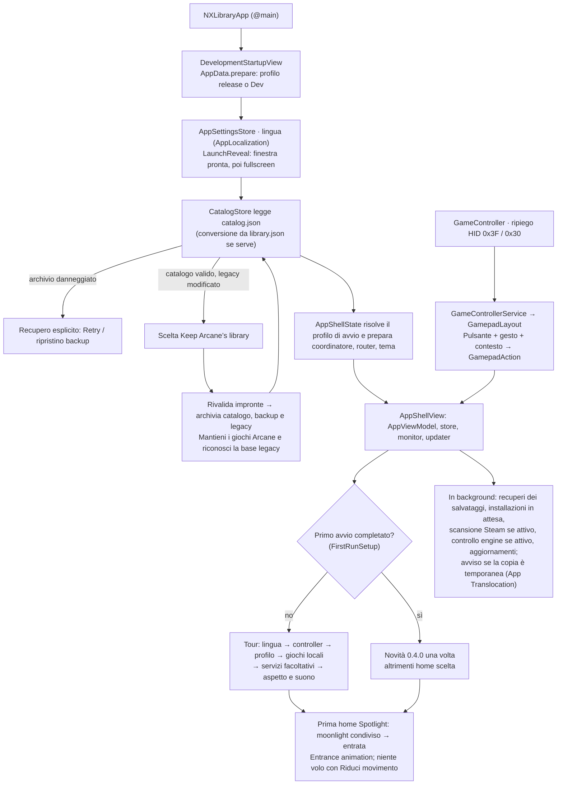
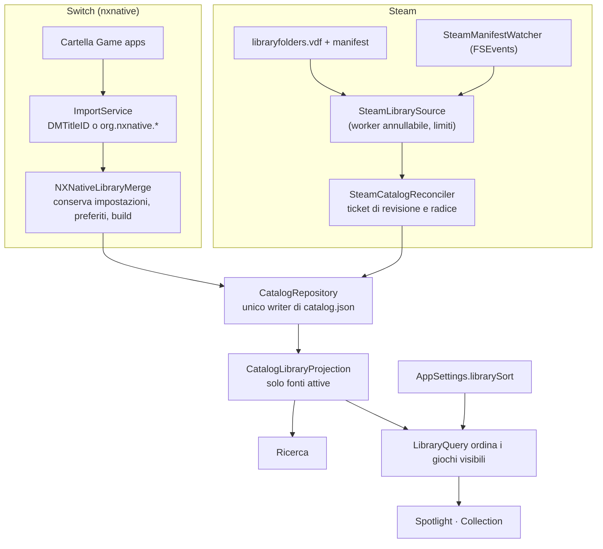
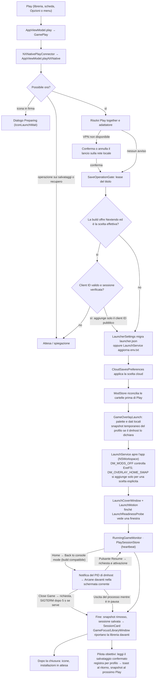
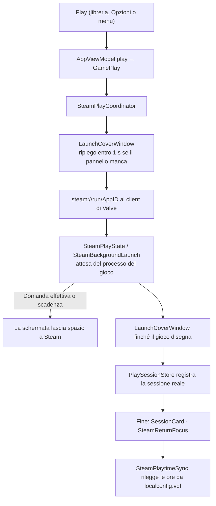
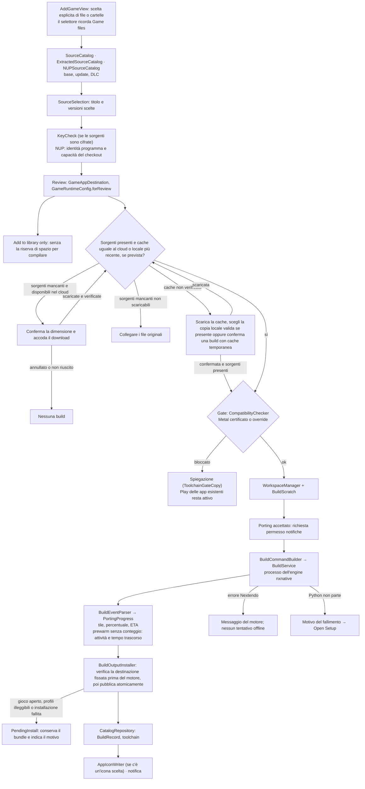
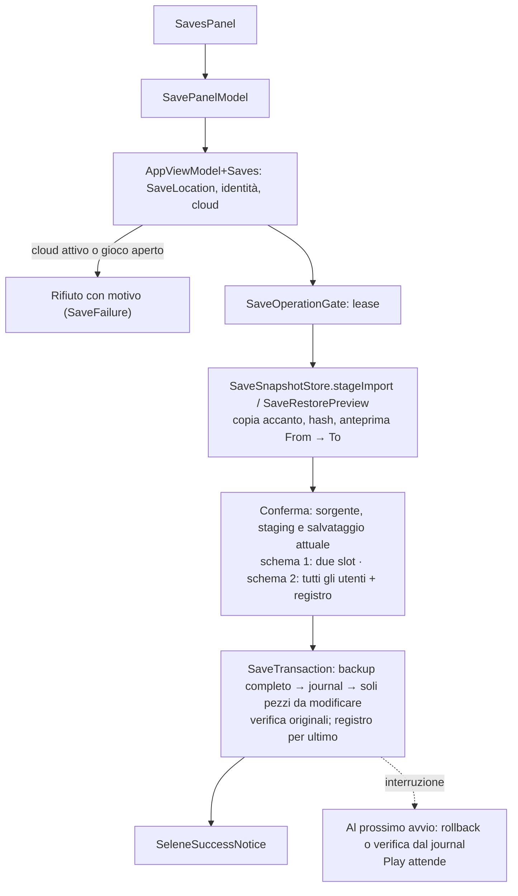
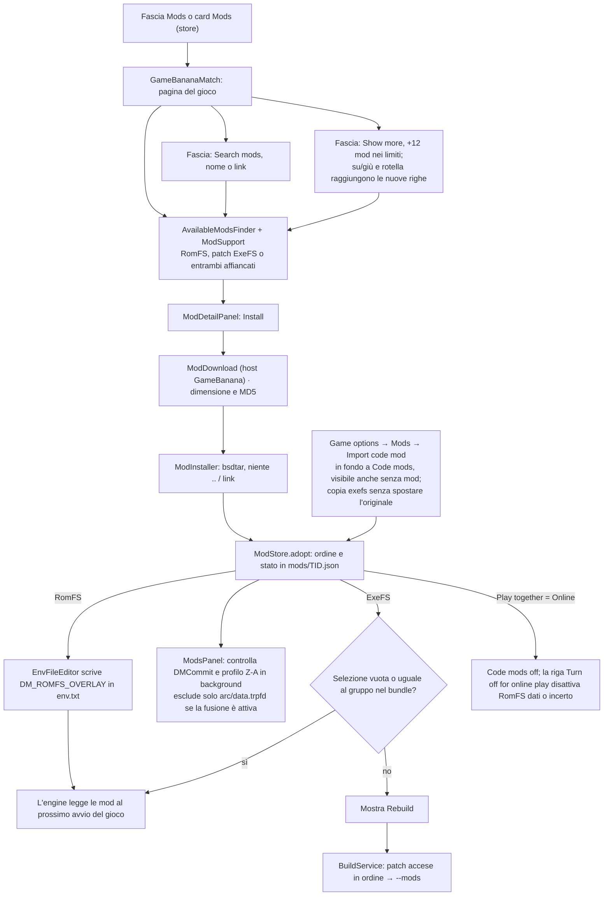
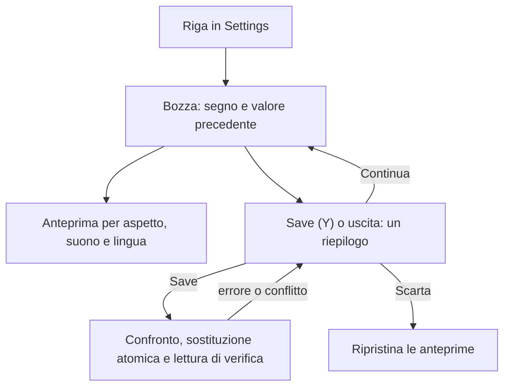
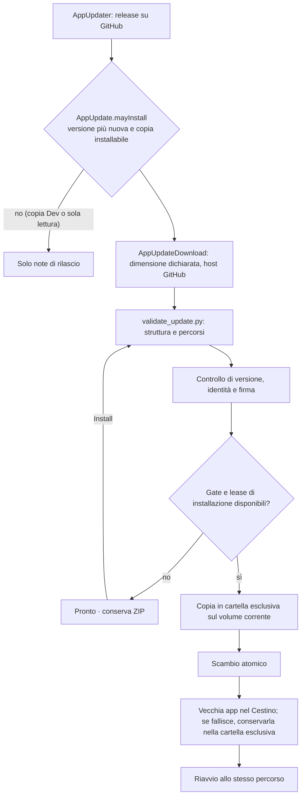

# Arcane — i flussi principali

Ogni flusso segue un'azione dall'input all'effetto, nominando i tipi che se ne occupano. I dettagli e le regole di ogni passo sono nella sezione dell'area in [architecture.md](architecture.md); come costruire un pezzo nuovo è in [conventions.md](../working-on-it/conventions.md). Se un flusso cambia, il suo schema si aggiorna nello stesso commit.

- [1. Avvio dell'app](#1-avvio-dellapp)
- [2. Dal disco alla libreria](#2-dal-disco-alla-libreria)
- [3. Play di un gioco Switch (nxnative)](#3-play-di-un-gioco-switch-nxnative)
- [4. Play di un gioco Steam](#4-play-di-un-gioco-steam)
- [5. Costruire un gioco Switch (Add Game)](#5-costruire-un-gioco-switch-add-game)
- [6. Importare o ripristinare un salvataggio](#6-importare-o-ripristinare-un-salvataggio)
- [7. Installare una mod](#7-installare-una-mod)
- [8. Cambiare un'impostazione](#8-cambiare-unimpostazione)
- [9. Aggiornare l'app](#9-aggiornare-lapp)
- [10. Preparare il DMG](#10-preparare-il-dmg)

## 1. Avvio dell'app

Punti fissi:
- Gli store si costruiscono una volta sola, prima della shell.
- Un archivio illeggibile non diventa mai una libreria vuota.
- La Dev scrive solo nel proprio profilo. Al primo avvio offre una copia selettiva della libreria stabile, senza intervenire sulla sorgente.
- Il tour riprende al passo salvato. L'elenco locale non installa nulla; i servizi si configurano separatamente. Gli strumenti Switch si preparano solo attraverso il controllo dei requisiti, ciascuno con una conferma.
- La scelta Steam del primo Setup resta salvata anche alla chiusura; lettura e attivazione usano la cartella scelta nella fonte. La scansione non sceglie Steam e Open library conserva la fonte in assenza di scelta. Una lettura incompleta offre Retry, senza dichiarare la libreria vuota.
- Riprendendo un Setup precedente, il vecchio Steam acceso non basta per attivare una fonte spenta: occorre sceglierlo sulla prima pagina o in Settings. Una fonte già attiva rimane visibile in assenza di una scelta contraria.
- Se il file delle chiavi viene rifiutato in Get ready, il motivo compare sulla scheda Chiavi, dalla quale si può riprovare senza chiudere un dialogo.
- La cartella Game files ricordata resta una preferenza del selettore: l'avvio non ne enumera i sorgenti.
- La shell riceve gli stessi comandi dal profilo esteso GameController o, in sua assenza, da un pad HID Nintendo. Un pad dichiarato compatibile da macOS attende fino a due secondi prima del ripiego a HID.
- Menu e dialoghi nativi hanno precedenza sul routing della shell: `nativeDialogOwnsInput` ferma i comandi del controller anche se un benvenuto, Setup o dialogo dell'app è già aperto sotto.
- Nelle conferme Selene, sinistra raggiunge l'azione principale, destra quella di annullamento. A attiva la scelta a fuoco e B annulla; l'aiuto della pagina coperta lascia il posto a quello del dialogo.

## 2. Dal disco alla libreria

Nella Collection vuota, Sinistra e Destra scelgono tra Add game e Import existing builds. A o Invio attiva la scelta; entrambi i pulsanti restano cliccabili.

Punti fissi:
- Una scansione aggiorna solo ciò che ha osservato; un'assenza non cancella nulla.
- Un risultato superato da un cambio di cartella o di fonte non si applica.

I titoli importati dal cloud compaiono in Spotlight e Collection. **Download** accoda il ripristino e lo spazio viene verificato durante il trasferimento. Il colore sale dal fondo della copertina con un'onda calma, anche se i byte arrivano a raffiche; il testo conserva la percentuale reale. Senza totale la copertina resta grigia. In pausa o senza nuovi dati il fronte termina la salita già acquisita e si calma. Quando il download è completo, sale fino in cima e la linea si dissolve; solo dopo il successo i punti formano brevemente il segno Oort. Con Riduci movimento il colore e il segno appaiono in dissolvenza senza spostarsi. Il pulsante tondo in Details apre il pannello Cloud library, da cui si può annullare o riprovare.

**Collegare un’app Mac.** In Settings → Integrations o nel menu macOS Game, **Add an app…** sceglie un `.app`; Spotlight e Collection accettano anche un `.app` trascinato se il catalogo lo convalida. Play consegna l’app verificata a macOS, senza tempo di gioco. Se il percorso non corrisponde più, **Locate the app…** ricollega l’app originale senza cambiare la tessera. **Tile options** cambia l’immagine di Oort o rimuove la tessera, senza toccare l’app.

## 3. Play di un gioco Switch (nxnative)

Play applica la scelta per gioco o il default globale. In Local usa l'adattatore VPN scelto o, se l'utente conferma l'avviso, la rete locale; il lancio non modifica le scelte salvate. I parametri espliciti di `env.txt` mantengono la precedenza.

Dopo lo scambio dell’app, la firma dell’icona o la conferma VPN, Play continua solo se il profilo iniziale è ancora attivo e sbloccato. Controlla l’installazione attuale e restituisce l’esito all’osservatore iniziale.
Se l’installazione cloud fallisce, viene annullata o torna in coda, Play è rifiutato senza aprire l’app precedente.

Per Switch e Steam, un errore di lettura dello storico o dei suoi totali non impedisce di giocare. Le sessioni nuove restano in memoria, senza sostituire i file su disco. Il salvataggio pubblica insieme le sessioni recenti e i totali archiviati; i vecchi file separati restano intatti.

Prima di aprire il bundle, Oort NX risolve lo schermo soltanto se il `dmhost` installato legge `DM_SCREEN`. Una scelta esplicita non collegata usa lo schermo della finestra di Oort NX. Se `env.txt` dichiara `DM_SCREEN`, il lanciatore non imposta la variabile. Il lancio unisce le scelte esplicite ai soli valori di ambiente autorizzati; il pannello dei salvataggi usa lo stesso filtro.

## 4. Play di un gioco Steam

Arcane legge le domande dal log di Steam. Durante `ShowInterstitials` l'attesa prosegue e il client può aprire le sue finestre dietro la schermata. Arcane non scrive mai i file di Steam e non apre l'app del gioco direttamente. Dettagli in [steam.md](steam.md).

Nella pagina Spotlight di un titolo Steam, Giù porta anche a **More like this** quando la fascia è presente. Invio, A o doppio clic selezionano la copertina sulla riga della libreria. Se il filtro la esclude, la libreria passa a **All games** come per Switch.

## 5. Costruire un gioco Switch (Add Game)

**Ordinare i file prima del porting.** Libreria → Sort incoming files (anche da Spotlight) mostra i file nella cartella Inbox configurata e quelli trascinati. Per non controllare la cartella né mostrare gli ingressi all'Inbox, disattivare Sort incoming files in Settings → Switch. Arcane legge i metadati senza estrarre il gioco e mostra il nuovo nome e il percorso per ogni file. Si conferma una riga o l'intero gruppo pronto, inclusi i duplicati indicati. Se **Game files** non è la radice attesa, il triage è in sola lettura finché non si conferma la correzione. Arcane copia in una cartella temporanea sul volume di destinazione, verifica dimensione e SHA-256, pubblica senza sostituire e usa il catalogo delle sorgenti per verificare il ritrovamento. Solo allora sposta l'originale nel Cestino; un file ambiguo, non verificato o collegato durante il triage rimane al suo posto. Questo passaggio non aggiunge un'app alla libreria e non avvia il porting.

**Rimuovere un gioco o le sue sorgenti.** Chiudi il gioco e non avviarlo da Finder durante la rimozione. Se più percorsi indicano lo stesso file, Oort NX rifiuta la richiesta senza scrivere l'intento. Altrimenti salva l'intento e pubblica il catalogo prima di spostare i file nel Cestino del volume. Un rifiuto o un riavvio prima della fine ripristina i file verificati e la scheda senza sostituire altri file. Se un volume manca o un percorso è occupato, conserva il registro indicato, ripristina i percorsi e scegli Retry. Non usare la 0.3.0 finché il registro è presente: quella versione non può riprenderlo.

Se mancano chiavi valide, la riga del pacchetto invita a importarle prima di poterlo identificare.

**Scegliere file o cartelle.** Il foglio di Oort mostra i luoghi a sinistra e il contenuto filtrato a destra. A apre una cartella o sceglie un file; con la selezione multipla, si conferma l'insieme dal pulsante in basso. B sale o chiude; Y cerca nella cartella. La stessa scelta serve al tour, a Game folders, Inbox, Cloud saves e Keys. Il foglio non apre i file. Se manca un permesso, indica l'impostazione macOS; il selettore nativo resta disponibile da Open in Finder.

**Add Game → Add ported app.** Scegli un bundle locale nel selettore oppure trascina un solo `.app` sulla schermata Add Game. Se la riga è disabilitata, il sottotitolo indica l'operazione in corso. Se il titolo esiste, Replace o Cancel decide se procedere. Una modifica al bundle da sostituire dopo l'anteprima richiede una nuova conferma. Arcane controlla lo spazio, ripara i metadati di trasferimento solo sulla copia e verifica identità e firma prima di pubblicarla in Game apps. La sorgente resta intatta e il titolo compare in libreria.

**Details → Options → Edit details → Attach sources.** Scegli i file originali o una cartella. La scansione usa le regole di Add Game e rifiuta le sorgenti che non producono un gioco compilabile con lo stesso title ID. Torna a Options → Rebuild: l'installazione riuscita sostituisce il bundle esistente, senza inviare nulla al cloud.

`BuildCommandBuilder` aggiunge `--nextendo` e l'ID pubblico all'ambiente solo se il checkout dichiara il flag e l'ID è configurato. La sessione serve al Play online, non al porting.

Durante un porting, B o Esc nasconde il pannello senza annullare il lavoro. Dopo il completamento o l'annullamento, B o Esc torna a Review se c'è una selezione nel wizard; da un Build o Rebuild aperto direttamente senza bozza, torna alla schermata di partenza.

Da Installazione il porting non è più annullabile, anche dal centro attività.
Per uno spostamento cloud l'annullamento resta disponibile fino alla fine della copia, non durante la chiusura.

Una notifica di compilazione riuscita seleziona subito il gioco in Spotlight. Se Aggiungi gioco o la console copre Spotlight, la selezione si applica al ritorno, anche se è in corso la compilazione di un altro gioco.

**Menu → Centro attività.** La campanella si apre con un clic o con la selezione del menu (Menu sul controller, ⌘K da tastiera). Mostra l'azione e l'oggetto di ogni compilazione, trasferimento o spostamento cloud. Su/Giù sposta il focus; A, Invio o un clic su una riga di compilazione apre Porting. X, Canc o il pulsante tondo ferma il lavoro selezionato o rimuove la singola richiesta in coda. Nei Risultati, Retry (A/Invio) riaccoda lo stesso lavoro; Clear (X/Canc) rimuove la riga; Clear all (A/Invio) rimuove gli esiti senza annullare i lavori. B o Esc torna alla campanella; un clic fuori chiude tutto il menu. Nessuno dei due ferma i lavori.

Con un porting in corso, Build o Rebuild per un altro gioco accoda la richiesta; ripetere il comando per lo stesso gioco non crea duplicati. In Spotlight e Details la pillola primaria mostra lo stato in coda e diventa Annulla al focus o al passaggio del puntatore; A, Invio o clic rimuove la richiesta senza avviarla. Dalla riga delle copertine in Spotlight, A avvia ancora l'app già installata o porta alle azioni del gioco se manca. Al successo, errore o annullamento del porting attivo parte il primo in attesa e la sua pillola diventa Porting. Un titolo occupato da un trasferimento o da un lease aspetta il rilascio. Dopo un cambio motore, anche se il clone fallisce, il porting in coda torna al controllo dell'ambiente. Al riavvio la compilazione interrotta torna in testa. Se il gioco, i file sorgente o l'app da ricompilare non ci sono più, resta un errore nei Risultati e il lavoro non parte da solo.

**Details o Spotlight → Cloud library.** In Details il primo passo indica Play, Download app, scaricare i file o Build, con luogo dei contenuti e stato della verifica. In coda, in verifica o in attesa la pillola Download diventa uno stato passivo; durante una copia con totale noto, riempimento e byte non si ripetono. In Spotlight la riga sotto i pulsanti indica disponibilità e aggiornamenti. Il pulsante tondo fra Options e Preferiti apre Cloud library; se disattivato, lo sostituisce il link in fondo quando attivo. Avanzate mostra cache, file del gioco, percorsi e aggiornamento dello stato. Al primo invio si scelgono app e cache di compilazione insieme se la cache esiste; altrimenti Send sulla riga dell'app pubblica l'app sola. Durante un invio completo la riga dell'app mostra «App pubblicata · invio della cache…» non appena l'app è disponibile per gli altri Mac.

**Details → Engine.** La data indica il motore con cui è stata compilata l'app installata. Se l'app è più vecchia, la riga dice se si può aggiornare o se prima servono i file del gioco. La copertina segnala solo un aggiornamento fattibile, con precedenza all'azione che serve per giocare. Play non cambia e non parte nessuna ricompilazione automatica.

Send copia file con rclone in una cartella di versione e riusa le copie già ricevute o identiche nella versione precedente. Pubblica un manifest in `<Titolo [ID]>/manifests/` per ogni parte nuova dopo verifica di dimensioni e MD5: prima l'app, poi la cache. Se il titolo cambia nome, Arcane riusa la cartella dallo stesso `[ID]`. Cancel conserva il manifest già pubblicato e i file ricevuti per Retry. Convert to the new format migra una copia `.aar` senza cambiare i file locali. Le versioni precedenti, compresi i `.aar`, non vengono spostate né cancellate.

Con solo una copia cloud dell'app, Download sostituisce il pulsante principale e usa lo stesso ripristino del pannello: riusa i file verificati, ripara l'app e verifica identità e firma prima di riattivare Play. Il download usa Game apps per un titolo importato e non richiede sorgenti, cache o una build. Dal browser si può scaricare `<Nome>.app`, estrarre lo ZIP e usare Add Game → Add ported app. Se la firma resta non valida dopo la riparazione, l'adozione ripiega su una firma ad hoc: se i manifest v2 del titolo esistono, ne richiede uno corrispondente; senza manifest v2 o connessione, l'esito mostra «Content not verified». La terza riga propone Send o Download per le sorgenti mancanti da un lato; con una divergenza non offre azioni.

Durante i trasferimenti dell'app, della cache e dei file del gioco, il colore risale nella copertina. Senza copertina c'è una barra sottile, o il riempimento di Download dove presente e con totale noto; il totale ignoto non produce una percentuale. Fase e byte compaiono in una sola riga. Cancel resta separato dalla misura; la coda e la verifica non sono una pausa. Reduce motion ferma le interpolazioni di avanzamento.

Per un aggiornamento dal riferimento, la riga Cloud mostra i byte da scaricare sul totale. Se un'app è già installata, Download mostra quale bundle Replace sostituisce e dà il focus ad Annulla. Il pannello mostra il percorso dell'app mantenuta e offre Reveal in Finder. Se il manifest di riferimento è irraggiungibile, una copia personale disponibile si scarica con le verifiche normali. Dopo il download di app o cache, se la copia personale è precedente, la riga lo indica e propone Send come azione manuale.

Durante una partita si può inviare la sola app, se le normali regole di invio singolo lo consentono, e scaricarla dalla libreria personale o dal riferimento. Download resta pieno con «Pronta» dopo la verifica e il pannello Cloud e il centro attività mostrano «Aggiornamento pronto · si applica quando chiudi il gioco». Arcane applica la copia alla chiusura del gioco, anche se aperto dal Finder. Play aspetta se lo scambio è già in corso. Cache, Rebuild e Free up space richiedono il gioco chiuso.

Durante la verifica, la riga Rebuild mostra una barra Selene; un clic, A o Invio sulla riga oppure B/Esc con la riga selezionata annulla la verifica. Se l'inventario dei metadati conferma che l'ultima compilazione riuscita ha scritto la cache locale dopo il manifest, Rebuild la riusa senza calcolarne l'hash. Se un download lascia una cache parziale verificata, si può riprendere Download o lasciare che la build rigeneri il resto.

Se le copie differiscono e la data non dimostra che quella locale è più recente, il dialogo mette Download cache and rebuild in testa e gli dà il focus, poi propone la cache di questo Mac, se valida, e Rebuild senza cache. Annulla è in fondo. Come per i file del gioco, il download richiesto da Rebuild apre Cloud library e solo il successo nella stessa richiesta riprende la compilazione. Se l'esito cloud richiede un Rebuild completo, Arcane riusa la cache locale verificata con la stessa catena shader dell'app installata; se nessuna cache locale è compatibile, usa i file originali e una cache temporanea. La scelta esplicita senza cache usa sempre una cache temporanea. Dopo l'installazione, un'app diversa dal manifest risulta «Newer on this Mac» e resta da inviare manualmente.

Free up space apre una conferma con le dimensioni e una selezione per app, cache e file del gioco. Il riepilogo indica la dimensione totale da spostare nel Cestino su questo Mac, se nota; i salvataggi restano intatti e la copia verificata resta sul cloud personale. Solo le copie sincronizzate sono selezionabili; app e cache partono selezionate quando disponibili, i file del gioco no. La conferma precede una nuova verifica prima del Cestino. Send, Download e Free rifiutano app e cache sovrapposte ai percorsi di salvataggio effettivi, anche senza slot già creati. La voce di libreria resta e lo spazio ritorna quando si svuota il Cestino. Invio, download e liberazione passano per la stessa coda. Cancel rimuove la richiesta in coda o annulla quella attiva; B chiude solo il pannello.

**Uscire durante un trasferimento.** Cmd+Q, Quit nella barra menu, Power → Quit e la chiusura della finestra principale aprono la stessa conferma nella finestra. Resta ha il focus iniziale: chiude la conferma e lascia proseguire il lavoro. Quit ferma il trasferimento, attende la scrittura della coda e poi chiude l'app. Se un'app è pronta ma non ancora installata, Arcane pulisce il bundle temporaneo senza toccare quello installato. Al prossimo avvio gli invii partiti o in coda vanno confermati di nuovo dalle schede dei giochi; gli altri lavori idonei ripartono in ordine, riusando i file v2 verificabili. Per la liberazione parziale Arcane verifica di nuovo solo ciò che può ancora andare nel Cestino. L'aggiornamento resta bloccato mentre ci sono trasferimenti.

Se al Build o Rebuild mancano file locali ma il cloud li ha, Arcane mostra la dimensione da scaricare. Download accoda il ripristino per lo stesso fornitore, cartella e selezione; se la nuova verifica non corrisponde, non scarica da un’altra fonte. Solo il ripristino riuscito nella stessa sessione riprende il percorso di build, con i normali controlli per cache e toolchain.

L'apertura del pannello Cloud legge le revisioni e confronta i contenuti locali; riusa le impronte di app e cache anche dopo un riavvio, se sono ancora valide. Come Resume, l'importazione, Free up space, Download e la migrazione `.aar`, il pannello usa la revisione più recente di ciascuna parte tra la cartella nominata e quella del solo ID. Un percorso ambiguo resta non verificato, non assente. Se il demone rclone è indisponibile, i comandi singoli mantengono la stessa distinzione.

**Errori cloud.** In Cloud library e nel centro attività Retry rimette in coda la stessa operazione con nuove verifiche, tranne gli invii e le richieste senza destinazione salvata o con un eseguibile non più verificabile, da confermare di nuovo nel pannello Cloud library. Se la destinazione di un invio è cambiata, l'avviso mostra quella precedente senza avviare un nuovo invio. Refresh rilegge lo stato. Credenziali scadute o revocate riaprono il passo Account; cartella mancante riapre direttamente il passo Folder, sul percorso della libreria o dei file del gioco. Quota Drive esaurita apre la gestione dello spazio Google. Il Mac senza spazio offre Storage senza avviare il download. Se la coda non si salva, un avviso una tantum spiega che il lavoro continua ma potrebbe non riprendere dopo l'uscita.

Se la connessione cade durante un trasferimento, il lavoro resta in testa. Anche dopo aver chiuso l'avviso, sia il pannello del gioco sia il centro attività mostrano il motivo e Resume per la stessa richiesta. Se era un invio, Resume chiede una nuova conferma invece di trasmettere i file correnti. Un trasferimento in attesa di un gioco aperto riparte quando il gioco si chiude.

Pause ferma un download idoneo di app o file di gioco dal pannello Cloud o da Attività. La testa resta ferma anche dopo un riavvio. Resume ricontrolla la stessa richiesta prima di avviarla; Cancel resta distinto da Pause.

Prima di togliere dalla coda un invio da riconfermare, Arcane salva il risultato con lo stesso identificatore e sincronizza file e directory. Se non ci riesce, la richiesta resta nella coda su disco. Un arresto tra le due scritture non duplica il risultato al riavvio.

**File del gioco (Porting).** Data la selezione del gioco, `CloudGameSources` riusa i file remoti con MD5 uguale e invia solo gli assenti; una divergenza blocca un nuovo invio. Il download conta i file mancanti con copia remota verificabile e controlla lo spazio totale prima del primo file. Per le sorgenti importate crea una cartella dedicata nel profilo, solo su richiesta di ripristino. Il ripristino pubblica ogni file verificato nella sua cartella; la liberazione sposta nel Cestino solo i file locali appena verificati. Un annullamento non annulla i file già pubblicati o spostati nel Cestino.

**Annullare.** Togliere dai preferiti, nascondere, togliere una tessera Mac, rimettere i valori predefiniti di un gioco, copiarne le impostazioni e cancellare le ricerche agiscono subito: `UndoOffers` mostra un avviso con Undo, ⌘Z fa lo stesso fuori da un campo di testo e il centro attività conserva l’ultimo gesto. Rimuovere un gioco, una mod o dei trucchi chiede ancora conferma perché sposta file nel Cestino.

**Copiare le impostazioni di un gioco.** Options → All settings → General → Copy settings to another game: scelta del gioco, anteprima riga per riga, Copy, poi Undo. `GameSettingsCopy` ricalcola al momento della scrittura e lascia env.txt, la rete e ciò che l’altra build non offre.

**Settings → Cloud library.** Dal pannello Cloud library, Open settings apre la sezione se la libreria è spenta o non configurata. Stato mostra l'ultimo controllo reale, data e azione in caso di errore; Configure cloud library apre l'assistente. L'interruttore entra nella bozza e si applica, dopo Save, solo alla connessione di partenza. Unfollow chiede conferma prima di togliere le schede presenti solo nel riferimento. Seguire un riferimento, cambiare cartella o scegliere un altro eseguibile conserva il proprio percorso, per non separare la verifica dall'autorizzazione. Reset group ripristina solo pulsante Cloud, link e badge. Test connection verifica gli ID approvati e l'accesso, senza importare; Retry ripete il controllo anche se manca ancora l'archivio. Disconnect dice cosa cancella: **Disconnect and keep the ID and secret** (focus iniziale) svuota solo il token (`rclone config update … token=`) e verifica il risultato con `rclone config redacted`, quindi l'ID e il segreto Google restano nel file cifrato di rclone senza passare da Oort NX; **Erase everything** elimina il remote. Ricollegarsi usa l'ID e il segreto conservati; **Google ID and secret** in Advanced li cancella dopo conferma.

Se manca rclone, Configure o Turn on presenta origine, dimensione, licenza e scopo, con il focus su Cancel. rclone legge e scrive nel Drive del giocatore, senza inviare nulla a Oort NX. Dopo Download, Stato mostra un solo avanzamento, Cancel e, in caso di errore, Retry. Una libreria che usava la copia integrata mostra una sola proposta all'avvio, poi Continue in Stato; la stessa conferma mostra l'eventuale percorso esplicito dei file del gioco salvato in 0.3.0 e lo lega a un ID solo dopo verifica. Prima del consenso, Arcane non riprende i trasferimenti e rifiuta una copia alternativa che usa una configurazione separata. Turn off conserva configurazione e file e offre il Cestino per la sola copia gestita non scelta separatamente. Disconnect offre lo stesso ritiro dopo aver rimosso il remote locale. Advanced lo rende disponibile a libreria spenta.

**Settings → Switch → Engine e Settings → Multiplayer.** Newest engine, Update e Back to tested chiedono conferma prima di modificare il checkout; il pin del bundle è di sola lettura. L'override manuale della toolchain, il VPN, il default multigiocatore, la modalità locale, l'adattatore e l'ID client pubblico entrano nella bozza comune. Cambiare VPN imposta l'adattatore su Automatic nella bozza. L'editor dell’ID restituisce il valore a Settings senza usarlo per l'accesso prima del salvataggio.

**Game Options → All settings.** La pagina completa resta separata dalle azioni rapide. I controlli disponibili sono raggruppati per argomento; le chiavi sconosciute e le righe non modificabili di `env.txt` sono in Other. Mods, Cheats e Saves si aprono nel dettaglio, con le stesse conferme. B/Esc torna alla barra, poi al pannello rapido sulla riga All settings. Le modifiche per il gioco si applicano come prima, senza toccare la bozza di Settings.

**Settings → Controllers o Game Options → Players.** Gli otto posti e le tre modalità restano visibili. Una pressione su una manetta libera occupa il primo posto senza controller, senza azionare il comando a fuoco. Sul posto, scegliere un profilo o un ospite nella fascia sotto la griglia; Move sceglie la destinazione nella stessa griglia e scambia i due posti se occupati. Remove libera il posto senza cancellare il profilo né scollegare il controller. Per confermare manualmente una manetta simile, il comando di assegnazione aspetta al massimo 12 secondi; B sul controller che naviga, Esc o Annulla chiudono l'attesa. In fusione il destinatario riceve tutti i controller; il gioco propone altri numeri solo con un host compatibile. I nomi valgono per Offline e Local, non sostituiscono il nome Nextendo. Le modifiche sono salvate subito. Indietro ritorna alle impostazioni o alle opzioni senza avviare il gioco.
**Settings → Controllers o Game Options → Players.** La lista mostra i posti preparati, fino a otto. Aprire un posto per scegliere un profilo o un ospite, assegnare una manetta con un tasto, scambiarlo con un altro o rimuoverlo. Durante l'assegnazione B sul controller che naviga, Esc o Annulla tornano alla lista; l'attesa finisce dopo 12 secondi e non attiva il menu dietro. Per la fusione il profilo del posto destinatario riceve tutti i controller; il gioco propone altri destinatari solo con un host compatibile. I nomi dei profili valgono per Offline e Local, non sostituiscono il nome Nextendo. Da Settings il piano resta nella bozza comune e i PIN autorizzano solo il piano confermato. Indietro torna a Settings senza scrivere; Game Options conserva il salvataggio immediato.

**Prima connessione.** Sign in apre Google nel browser. Con il client incorporato non si compila il modulo; Advanced → Use another Google client lo riapre. Folder propone la prima libreria con manifest verificati in `Games` o in un suo figlio diretto, poi il percorso dei file del gioco se riconoscibile. Resume apre la cartella dei file proposta nel selettore Drive; Choose another folder riparte da My Drive. Se non trova una proposta, il selettore si apre su `<libreria>/GameFiles`, utilizzabile anche se non ancora creato. Continue ha il focus iniziale quando abilitato. Verify controlla la libreria e il percorso file esplicito. Solo Activate applica le preferenze e avvia l'importazione, senza spostare file.

L’écran Compte distingue le droit Google complet des dossiers utilisés dans l’app. Après le choix de la bibliothèque, la suggestion de sources reste sous cette racine : `GameFiles`, `Switch/Jeux`, puis `Switch/Games`. Pour utiliser un dossier ailleurs, le sélectionner ou saisir son chemin. Si le compte ou la bibliothèque change, confirmer ce dossier ou choisir le dossier par défaut avant toute lecture ou écriture des sources. Déplacer les archives laisse les sources en place. Une référence vide ou un contrôle incomplet ne devient pas un nouvel état vérifié.

**Cambiare cartella cloud.** Senza spostamento, Activate cambia solo la preferenza; con lo spostamento, la conferma nomina gli archivi, la destinazione e la dimensione e precisa che i file di gioco restano al loro posto. Prima di confermare, sospendi gli invii dagli altri Mac: Drive non offre un blocco tra le due cartelle. Se l'anteprima o Retry segnala un archivio fuori piano, sposta il file indicato fuori dalla vecchia cartella senza eliminarlo. Cancel ferma il comando attivo, anche durante la verifica finale, senza cancellare il registro. Close chiude l’assistente senza abbandonare il piano. Al prossimo avvio lo stesso eseguibile verifica le due cartelle senza spostare altri file. Se il piano non è interamente completato, i trasferimenti restano in pausa e Retry riprende lo stesso piano in Attività. Se gli ID non coincidono, ripristina account e cartelle originali. Se restano copie o nuovi archivi, conserva entrambe le copie e confrontale prima di riprovare. Non usare la 0.3.0 con un registro pendente: non può riprenderlo.

Lo spostamento riguarda solo i manifest e le copie di app e cache, non le sorgenti. Cartelle mostra entrambi i percorsi `remote:percorso` affiancati; entrambe le righe aprono direttamente Folder. Game files folder usa lo stesso selettore Drive della libreria e propone di riprendere i file riconosciuti. Si può anche scegliere Enter a path e salvare un percorso valido non ancora esistente, senza crearlo. Save cambia solo il percorso sullo stesso remote. La riga compare in Search e, quando il percorso è esplicito, in Changed. Il percorso esplicito resta invariato. Se un `GameFiles` implicito esiste all'origine, lo spostamento conserva quel percorso; altrimenti il default rimane implicito e segue la libreria. Details → Cloud mostra il percorso di ogni cartella determinabile. I giochi con i file locali nella stessa cartella usano sottocartelle distinte sul remote, identificate dal title ID base.

**Importazione dalla libreria cloud.** All'avvio, all'attivazione o con Import games from the cloud, Arcane cerca manifest validi e file riconducibili a un title ID nel nome della cartella o del file, senza scaricare app, cache o sorgenti. La selezione in un manifest può indicare un programma NUP preciso; senza manifest non si indovina il contenuto di un NUP né l'identità di un file dal solo nome del gioco. I risultati segnalano le voci ambigue e illeggibili senza importarle. Un gioco rimosso esplicitamente resta escluso senza modificare Drive. Nelle viste della libreria e in Details, Download ripristina un'app; per le sole sorgenti la tile è attenuata e Download game files diventa Build, poi Play. Il filtro Cloud di Spotlight e Collection mostra solo le voci senza app o sorgenti complete qui.

**Libreria di riferimento.** Condividi manualmente una cartella dedicata, senza chiavi o salvataggi, in Google Drive come Lettore. I lettori possono scaricare ciò che Drive rende visibile. Su quel Mac, in Cloud library → Reference library, incolla il link o l'ID: seguire una cartella non condivide la propria. Lo stato mostra cartella, conteggio e sola lettura, oppure No access e come recuperare l'accesso. Le cartelle personali e il riferimento non possono essere uguali né contenersi: il controllo si ripete quando Arcane scrive, crea o sposta. I nuovi titoli usano le stesse tessere; i record illeggibili sono segnalati e non importati. In Details → Cloud, la riga di aggiornamento indica i byte da scaricare sul totale. Unfollow dimentica il riferimento e toglie solo le voci del catalogo senza copia locale; non elimina file.

**Collection → Cloud.** L’avviso di attivazione indica come raggiungere il filtro. Se non ci sono tessere, la vista indica se connettere Drive, attendere la ricerca o verificare la connessione. Mostra «nessun gioco da scaricare» solo dopo le verifiche richieste.

**Details → Cloud → Update from my cloud.** Se l’app installata corrisponde alla ricevuta del trasferimento e il cloud personale offre una copia successiva verificabile, la riga mostra la dimensione. La conferma indica quale app sarà sostituita; Arcane ricontrolla entrambe le copie, aspetta la chiusura del gioco e conserva l’app precedente. Una divergenza senza prova non propone lo scambio.

Conclusa l'importazione automatica e ripristinata la coda, Arcane verifica la presenza remota per ogni titolo valido del catalogo in sequenza; il badge solo cloud non richiede di aprire Details. Un errore interrompe il controllo e mostra l'azione di recupero. Le tessere mantengono l'ultima presenza nota anche dopo il riavvio, non uno stato di sincronizzazione. Se arriva un trasferimento, gli lascia la precedenza; spegnere la libreria ferma il controllo.

## 6. Importare o ripristinare un salvataggio

Il primo profilo mantiene i file originali. Gli altri hanno salvataggi e backup distinti; nel
pannello Saves, **Copy saves from another profile** copia il gioco corrente solo in uno spazio vuoto.
**Back up now** usa il salvataggio e la cartella di backup del profilo attivo al momento del comando, anche se il profilo cambia mentre il lavoro attende in coda.
Un recupero fallito blocca soltanto il percorso del profilo interessato; un'operazione ancora attiva resta esclusiva per l'intero gioco.
Un errore di lettura dei profili rifiuta la gestione dei salvataggi e il recupero automatico invece di scegliere il profilo originale.
Un rollback ripete una copia parziale a partire dal backup verificato prima di riabilitare Play.

## 7. Installare una mod

## 8. Cambiare un'impostazione

**Settings → Sound.** Il giocatore sceglie il pacchetto e l’evento da ascoltare. Import sound pack legge una cartella o un archivio `.oortsound` e mostra nome, autore, licenza, versione ed eventi. Solo Import conferma la copia, senza attivarla. Remove sposta nel Cestino solo la copia importata; se era attiva, torna Selene. Un pacchetto selezionato illeggibile ripiega su Selene e la sezione spiega il motivo. Reset group mantiene le copie e seleziona Selene.

In Spotlight e Collection, la barra Integrations apre il riepilogo. Con tastiera o controller, Su raggiunge il ritratto se presente e Sinistra raggiunge la barra; senza ritratto basta Su. Giù torna ai giochi. Su/Giù nella pagina sceglie una riga tra Giochi e Servizi; Apri presenta la scheda dei dati. Dalla scheda, Apri raggiunge le impostazioni esistenti senza premere il controllo. Indietro ripristina scheda, riga e barra in successione, senza cambiare il gioco selezionato.
La destinazione Switch mostra lo stato già noto. Re-check controlla la compatibilità senza importare chiavi; l'import resta nelle impostazioni delle chiavi e nel Setup.
La destinazione Nextendo mostra lo stato noto senza contattare il servizio. Check status e Sign in sono azioni separate; l'accesso normale dalle impostazioni mantiene il controllo automatico.
Aprire Drive da Integrations non ripropone un recupero pendente e non esegue rclone; aprire Folders and connection tools avvia l'ispezione locale.
In Spotlight, la rotella toglie il focus dalla barra quando porta il focus nella pagina del gioco. X, Y e i salti della riga non passano ai giochi mentre la barra è ancora a fuoco.

La prima tessera di Spotlight filtra per piattaforma senza cambiare schermata. A, Invio o un clic aprono; Su/Giù o le frecce sulla tessera scorrono fra Tutti e le piattaforme presenti. Le copertine seguono dopo una breve pausa, con il filtro e l'ordinamento già scelti. A/B, Invio/Esc o un clic sulla tessera chiudono e lasciano il fuoco sulla tessera. L'apertura di un risultato di ricerca fuori piattaforma mostra tutti i giochi senza cambiare la preferenza del profilo.

Cambiare sezione non chiude la bozza; Back dalla barra, Menu e Quit la chiudono solo dopo una scelta se è cambiata. Il controller può scorrere il riepilogo. Il reset delle preferenze in `AppSettings` entra nella bozza. In Porting → Game folders, il reset del gruppo non cambia le cartelle. Il pulsante Reset nella riga Game apps ripristina solo quella cartella.

Nel menu rapido, Theme apre prima i colori con anteprima viva; A applica la palette e passa alla selezione dello sfondo. Oort (`oort`) è il default senza preferenza; Arcane (`selene`) conserva il blu classico; le alternative Arcane Crystal e Arcane Flow salvano `arcane-crystal` e `arcane-flow` nello stesso `colorThemeID`. La shell conserva un backdrop persistente; le pagine ne dichiarano stile, pausa e Mods con `SeleneBackdropRequest`, mantenendo artwork e maschere locali. La shell passa la palette completa in `SeleneBackdropStyle`: cambia il valore dell’ambiente e aggiorna sfondo e maschere anche senza spostare la selezione. La superficie usa lo stesso renderer, con orologio e regole di pausa condivisi. Le particelle sono sempre morbide, senza una scelta aggiuntiva. La scelta dello sfondo mantiene il dialogo di destinazione esistente.

Settings → General → At startup passa da «Chi gioca?» a «Ultimo profilo» e poi ai nomi dei singoli profili. Il vecchio interruttore acceso equivale a «Chi gioca?», spento a «Ultimo profilo». Un profilo fisso rimosso riporta a «Chi gioca?». Un profilo bloccato apre il selettore con il suo ritratto a fuoco, anziché entrare automaticamente. Nel selettore `+` aggiunge, Y apre Identity per il profilo attivo fuori dall’avvio e X apre una conferma con Keep a fuoco, quando l’azione è disponibile. Il selettore di avvio non è annullabile.

La procedura guidata crea un profilo e lo salva dopo nome, avatar, tema e sfondo. B torna al passo precedente; al primo passo esce, come la croce da qualsiasi passo, con conferma solo se la bozza è cambiata. L’anteprima non cambia l’aspetto già salvato. Una nuova immagine di sfondo si copia alla conferma. Identity modifica il profilo attivo: il nome apre solo la tastiera Selene, non i quattro passi.

La rimozione non è disponibile per il profilo originale: conserva l'accesso a preferiti e attività storici.

Il carosello degli avatar usa artwork già nella cache, con ritaglio sul volto rilevato o al centro, e simboli neutri del sistema. L’ultima tessera apre la scelta di una foto, con assi e zoom per inquadrarla; B o Esc annulla. Per le GIF si conservano i fotogrammi e i tempi; con Riduci movimento si vede solo il primo.

Home con la disposizione Arcane, Cambia profilo e un clic su Profili nella barra Spotlight aprono il selettore. La carta Attività di Spotlight, il ritratto a destra e Profilo → Il mio profilo aprono la pagina profilo anche senza conto. I pulsanti Modifica, Nextendo e Verrou aprono le rispettive sezioni Identity, Nextendo e Security di Settings; Menu premuto apre Profile page, per attivare e riordinare le sette schede. B torna al profilo. Le anteprime dei giochi aprono i dettagli; «Vedi tutto» apre Collection nell'ordine proprio della scheda o il dettaglio Amici o Obiettivi, senza toccare le preferenze globali. Il vecchio pannello non è più separato: codice e Nextendo sono in Settings. Un profilo bloccato chiede il PIN o Touch ID, se disponibile; Touch ID riconosce l’utente macOS, non distingue i profili Arcane. Senza codice né Touch ID si può scegliere un altro profilo; non c’è un ripristino dal servizio online.

Il tastierino condiviso accetta croce, stick, frecce, cifre e clic. A/Invio preme il tasto in focus; ⌫ o X cancella l'ultima cifra; B/Esc annulla. ✓, Menu/+ o ⌘Invio confermano dopo quattro cifre. In Settings → Account si può impostare, cambiare o rimuovere il codice: per cambiarlo si inserisce il codice attuale, poi il nuovo due volte. Fino al salvataggio il codice precedente resta valido. Per rimuoverlo si usa il PIN attuale o Touch ID.

Sulla carta Attività, X o un clic sul suggerimento mostra o nasconde «Compilati di recente», e la scelta resta al riavvio. Y apre ancora il menu della carta. Il centro attività per trasferimenti e compilazioni resta distinto.

Passare a un altro profilo con un gioco aperto chiede conferma. Arcane chiude i giochi Switch e aspetta che finiscano; i giochi Steam si chiudono manualmente. L’ospite gioca a Switch offline senza conto né cloud dei salvataggi. Entrare e uscire richiede conferma; i dati salvati rimangono separati sul Mac, senza ripresa dal selettore per il prossimo ospite. I giochi Steam non partono come ospite perché Arcane non può separarne le partite.

Se l’ospite chiede di chiudere l’app, la conferma dell’ospite precede la chiusura delle code e l’eventuale conferma cloud. Annullare lascia l’app operativa.

Quando cambia il profilo, le notifiche di fine sessione e degli obiettivi del profilo precedente non restano visibili né in attesa.

La migrazione salva i file precedenti una sola volta in `profiles-migration-backup`, senza credenziali. Per ripristinarli, con Arcane chiuso, conservare prima una copia dei dati attuali; poi rimettere i file del backup e spostare fuori dalla cartella attiva `profiles.json` e `profiles-active` se non erano presenti nel backup. La copia attuale conserva le sessioni successive alla migrazione.

La barra laterale mostra le rubriche di `SettingsCategory`. A o clic su un argomento aprono la pagina nella stessa colonna; B/Esc risalgono all’argomento, alla barra e poi all’uscita. All e Changed filtrano la ricerca in alto; aprire un risultato mira alla riga, tornare ripristina il risultato e la ricerca. Il salvataggio non dipende dalla pagina aperta.

In Settings → Account → Nextendo, la scheda legge il conto all'apertura, al completamento di Sign in e con Check status, senza polling. Mostra un dettaglio sotto l'errore e apre il conto sul sito quando manca il collegamento Discord o la conferma dell'e-mail. In Amici si può mandare una richiesta con un codice o da Giocatori recenti, accettare o rifiutare una richiesta ricevuta e rimuovere un amico dopo conferma. Le richieste inviate restano in attesa e non hanno azioni. Il risultato compare nel pannello e una scrittura confermata ricarica le liste; se la rilettura fallisce o l'esito è incerto, Check status rilegge senza reinviare. Il codice personale si può copiare e il profilo si può ancora aprire nel browser. Le letture in corso si annullano quando si lascia la pagina; una rotazione già avviata termina per conservare il token condiviso.

Sign in apre il browser predefinito e la riga offre Cancel finché attende la callback loopback. Una callback valida porta allo scambio PKCE e allo store condiviso del motore; Sign out rimuove solo il token locale. Nelle Opzioni, Play ha il focus iniziale; Play together viene subito dopo, per le build che dichiarano le modalità di rete.

La shell controlla la presenza del token del profilo attivo all’apertura, al cambio di profilo e ogni 180 s: solo con un token legge i contatori pubblici. Per l’ospite non avvia la lettura.

Nel profilo, Mostrati online pubblica la presenza senza titolo; Mostra il gioco in corso è un consenso separato, efficace al prossimo lancio e solo se la presenza è attiva. Un rifiuto del servizio mostra una nota discreta senza cambiare lo stato dell’account. La pagina profilo controlla il conto all’apertura; il pannello di gestione aperto aggiorna le liste ogni 60 s. Aggiorna anticipa la lettura e la riga mostra il tempo dall’ultimo aggiornamento riuscito. Gli amici in gioco mostrano il titolo quando disponibile.

Play together mostra lo stato della VPN scelta e offre Scarica o Apri. Advanced raccoglie la scelta LAN o comunicazione locale e l'adattatore manuale. Reset group torna a Nessuna VPN, Offline e impostazioni avanzate automatiche.

In System → About, il riepilogo collega Arcane 0.2.1 di Bium23 al progetto originale; il pulsante sotto apre la pagina Buy Me a Coffee di Bium23. Entrambi funzionano con clic, Invio o conferma del controller.

Tornando alla home, le viste delle tessere ricreate leggono subito le immagini decodificate in `TileArtMemo`; i task caricano quelle mancanti e rivalidano i file Steam. La cover della card Mods resta nel `ModStoreHost` posseduto dalla shell ed è rivalidata in background rispetto agli abbinamenti correnti.

La scheda Switch usa la fonte Nintendo Store originale di Arcane quando si seleziona o apre un gioco. Nintendo Europe aggiunge i campi mancanti e il link locale dal prodotto trovato per ID; Nlib e Wikipedia possono completare il testo nella lingua dell'app. Le modifiche da Change metadata restano locali e prevalgono. In Settings → Storage, svuotare la cache dei metadati scarta anche i risultati di precaricamento già letti ma non ancora mostrati. Una nuova apertura può caricare dati aggiornati.

## 9. Aggiornare l'app

Alla chiusura successiva, una copia release che si chiama ancora `NX Library.app` diventa `Oort NX.app` se la destinazione è libera; una copia `Arcane.app` resta al suo percorso (`AppBundleRename`, chiamato da `AppDelegate.applicationWillTerminate`). Non succede se un riavvio è in programma, perché l'aiuto che riapre l'app usa il percorso attuale.

Dopo il riavvio, Setup confronta l'engine locale con il pin della nuova app. Se la release specifica un repository, Clone, Update e Switch usano quello. Install all può clonare in una cartella mancante, ma per cambiare un checkout esistente bisogna scegliere la sua scheda e confermare il percorso e la versione. Un checkout modificato resta intatto. I giochi già compilati non vengono ricompilati dalla procedura.

## 10. Preparare il DMG

`release.sh` passa il bundle firmato a `build_dmg.sh`, che copia `Oort NX.app` senza risorse Finder e aggiunge il collegamento ad Applicazioni. Senza il ripiego esplicito `--plain-dmg`, aggiunge il layout, lo sfondo e l'icona al volume, non all'app. Crea il DMG UDZO, lo monta senza Finder in sola lettura, verifica firma e contenuto e lo smonta. Solo dopo questi controlli `release.sh` conserva il file come `NXLibrary-<version>.dmg`. Lo ZIP usato dall'updater è indipendente da questo layout.
